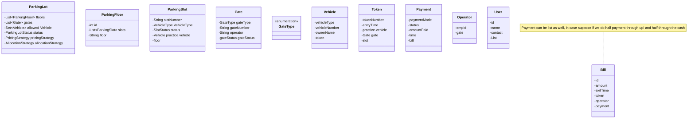

Parking Lot
Parking Floor
Parking Slots
Vehicle
Vehicle type
Admin
Slot Assignment Strategy
Pricing Strategy
Token
Bill
User
Payment Mode

Entity :
Parking Lot
Parking Floor
Parking Slot
Vehicle

# Class Diagram
