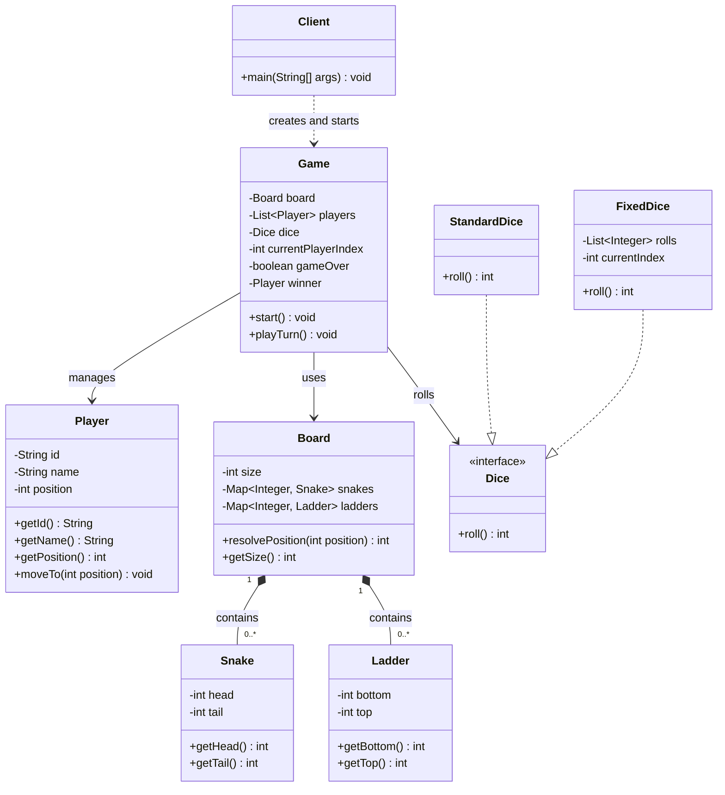

# Snake and Ladder: Low-Level Design

## Part 3 · UML Class Diagram and Board Implementation

*From a planned design to working `Snake`, `Ladder`, and `Board` classes in Java.*

---

## Contents

1. [Project Overview](#1-project-overview)
2. [Requirements Recap](#2-requirements-recap)
3. [Part 1: UML Class Diagram](#3-part-1-uml-class-diagram)
4. [Understanding Class Relationships](#4-understanding-class-relationships)
5. [Understanding Each Class](#5-understanding-each-class)
6. [Part 2: Board Design](#6-part-2-board-design)
7. [Designing the Snake Class](#7-designing-the-snake-class)
8. [Designing the Ladder Class](#8-designing-the-ladder-class)
9. [Designing the Board Class](#9-designing-the-board-class)
10. [Board Configuration and Validation](#10-board-configuration-and-validation)
11. [Resolving a Player's Landing Position](#11-resolving-a-players-landing-position)
12. [Demonstrating the Board](#12-demonstrating-the-board)
13. [Time and Space Complexity](#13-time-and-space-complexity)
14. [Important Design Decisions](#14-important-design-decisions)
15. [Acceptance Checklist](#15-acceptance-checklist)
16. [What Comes Next](#16-what-comes-next)

---

## 1. Project Overview

Snake and Ladder is a turn-based board game. Players move across numbered positions by rolling a die, and the goal is to
reach the final position. **Snakes move players backward; ladders move them forward.**

We are designing the game with object-oriented principles in Java, assigning responsibilities to classes before
implementing the complete game.

### What the finished game will support

- Multiple players
- A configurable board
- Snakes and ladders
- A six-sided die
- Random and predictable dice implementations
- Turn management
- Winning conditions
- A CLI-based demonstration

### Implementation stages

| Stage | Topic                                      |   Status    |
|:-----:|--------------------------------------------|:-----------:|
|   1   | Requirement gathering                      | ✅ Completed |
|   2   | Entity identification and responsibilities | ✅ Completed |
|   3   | UML class diagram                          | ✅ Completed |
|   4   | Board, Snake, and Ladder implementation    | ✅ Completed |
|   5   | Player design and implementation           |  ⏳ Pending  |
|   6   | Dice design and implementation             |  ⏳ Pending  |
|   7   | Game logic and turn management             |  ⏳ Pending  |
|   8   | Game orchestration                         |  ⏳ Pending  |
|   9   | Client implementation                      |  ⏳ Pending  |
|  10   | Design review and refinement               |  ⏳ Pending  |

---

## 2. Requirements Recap

### 2.1 Functional requirements

1. The board contains 100 numbered positions.
2. The game supports at least two players.
3. Every player starts at position 0.
4. Players use a six-sided die.
5. Landing on a snake's head moves the player to its tail.
6. Landing on a ladder's bottom moves the player to its top.
7. A player must land exactly on position 100 to win.
8. If a move exceeds position 100, the player stays at the current position.
9. The first player to reach position 100 wins.
10. The game ends immediately after a winner is determined.
11. Snake and ladder configurations are supplied during board initialization.
12. The game supports random dice rolls and predictable rolls for demonstrations.

### 2.2 An important boundary condition

A player at position 97 rolls a 5. The target would be:

```
97 + 5 = 102
```

The board ends at 100, so the player **stays at 97**.

> **Where this rule lives:** in the `Game` logic, not in `Board`. `Board` is responsible for *resolving a landing
position*. `Game` is responsible for deciding whether a move is allowed and whether the player wins.

---

## 3. Part 1: UML Class Diagram

With the entities and responsibilities identified, the next step is to see how they interact. A UML class diagram helps
us visualize:

- Classes and interfaces
- Attributes and methods
- Inheritance and interface implementation
- Associations between objects
- Object ownership and dependencies

### 3.1 Initial class diagram



> **Note:** This is the planned overall design. We are implementing it in stages, so some classes and methods shown here
> do not exist yet.

### 3.2 Why separate these classes?

| Class          | Primary responsibility                                  |
|----------------|---------------------------------------------------------|
| `Player`       | Maintain player identity and current position           |
| `Dice`         | Define the contract for rolling a die                   |
| `StandardDice` | Generate random dice results                            |
| `FixedDice`    | Supply predetermined dice results                       |
| `Snake`        | Represent a snake's head and tail                       |
| `Ladder`       | Represent a ladder's bottom and top                     |
| `Board`        | Store board configuration and resolve special positions |
| `Game`         | Coordinate turns, movement, and winning conditions      |
| `Client`       | Create objects and demonstrate the game                 |

The key idea is **separation of responsibilities**. A `Snake` should not decide whose turn it is, and the `Board` should
not roll dice or decide when the game ends.

---

## 4. Understanding Class Relationships

The diagram uses several UML relationships.

### 4.1 Dependency

A dependency means one class *uses* another.

```
Client ..> Game
```

`Client` creates or uses a `Game` to start play. It does not implement game rules itself.

### 4.2 Association

An association means objects hold references to one another.

- `Game` has a reference to `Board`.
- `Game` manages multiple `Player` objects.
- `Game` uses a `Dice` implementation.

In this design, `Game` owns the overall flow, `Board` manages snake and ladder configuration, and `Player` represents an
individual participant.

### 4.3 Composition

Composition represents strong ownership.

```
Board *-- Snake
Board *-- Ladder
```

The `Board` manages its snakes and ladders. They are created as part of the configuration supplied to a `Board` and are
treated as part of it.

> **Important distinction:** composition is a *design choice* here, not an automatic consequence of a Java field. If
> snakes and ladders were managed independently and shared across several boards, composition might not be the right
> relationship.

### 4.3.1 Interface implementation (realization)

The `Dice` interface defines one contract:

```java
int roll();
```

Two implementations satisfy it:

- `StandardDice` generates random results.
- `FixedDice` returns predetermined results.

```
StandardDice ..|> Dice
FixedDice    ..|> Dice
```

**Why this helps.** In a real game we want random rolls. In a demonstration we may want predictable rolls so a specific
sequence of moves can be reproduced. If `Game` depended directly on `StandardDice`, swapping in a predictable dice would
be awkward. Depending on the `Dice` interface lets us change the implementation without changing the game design.

---

## 5. Understanding Each Class

Before writing code, here are the intended responsibilities and boundaries of each class.

### 5.1 Player

A `Player` represents one participant. Its state:

- `id`: identifies the player.
- `name`: identifies the player in the CLI.
- `position`: the player's current position, starting at `0`.

`Player` exposes a controlled way to update its position. It does **not** decide what the die rolls, whether a snake or
ladder exists at a position, or whether the game has ended.

### 5.2 Dice

The `Dice` interface defines a single operation, `roll()`. It does not dictate *how* the result is generated, so
different implementations can behave differently while honoring the same contract.

### 5.3 Snake

A `Snake` is a connection from a higher position to a lower one. It has a `head` and a `tail`.

```java
new Snake(16,6)   // landing on 16 moves the player to 6
```

The object represents the connection. It does not move the player itself.

### 5.4 Ladder

A `Ladder` is a connection from a lower position to a higher one. It has a `bottom` and a `top`.

```java
new Ladder(3,22)  // landing on 3 moves the player to 22
```

Like `Snake`, it represents configuration rather than controlling movement.

### 5.5 Board

The `Board` stores the board size, the snake configuration, and the ladder configuration. Its main operation is:

```java
resolvePosition(position)
```

It checks whether the position is a snake's head or a ladder's bottom; if neither, the position is unchanged. The
`Board` also validates the configuration it receives.

### 5.6 Game

`Game` will coordinate the complete flow:

1. Select the current player.
2. Roll the die.
3. Calculate the target position.
4. Check whether the move overshoots the board.
5. Resolve a valid landing position using `Board`.
6. Update the player's position.
7. Check for a winner.
8. Advance to the next player.
9. End the game when a winner is found.

This class is implemented in a later stage.

### 5.7 Client

`Client` is the entry point. It creates the required objects, configures the game, and starts it. It should not contain
game rules.

---

## 6. Part 2: Board Design

Now we move from the diagram to implementation. Three classes come first:

1. `Snake`
2. `Ladder`
3. `Board`

The goal is for `Board` to be independently responsible for its configuration and position-resolution behavior.

### 6.1 Board responsibilities

| The Board **must**                                         | The Board **must not**         |
|------------------------------------------------------------|--------------------------------|
| Store the board size                                       | Roll the die                   |
| Store snakes                                               | Maintain player positions      |
| Store ladders                                              | Select the next player         |
| Validate positions used by snakes and ladders              | Check whether a player has won |
| Prevent a cell being both a snake head and a ladder bottom | Handle turn order              |
| Resolve a position to its destination                      | Print the complete game flow   |

### 6.2 Choosing the data structures

A straightforward option is a `List<Snake>`. But checking whether a given position holds a snake would mean scanning the
list, which takes **O(S)** time, where *S* is the number of snakes.

Instead we use maps:

```java
Map<Integer, Snake>   // keyed by the snake's head
Map<Integer, Ladder>  // keyed by the ladder's bottom
```

| Snake head | Snake tail |
|:----------:|:----------:|
|     16     |     6      |
|     47     |     26     |
|     64     |     60     |
|     93     |     73     |

Conceptually the map holds `16 -> Snake(16, 6)`, `47 -> Snake(47, 26)`, and so on. We look up a snake by its head
without scanning every snake. Ladders work the same way.

**Why not a single map for both?** A shared representation for all transitions is possible, but unnecessary for the
current requirements. Separate maps keep the meaning clear: one is keyed by snake heads, the other by ladder bottoms. We
can reconsider a unified representation if requirements grow.

---

## 7. Designing the Snake Class

A `Snake` is a fixed connection from a higher position to a lower one.

### 7.1 Design rule

A valid snake satisfies `head > tail`.

| Example         | Valid? |
|-----------------|:------:|
| `Snake(16, 6)`  |   ✅    |
| `Snake(47, 26)` |   ✅    |
| `Snake(6, 16)`  |   ❌    |
| `Snake(10, 10)` |   ❌    |

The rule is enforced in the constructor.

### 7.2 Implementation

```java
public class Snake {
    private final int head;
    private final int tail;

    public Snake(int head, int tail) {
        if (head <= tail) {
            throw new IllegalArgumentException(
                    "Snake head must be greater than its tail"
            );
        }
        this.head = head;
        this.tail = tail;
    }

    public int getHead() {
        return head;
    }

    public int getTail() {
        return tail;
    }
}
```

### 7.3 Why are the fields `final`?

The head and tail define the snake's identity. Once created, its endpoints should not change. `final` prevents
reassignment after construction, giving us a simple **immutable** object.

### 7.4 Why validate in the constructor?

If we allowed `new Snake(6, 16)`, the object would describe an upward connection, contradicting what a snake is.
Validating in the constructor means an invalid `Snake` can never be created. This is an object validating its own
invariants at its boundary.

`Snake` validates the relationship between its endpoints. `Board` validates whether those endpoints are on the board.

---

## 8. Designing the Ladder Class

A `Ladder` is a fixed connection from a lower position to a higher one.

### 8.1 Design rule

A valid ladder satisfies `top > bottom`.

| Example          | Valid? |
|------------------|:------:|
| `Ladder(3, 22)`  |   ✅    |
| `Ladder(8, 30)`  |   ✅    |
| `Ladder(22, 3)`  |   ❌    |
| `Ladder(10, 10)` |   ❌    |

### 8.2 Implementation

```java
public class Ladder {
    private final int bottom;
    private final int top;

    public Ladder(int bottom, int top) {
        if (top <= bottom) {
            throw new IllegalArgumentException(
                    "Ladder top must be greater than its bottom"
            );
        }
        this.bottom = bottom;
        this.top = top;
    }

    public int getBottom() {
        return bottom;
    }

    public int getTop() {
        return top;
    }
}
```

### 8.3 Why does Ladder validate itself?

`Ladder` understands what makes *a ladder* valid. `Board` understands what makes a ladder valid *on a particular board*.
These are different responsibilities:

- `top > bottom` belongs to `Ladder`.
- `top <= boardSize` belongs to `Board`.

This division keeps each class focused.

---

## 9. Designing the Board Class

`Board` brings the configuration together.

### 9.1 State

| Field     | Meaning                              |
|-----------|--------------------------------------|
| `size`    | The number of positions on the board |
| `snakes`  | Snakes indexed by head position      |
| `ladders` | Ladders indexed by bottom position   |

The fields are `final`, so the references cannot be reassigned. The maps themselves are mutable Java objects, but the
design never exposes them for external modification, so after initialization the configuration is effectively fixed.

### 9.2 Constructor

The constructor receives the board size, a list of snakes, and a list of ladders. It then:

1. Validates the board size.
2. Initializes the maps.
3. Configures the snakes.
4. Configures the ladders.
5. Validates the complete configuration.

An invalid configuration is therefore rejected during construction, not discovered later in gameplay.

### 9.3 Complete implementation

```java
import java.util.HashMap;
import java.util.List;
import java.util.Map;

public class Board {
    private final int size;
    private final Map<Integer, Snake> snakes;
    private final Map<Integer, Ladder> ladders;

    public Board(int size, List<Snake> snakes, List<Ladder> ladders) {
        if (size <= 0) {
            throw new IllegalArgumentException(
                    "Board size must be positive"
            );
        }
        if (snakes == null || ladders == null) {
            throw new IllegalArgumentException(
                    "Snakes and ladders cannot be null"
            );
        }
        this.size = size;
        this.snakes = new HashMap<>();
        this.ladders = new HashMap<>();
        configureSnakes(snakes);
        configureLadders(ladders);
        validateConfiguration();
    }

    private void configureSnakes(List<Snake> snakes) {
        for (Snake snake : snakes) {
            if (snake == null) {
                throw new IllegalArgumentException(
                        "Snake configuration cannot contain null"
                );
            }
            validatePosition(snake.getHead());
            validatePosition(snake.getTail());
            if (this.snakes.containsKey(snake.getHead())) {
                throw new IllegalArgumentException(
                        "Duplicate snake head: " + snake.getHead()
                );
            }
            this.snakes.put(snake.getHead(), snake);
        }
    }

    private void configureLadders(List<Ladder> ladders) {
        for (Ladder ladder : ladders) {
            if (ladder == null) {
                throw new IllegalArgumentException(
                        "Ladder configuration cannot contain null"
                );
            }
            validatePosition(ladder.getBottom());
            validatePosition(ladder.getTop());
            if (this.ladders.containsKey(ladder.getBottom())) {
                throw new IllegalArgumentException(
                        "Duplicate ladder bottom: " + ladder.getBottom()
                );
            }
            this.ladders.put(ladder.getBottom(), ladder);
        }
    }

    private void validatePosition(int position) {
        if (position < 1 || position > size) {
            throw new IllegalArgumentException(
                    "Position must be between 1 and " + size
            );
        }
    }

    private void validateConfiguration() {
        for (int head : snakes.keySet()) {
            if (ladders.containsKey(head)) {
                throw new IllegalArgumentException(
                        "A position cannot be both a snake head "
                                + "and a ladder bottom: " + head
                );
            }
        }
    }

    public int resolvePosition(int position) {
        validatePosition(position);
        Snake snake = snakes.get(position);
        if (snake != null) {
            return snake.getTail();
        }
        Ladder ladder = ladders.get(position);
        if (ladder != null) {
            return ladder.getTop();
        }
        return position;
    }

    public int getSize() {
        return size;
    }
}
```

### 9.4 Why private helper methods?

The constructor delegates to `configureSnakes()`, `configureLadders()`, and `validateConfiguration()` instead of packing
everything into one large constructor. Each helper has one clear job, which keeps the code easy to read and maintain.
They are `private` because they are internal details of `Board`.

The public surface stays small:

- The constructor
- `resolvePosition()`
- `getSize()`

### 9.5 Why detect duplicate positions explicitly?

Consider this configuration:

```java
List.of(
    new Snake(16, 6),
    new

Snake(16,8)
);
```

Both snakes share the head `16`. If we simply `put` both into the map, the second silently replaces the first, and an
invalid configuration is accepted without complaint. By checking for duplicates and throwing an exception, we make
configuration failures visible and predictable.

### 9.6 Why reject a cell that is both a snake head and a ladder bottom?

If a snake and a ladder both start at position 16, a player landing there faces two possible transitions. The design
rejects that ambiguity: `Board` checks that no snake head is also a ladder bottom.

Other configurations, such as a snake's destination being another special position, are **not** rejected. We
deliberately resolve only one transition per call, so such a configuration never triggers an automatic chain of snakes
and ladders.

---

## 10. Board Configuration and Validation

A summary of the rules `Board` enforces:

| Rule                                        | Where it is validated | Example                                          |
|---------------------------------------------|-----------------------|--------------------------------------------------|
| Board size must be positive                 | `Board` constructor   | `size = 0` is invalid                            |
| Snake head must be greater than tail        | `Snake` constructor   | `Snake(6, 16)` is invalid                        |
| Ladder top must be greater than bottom      | `Ladder` constructor  | `Ladder(22, 3)` is invalid                       |
| Snake endpoints must be on the board        | `Board`               | `Snake(105, 80)` is invalid on a 100-cell board  |
| Ladder endpoints must be on the board       | `Board`               | `Ladder(10, 110)` is invalid on a 100-cell board |
| Snake heads must be unique                  | `Board`               | Two snakes starting at 16 are invalid            |
| Ladder bottoms must be unique               | `Board`               | Two ladders starting at 8 are invalid            |
| A snake head cannot also be a ladder bottom | `Board`               | Both starting at 16 is invalid                   |
| Null lists or null elements are invalid     | `Board`               | A null list or null entry is rejected            |

The lesson: **validate at the appropriate boundary.**

- A `Snake` validates its own direction.
- A `Ladder` validates its own direction.
- A `Board` validates its configuration against the board's size and the other configured objects.

---

## 11. Resolving a Player's Landing Position

The `Board`'s main operation is:

```java
int resolvePosition(int position)
```

It answers one question: *given a valid board position, where should the player end up after applying the
snake-or-ladder rule at that position?*

### 11.1 Worked examples

| Landing position | Configuration                  |            Result            |
|:----------------:|--------------------------------|:----------------------------:|
|        5         | No snake or ladder starts at 5 |   `resolvePosition(5) = 5`   |
|        8         | A ladder connects 8 to 30      |  `resolvePosition(8) = 30`   |
|        47        | A snake connects 47 to 26      |  `resolvePosition(47) = 26`  |
|       100        | Nothing starts at 100          | `resolvePosition(100) = 100` |

The `Board` does **not** declare a winner. `Game` checks the resulting player position and decides whether the winning
condition has been met.

### 11.2 Why only one transition?

Suppose a ladder takes a player from 8 to 30, and another special connection starts at 30. The current implementation
returns 30 and does not resolve it again.

This is a deliberate, simple rule. It avoids implicit chaining and keeps the method predictable. Chained transitions
could be added in a more elaborate version, but they bring extra rules, such as detecting cycles, that the current
requirements do not need.

### 11.3 Why doesn't Board handle overshooting?

The `Board` receives a valid position and resolves special connections there. It does not know:

- Which player is moving
- Where that player started
- What the die rolled

So it cannot tell whether a move overshoots the final position. `Game` calculates the target and rejects the move if it
exceeds the board size. This keeps `Board` focused on configuration and position resolution.

---

## 12. Demonstrating the Board

Before building the full game, we can verify `Board` on its own with a small client.

### 12.1 `BoardClient.java`

```java
import java.util.List;

public class BoardClient {
    public static void main(String[] args) {
        List<Snake> snakes = List.of(
                new Snake(16, 6),
                new Snake(47, 26),
                new Snake(64, 60),
                new Snake(93, 73)
        );

        List<Ladder> ladders = List.of(
                new Ladder(3, 22),
                new Ladder(8, 30),
                new Ladder(20, 41),
                new Ladder(63, 81)
        );

        Board board = new Board(100, snakes, ladders);

        System.out.println(board.resolvePosition(5));
        System.out.println(board.resolvePosition(8));
        System.out.println(board.resolvePosition(47));
        System.out.println(board.resolvePosition(100));
    }
}
```

### 12.2 Expected output

```text
5
30
26
100
```

### 12.3 What did we verify?

| Input | Configuration                | Expected result |
|:-----:|------------------------------|:---------------:|
|   5   | No snake or ladder           |        5        |
|   8   | Ladder from 8 to 30          |       30        |
|  47   | Snake from 47 to 26          |       26        |
|  100  | No special connection at 100 |       100       |

This small client exercises `Board` without needing players, dice, or turn management. Validating each component
independently before integrating the whole game is the point.

---

## 13. Time and Space Complexity

Let **S** be the number of snakes and **L** the number of ladders.

| Operation           | Expected complexity | Why                                                                                                                                                                              |
|---------------------|:-------------------:|----------------------------------------------------------------------------------------------------------------------------------------------------------------------------------|
| Initialization      |    **O(S + L)**     | Each snake and ladder is processed once; hash-map insertions and lookups are expected O(1). The conflict check over snake heads adds expected O(S), which stays within O(S + L). |
| Position resolution |      **O(1)**       | At most one snake lookup and one ladder lookup.                                                                                                                                  |
| Space               |    **O(S + L)**     | One map entry per configured snake and ladder.                                                                                                                                   |

These are expected complexities, assuming typical hash-map behavior.

---

## 14. Important Design Decisions

This section records the reasoning so we can refer back to it in later stages.

### 14.1 Why does Board own the snake and ladder configuration?

Snakes and ladders define the board's layout, so `Board` is the natural place to store and validate them. If `Game` kept
separate maps, it would duplicate `Board`'s responsibility.

### 14.2 Why does Board return a position instead of moving a Player?

```java
board.resolvePosition(position)
```

It takes and returns integers, which keeps `Board` independent of `Player`. It can resolve a position without knowing
who landed there, and `Game` decides how to apply the result to the right player.

### 14.3 Why are Snake and Ladder separate classes?

They are different concepts with different invariants: a snake moves *downward*, a ladder moves *upward*. Separate
classes make those rules explicit and the configuration easy to read.

### 14.4 Why use a Dice interface?

`Game` should not need to know how a dice result is produced. Depending on the `Dice` interface lets it work with random
or predetermined rolls. This is programming to an abstraction rather than a concrete implementation.

### 14.5 Why not introduce a Cell class?

A `Cell` would be justified if individual cells had meaningful independent state or behavior, such as special effects,
ownership, or unique rules. For now, positions are integers and snakes and ladders describe the special transitions. A
`Cell` class would add classes without adding value.

### 14.6 Why not introduce a TurnManager?

Turn order is simple: after a turn, `Game` advances the current-player index. A separate `TurnManager` would add a class
and an interaction without solving a present problem. We can introduce one if turn rules become complex.

### 14.7 Why does Board reject invalid configuration immediately?

Invalid configurations should fail before gameplay starts. A snake whose head lies outside the board, for example, is
not a valid configuration. Rejecting it at construction makes errors far easier to locate than letting the game start
and fail later.

---

## 15. Acceptance Checklist

### Requirements and UML

- [x] Game requirements documented
- [x] Main entities identified
- [x] Responsibilities assigned to each entity
- [x] UML class diagram created
- [x] Main relationships identified
- [x] Dice interface and implementations planned
- [x] Game and Client responsibilities documented

### Snake

- [x] Head and tail are stored
- [x] Head must be greater than tail
- [x] Fields are immutable after construction
- [x] Getter methods are available

### Ladder

- [x] Bottom and top are stored
- [x] Top must be greater than bottom
- [x] Fields are immutable after construction
- [x] Getter methods are available

### Board

- [x] Board size is stored
- [x] Snakes are indexed by head position
- [x] Ladders are indexed by bottom position
- [x] Snake endpoints are validated against board size
- [x] Ladder endpoints are validated against board size
- [x] Duplicate snake heads are rejected
- [x] Duplicate ladder bottoms are rejected
- [x] Snake-head and ladder-bottom conflicts are rejected
- [x] Ordinary positions resolve to themselves
- [x] Snake heads resolve to their tails
- [x] Ladder bottoms resolve to their tops
- [x] Only one transition is applied per resolution
- [x] A standalone client demonstrates the Board

### Not implemented yet

- [ ] Player implementation
- [ ] Dice interface and implementations
- [ ] Turn management
- [ ] Exact-win and overshoot handling
- [ ] Winner detection
- [ ] Complete Game orchestration
- [ ] Full CLI demonstration

---

## 16. What Comes Next

The next stage is **Player design and implementation**. We will build `Player` with:

- A player ID
- A player name
- A current position
- An initial position of `0`
- A controlled method to update the position
- Appropriate validation

We will demonstrate `Player` on its own before moving to `Dice`. After that, we connect the components through `Game`,
implement turn handling and the winning rules, and finish with the complete CLI demonstration.

The guiding principle stays the same:

> **Design each class around a clear responsibility, verify it independently, and integrate the classes incrementally.**