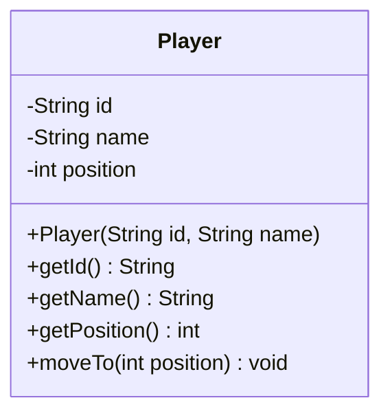

# Snake and Ladder: Low-Level Design

## Part 5 · Player Design and Implementation

*Giving each participant an identity and a position, and nothing more.*

---

## Contents

1. [Overview](#1-overview)
2. [Where We Stand](#2-where-we-stand)
3. [Identifying Player Responsibilities](#3-identifying-player-responsibilities)
4. [Designing the Player Class](#4-designing-the-player-class)
5. [Understanding the Player's State](#5-understanding-the-players-state)
6. [Implementing Player.java](#6-implementing-playerjava)
7. [Demonstrating the Player Class](#7-demonstrating-the-player-class)
8. [Player Interaction with Other Components](#8-player-interaction-with-other-components)
9. [Updated UML Class Diagram](#9-updated-uml-class-diagram)
10. [Design Decisions](#10-design-decisions)
11. [Validation and Edge Cases](#11-validation-and-edge-cases)
12. [Acceptance Checklist](#12-acceptance-checklist)
13. [Key Takeaways](#13-key-takeaways)
14. [Next Step](#14-next-step)

---

## 1. Overview

In this stage we designed and implemented the `Player` class. Its purpose is to represent a participant and manage that
participant's identity and current position.

We built `Player` on its own, verified it through a client class, and established how it will collaborate with `Board`,
`Dice`, and `Game`. The complete game flow is **not** implemented yet.

### What we implemented

- Player identity
- Player name
- Current position
- An initial position of `0`
- Controlled position updates
- Validation of player identity and position
- A standalone client demonstration
- The `Player` UML class diagram

---

## 2. Where We Stand

| Stage | Topic                                      |   Status    |
|:-----:|--------------------------------------------|:-----------:|
|   1   | Requirement gathering                      | ✅ Completed |
|   2   | Entity identification and responsibilities | ✅ Completed |
|   3   | UML class diagram                          | ✅ Completed |
|   4   | Board, Snake, and Ladder implementation    | ✅ Completed |
|   5   | Player design and implementation           | ✅ Completed |
|   6   | Dice design and implementation             |   ➡️ Next   |
|   7   | Game logic and turn management             |  ⏳ Pending  |
|   8   | Game orchestration                         |  ⏳ Pending  |
|   9   | Client implementation                      |  ⏳ Pending  |
|  10   | Design review and refinement               |  ⏳ Pending  |

`Player` is designed to work with the `Board` and `Dice` components without depending directly on either.

---

## 3. Identifying Player Responsibilities

Before writing `Player`, we decided what it should remember and what it should do.

### 3.1 What does Player represent?

A `Player` is one participant in the game. Each player keeps an independent position.

**At the start of the game**

| Player ID | Name  | Position |
|:---------:|-------|:--------:|
|    P1     | Alice |    0     |
|    P2     | Bob   |    0     |

**Later in the game**

| Player ID | Name  | Position |
|:---------:|-------|:--------:|
|    P1     | Alice |    25    |
|    P2     | Bob   |    17    |

`Player` stores this information without implementing the game workflow.

### 3.2 What Player is responsible for

1. Maintaining a player ID
2. Maintaining a player name
3. Maintaining the current position
4. Providing access to the player's information
5. Allowing controlled updates to the current position

### 3.3 What Player should not do

`Player` does not:

- Roll the die
- Interpret a dice roll
- Determine the next player
- Search for snakes or ladders
- Decide whether a move exceeds the board boundary
- Determine whether the player has won
- End the game

Those jobs belong to other components:

| Responsibility                               | Component |
|----------------------------------------------|-----------|
| Store player information                     | `Player`  |
| Generate a dice result                       | `Dice`    |
| Store and resolve snake and ladder positions | `Board`   |
| Coordinate turns and movement                | `Game`    |
| Determine the winner                         | `Game`    |
| Start and demonstrate the application        | `Client`  |

> **Design principle:** each class has a clear responsibility and does not take over the responsibilities of other
> classes.

---

## 4. Designing the Player Class

`Player` has three fields.

| Field      | Type     | Purpose                       |
|------------|----------|-------------------------------|
| `id`       | `String` | Identifies the player         |
| `name`     | `String` | The player's display name     |
| `position` | `int`    | The player's current position |

```java
Player player = new Player("P1", "Alice");
```

The initial state of that player is:

- **ID:** `P1`
- **Name:** `Alice`
- **Position:** `0`

### 4.1 Why a String for the player ID?

A `String` allows readable identifiers such as `P1`, `P2`, or `PLAYER_101`. For a game this size we do not need a
separate ID-generation component. If automatic ID generation is ever required, that responsibility can be added
separately.

### 4.2 Why an integer for position?

The board is made of numbered positions, so an `int` is enough.

- Position `0` is reserved for the initial state, before the player enters the numbered board.
- Valid board positions run from `1` to the board's configured size.
- In the standard game, the final position is `100`.

### 4.3 Why is position mutable?

A player's position changes throughout the game:

- It starts at 0.
- After one move it may be 4, after another 12.
- If the player lands on a snake, it may move backward.

So position cannot be immutable. We still want to control *how* it changes.

---

## 5. Understanding the Player's State

`Player` uses **encapsulation** to protect its internal state.

### 5.1 Why should fields be private?

Consider this version:

```java
public class Player {
    public String id;
    public String name;
    public int position;
}
```

With public fields, any class could write:

```java
player.position =-50;
```

That would create an invalid state. Instead we make the fields private:

```java
private final String id;
private final String name;
private int position;
```

External classes can no longer reach in and change them directly.

### 5.2 Why are `id` and `name` final?

They identify the player. Once a `Player` exists, these values should not change in the current design, and `final`
prevents reassignment.

### 5.3 Why is `position` not final?

Position changes during gameplay, so it stays mutable. That gives us two categories of state:

| Field      | Mutable? | Reason                                 |
|------------|:--------:|----------------------------------------|
| `id`       |    No    | Player identity stays fixed            |
| `name`     |    No    | Player name stays fixed in this design |
| `position` |   Yes    | The player moves during gameplay       |

### 5.4 Why provide getters?

Getters give controlled **read** access.

```java
player.getName();
player.

getPosition();
```

Other components can inspect the player's state without modifying the fields directly, which is a straightforward use of
encapsulation.

---

## 6. Implementing `Player.java`

### 6.1 Complete implementation

```java
public class Player {
    private final String id;
    private final String name;
    private int position;

    public Player(String id, String name) {
        if (id == null || id.isBlank()) {
            throw new IllegalArgumentException(
                    "Player ID cannot be empty"
            );
        }
        if (name == null || name.isBlank()) {
            throw new IllegalArgumentException(
                    "Player name cannot be empty"
            );
        }
        this.id = id;
        this.name = name;
        this.position = 0;
    }

    public String getId() {
        return id;
    }

    public String getName() {
        return name;
    }

    public int getPosition() {
        return position;
    }

    public void moveTo(int position) {
        if (position < 0) {
            throw new IllegalArgumentException(
                    "Player position cannot be negative"
            );
        }
        this.position = position;
    }
}
```

### 6.2 The constructor

The constructor takes the player's ID and name and rejects values that are `null`, empty, or blank. It then assigns the
values and sets the position to `0`, so a new `Player` always starts in the expected state.

### 6.3 The getters

```java
public String getId()

public String getName()

public int getPosition()
```

These let other components read the player's information.

### 6.4 The `moveTo()` method

```java
public void moveTo(int position) {
    if (position < 0) {
        throw new IllegalArgumentException(
                "Player position cannot be negative"
        );
    }
    this.position = position;
}
```

It takes a destination and sets the current position to it.

```java
player.moveTo(10);   // position is now 10
```

`moveTo()` does **not** calculate how far the player should move. It simply records the position the caller supplies.

### 6.5 Why `moveTo()` instead of `setPosition()`?

Either name would work. `moveTo()` communicates the action more clearly in a board game: the player is being moved to a
particular destination. This is a naming choice, not a strict object-oriented rule.

---

## 7. Demonstrating the Player Class

A separate client verifies `Player` independently, before it is integrated with the rest of the game.

### 7.1 `PlayerClient.java`

```java
public class PlayerClient {
    public static void main(String[] args) {
        Player player = new Player("P1", "Alice");

        System.out.println("Player ID: " + player.getId());
        System.out.println("Player Name: " + player.getName());
        System.out.println(
                "Initial Position: " + player.getPosition()
        );

        player.moveTo(10);
        System.out.println(
                "Updated Position: " + player.getPosition()
        );

        player.moveTo(25);
        System.out.println(
                "Updated Position: " + player.getPosition()
        );
    }
}
```

### 7.2 Expected output

```text
Player ID: P1
Player Name: Alice
Initial Position: 0
Updated Position: 10
Updated Position: 25
```

### 7.3 What this demonstrates

1. A `Player` can be created.
2. The ID and name are stored correctly.
3. The initial position is `0`.
4. The position can be updated.
5. The latest position can be retrieved.

This client is only a demonstration. It is not the final game client.

---

## 8. Player Interaction with Other Components

`Player` is deliberately independent of `Board` and `Dice`. Here is how the components will collaborate once `Game`
exists.

**Scenario:** Alice is at position 12 and rolls a 4, so the target is `12 + 4 = 16`. The `Board` has a snake from 16 to
6.

| Step | What happens                                  | Component                       |
|:----:|-----------------------------------------------|---------------------------------|
|  1   | Generate the result 4                         | `Dice`                          |
|  2   | Calculate the target position 16              | `Game`                          |
|  3   | Check the move does not exceed the board size | `Game`                          |
|  4   | Resolve position 16 to position 6             | `Board`                         |
|  5   | Call `player.moveTo(6)`                       | `Game`, then `Player` stores it |
|  6   | Check whether the player has won              | `Game`                          |

### 8.1 Illustrative interaction

```java
int targetPosition = player.getPosition() + dice.roll();

if(targetPosition <=board.

getSize()){
int resolvedPosition = board.resolvePosition(targetPosition);
    player.

moveTo(resolvedPosition);
}
```

This illustrates the collaboration; it is not the complete turn implementation. The final `Game` will also handle
overshooting, winner detection, and advancing to the next player.

---

## 9. Updated UML Class Diagram



### Reading the diagram

- `-` means private visibility; `+` means public visibility.
- `final` is a Java modifier and is not shown in this simplified diagram.
- The constructor initializes the player's identity and starting position.
- The getters expose the player's information.
- `moveTo()` updates the current position.

---

## 10. Design Decisions

### 10.1 Why doesn't Player roll the dice?

Rolling is a separate responsibility. If `Player` rolled the die, it would become coupled to dice behavior. Instead,
`Game` coordinates the turn and uses a `Dice` implementation.

### 10.2 Why doesn't Player calculate its next position?

The next position depends on game rules, which must account for:

- Dice results
- Board boundaries
- Snakes
- Ladders
- Winning conditions

`Game` coordinates these rules and `Board` resolves special positions. `Player` only holds the resulting position.

### 10.3 Why doesn't Player validate the maximum position?

`Player` does not know the board size. Hardcoding `100` into it would tie it to the standard board configuration.
Instead:

- `Player` rejects negative positions.
- `Game` prevents moves that exceed the board size.
- `Board` validates positions passed to its resolution method.

This keeps `Player` independent of any specific board size.

### 10.4 Should Player validate duplicate IDs?

`Player` checks that the ID is not `null` or blank, but it does not enforce uniqueness across `Player` objects; two
players could be created with the same ID.

`Game` manages the collection of players, so it is the right place to enforce unique IDs if that requirement is adopted.
We do not need an ID registry inside `Player`.

### 10.5 Why not a separate PlayerPosition class?

The position is a single integer with no independent behavior. A separate class would add complexity for no gain. We can
introduce a richer representation if future requirements add position-related state or behavior.

---

## 11. Validation and Edge Cases

| Scenario                    | Expected behavior                                           |
|-----------------------------|-------------------------------------------------------------|
| Valid ID and name           | Player is created                                           |
| Null ID                     | Constructor throws `IllegalArgumentException`               |
| Blank ID                    | Constructor throws `IllegalArgumentException`               |
| Null name                   | Constructor throws `IllegalArgumentException`               |
| Blank name                  | Constructor throws `IllegalArgumentException`               |
| Initial position            | `0`                                                         |
| Move to position 10         | Position becomes 10                                         |
| Move to position 0          | Accepted by the current implementation                      |
| Move to a negative position | Throws `IllegalArgumentException`                           |
| Move beyond the board size  | `Player` permits it; `Game` must prevent it during gameplay |

> **Important distinction:** `moveTo()` accepts any non-negative position. That is intentional, because `Player` does
> not know the board size. During gameplay, `Game` must make sure only valid destinations are supplied. If stricter state
> transitions are needed later, we can revisit this interface.

---

## 12. Acceptance Checklist

### Player implementation

- [x] Player ID is stored
- [x] Player name is stored
- [x] Player position is stored
- [x] Player starts at position 0
- [x] ID and name cannot be reassigned after construction
- [x] Position is updated through `moveTo()`
- [x] Negative positions are rejected
- [x] Null and blank IDs are rejected
- [x] Null and blank names are rejected
- [x] Getter methods expose the player's state
- [x] `PlayerClient` demonstrates the implementation
- [x] Player responsibilities are separated from `Board`, `Dice`, and `Game`
- [x] UML diagram updated for `Player`

### Still pending

- [ ] `Dice` interface
- [ ] `StandardDice` implementation
- [ ] `FixedDice` implementation
- [ ] `Game` turn management
- [ ] Overshoot handling
- [ ] Winner detection
- [ ] Complete game orchestration
- [ ] Final CLI demonstration

---

## 13. Key Takeaways

1. **Encapsulation:** private fields protect the `Player`'s internal state.
2. **Immutability:** the player's ID and name stay fixed after construction.
3. **Controlled mutation:** position changes only through `moveTo()`.
4. **Single responsibility:** `Player` stores state instead of coordinating the game.
5. **Low coupling:** `Player` does not depend directly on `Board` or `Dice`.
6. **Appropriate validation:** `Player` validates its own basic state, while `Game` and `Board` enforce game-specific
   rules.
7. **Incremental implementation:** a component can be demonstrated on its own before it is integrated with the rest of
   the system.

---

## 14. Next Step

The next stage is **Part 6: Dice Design and Implementation**. We will build:

1. The `Dice` interface
2. `StandardDice` for random rolls from 1 to 6
3. `FixedDice` for predictable rolls
4. Validation of dice results
5. A demonstration client for both implementations
6. The rationale for making `Game` depend on the `Dice` interface

After `Dice`, we integrate `Player`, `Dice`, and `Board` into the `Game` class.