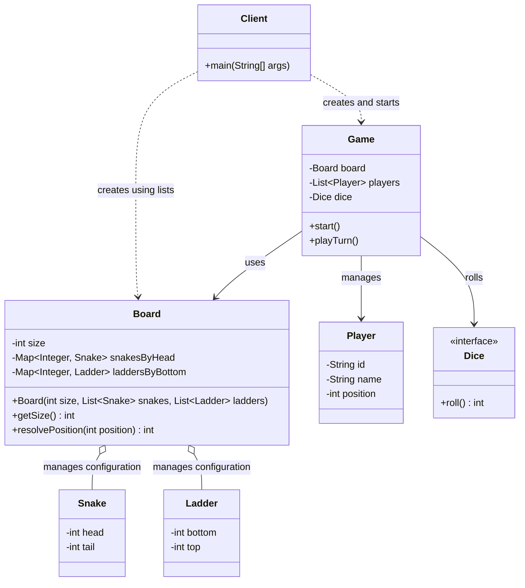

# Snake and Ladder: Low-Level Design

## Part 9 · Client Implementation and Board Configuration

*Wiring everything together, and letting the `Board` own how it stores snakes and ladders.*

---

## Contents

1. [Objective](#1-objective)
2. [Understanding the Design Problem](#2-understanding-the-design-problem)
3. [Responsibilities of Each Class](#3-responsibilities-of-each-class)
4. [Updated Client Implementation](#4-updated-client-implementation)
5. [Board's Internal Data Structures](#5-boards-internal-data-structures)
6. [Why Not Store Only Lists?](#6-why-not-store-only-lists)
7. [Updated UML Class Diagram](#7-updated-uml-class-diagram)
8. [Design Principles Learned](#8-design-principles-learned)
9. [Complexity Analysis](#9-complexity-analysis)
10. [Practice Questions](#10-practice-questions)
11. [Key Takeaways](#11-key-takeaways)
12. [Git Commit Message](#12-git-commit-message)
13. [Progress Checklist](#13-progress-checklist)

---

## 1. Objective

In this part we connected all the components of the game and implemented the `Client` class to run it.

During implementation we found an important design improvement:

> **The `Client` should pass lists of snakes and ladders to the `Board`, rather than constructing maps itself.**

The `Board` is responsible for validating the configuration and organizing snakes and ladders into suitable internal
data structures. This keeps the client's responsibilities simple and stops it from depending on the board's internal
implementation.

---

## 2. Understanding the Design Problem

At first, we considered configuring snakes and ladders in the client using maps:

```java
Map<Integer, Snake> snakes = Map.of(
        16, new Snake(16, 6),
        47, new Snake(47, 26),
        64, new Snake(64, 60),
        93, new Snake(93, 73)
);
```

The map uses the snake's head position as its key, and ladders could be configured the same way with their bottom
positions as keys.

The problem: this makes the client responsible for knowing **how the `Board` organizes its internal data**. That is
unnecessary coupling. The client should only describe *which* snakes and ladders exist.

### The improved approach

Provide lists instead of maps:

```java
List<Snake> snakes = List.of(
        new Snake(16, 6),
        new Snake(47, 26),
        new Snake(64, 60),
        new Snake(93, 73)
);
```

```java
List<Ladder> ladders = List.of(
        new Ladder(3, 22),
        new Ladder(8, 30),
        new Ladder(20, 41),
        new Ladder(63, 81)
);
```

The `Board` receives these lists and manages their internal representation.

---

## 3. Responsibilities of Each Class

The updated design separates responsibilities clearly.

### Client

The `Client` is responsible for:

- Creating snakes and ladders
- Supplying the board configuration
- Creating players
- Selecting a dice implementation
- Creating the game
- Starting the game
- Displaying the final winner

It does not need to know how the board stores snakes and ladders.

### Board

The `Board` is responsible for:

- Maintaining the board size
- Accepting lists of snakes and ladders
- Validating their configuration
- Organizing them into internal maps
- Resolving a player's landing position

Internally it can use:

```java
private final Map<Integer, Snake> snakesByHead;
private final Map<Integer, Ladder> laddersByBottom;
```

The client does not need to know these fields exist.

### Game

The `Game` is responsible for:

- Managing player turns
- Rolling the dice through the `Dice` interface
- Calculating target positions
- Handling overshoots
- Asking the board to resolve snakes and ladders
- Updating player positions
- Detecting the winner
- Ending the game

It should not need to know whether the board uses lists, maps, or any other internal structure.

---

## 4. Updated Client Implementation

This version passes lists to the `Board`.

```java
import java.util.List;

public class Client {

    public static void main(String[] args) {
        // 1. Configure snakes
        List<Snake> snakes = List.of(
                new Snake(16, 6),
                new Snake(47, 26),
                new Snake(64, 60),
                new Snake(93, 73)
        );

        // 2. Configure ladders
        List<Ladder> ladders = List.of(
                new Ladder(3, 22),
                new Ladder(8, 30),
                new Ladder(20, 41),
                new Ladder(63, 81)
        );

        // 3. Create the board
        Board board = new Board(100, snakes, ladders);

        // 4. Create players
        List<Player> players = List.of(
                new Player("P1", "Alice"),
                new Player("P2", "Bob")
        );

        // 5. Create the dice
        Dice dice = new StandardDice();

        // 6. Create the game
        Game game = new Game(board, players, dice);

        // 7. Start the game
        System.out.println("Starting Snake and Ladder!");
        game.start();

        // 8. Display the final result
        System.out.println("\nGame Over!");
        if (game.getWinner() != null) {
            System.out.println(
                    "Winner: " + game.getWinner().getName()
            );
        }
    }
}
```

### What changed?

Previously the client built maps of snakes and ladders. Now it builds lists and hands them straight to the board:

```java
Board board = new Board(100, snakes, ladders);
```

This is the only change the client needs, provided the `Board` constructor already accepts `List<Snake>` and
`List<Ladder>`.

---

## 5. Board's Internal Data Structures

Although the client supplies lists, the board can still use maps internally.

### Why?

When a player lands on a position, we need to know whether it is a snake's head or a ladder's bottom. Suppose a player
lands on 47: we must find the snake that starts at 47 and move the player to 26. A map gives us an expected
constant-time lookup.

### Internal representation

```java
private final Map<Integer, Snake> snakesByHead;
private final Map<Integer, Ladder> laddersByBottom;
```

| Map               | Key                    | Value                      |
|-------------------|------------------------|----------------------------|
| `snakesByHead`    | Snake head position    | The corresponding `Snake`  |
| `laddersByBottom` | Ladder bottom position | The corresponding `Ladder` |

For example:

```text
snakesByHead:

16 -> Snake(16, 6)
47 -> Snake(47, 26)
64 -> Snake(64, 60)
93 -> Snake(93, 73)
```

```text
laddersByBottom:

3  -> Ladder(3, 22)
8  -> Ladder(8, 30)
20 -> Ladder(20, 41)
63 -> Ladder(63, 81)
```

These maps are the board's internal representation, **not** structures the client has to build.

### Converting lists into maps

The `Board` constructor can build its maps from the supplied lists. An illustrative conversion:

```java
Map<Integer, Snake> snakeMap = new HashMap<>();

for(
Snake snake :snakes){
        snakeMap.

put(snake.getHead(),snake);
        }

Map<Integer, Ladder> ladderMap = new HashMap<>();

for(
Ladder ladder :ladders){
        ladderMap.

put(ladder.getBottom(),ladder);
        }
```

> **Caution:** this snippet shows only the basic conversion. The real `Board` constructor must validate its inputs and
> reject duplicate snake heads or ladder bottoms *before* accepting the configuration. Otherwise a later entry could
> silently replace an earlier one.

It must also:

- Validate position boundaries, so every endpoint lies within positions 1 through *N* for a board of size *N*.
- Reject conflicting snake-head and ladder-bottom positions, per our existing design rules.
- Not allow the winning position to be configured as a snake head, because that could move a player away from the
  winning square.

---

## 6. Why Not Store Only Lists?

We could keep snakes and ladders as lists and search them whenever a player lands:

```java
for(Snake snake :snakes){
        if(snake.

getHead() ==position){
        return snake.

getTail();
    }
            }
```

That is a linear search. With *S* snakes, finding a match takes **O(S)** in the worst case, and searching *L* ladders
takes **O(L)**. Maps give expected **O(1)** lookup for each.

So our design combines the strengths of both:

| Where                 | Structure | Why                                                       |
|-----------------------|-----------|-----------------------------------------------------------|
| Construction boundary | Lists     | Simple and natural for describing the board configuration |
| Inside the `Board`    | Maps      | Efficient for resolving player positions                  |

This is a good example of separating a class's public interface from its internal implementation.

---

## 7. Updated UML Class Diagram



The diagram shows the important boundary:

- The client creates the board using lists.
- The board maintains its internal maps.
- The game uses the board without depending on its storage details.

`Snake` and `Ladder` stay separate entities because each represents a distinct board transition.

---

## 8. Design Principles Learned

### 8.1 Encapsulation

The board's internal maps are private implementation details. The client interacts with the board through its
constructor and public methods, not by modifying its internal data structures.

### 8.2 Low coupling

The client does not need to know the board uses maps. If we later replace them with another suitable structure, the
client stays unchanged as long as the public interface does.

### 8.3 Appropriate data structures

We choose each structure for its job:

| Structure                     | Used for                           |
|-------------------------------|------------------------------------|
| `List<Snake>`, `List<Ladder>` | Supplying configuration            |
| `Map<Integer, Snake>`         | Finding snakes by head position    |
| `Map<Integer, Ladder>`        | Finding ladders by bottom position |
| `List<Player>`                | Maintaining players in turn order  |

### 8.4 Keep the design simple

We do not need a factory, configuration manager, or separate board builder for the current requirements. The client
constructs the objects directly, and the board handles its own configuration.

---

## 9. Complexity Analysis

Let **S** be the number of snakes, **L** the number of ladders, and **N** the number of board positions.

| Operation            |       Time        |      Space      | Notes                                                                     |
|----------------------|:-----------------:|:---------------:|---------------------------------------------------------------------------|
| Board initialization | Expected O(S + L) |    O(S + L)     | Assumes ordinary hash-map behavior; excludes the space of the input lists |
| Position resolution  |   Expected O(1)   | O(1) per lookup | The stored board configuration occupies O(S + L)                          |

---

## 10. Practice Questions

**Q1. Why should the client pass lists instead of maps?**

The client should describe which snakes and ladders exist, not dictate how the board stores them. Passing lists reduces
coupling to the board's implementation.

**Q2. If we pass lists to the board, can the board still use maps internally?**

Yes. The constructor can convert the lists into maps. The public interface and the internal representation do not have
to use the same data structure.

**Q3. Why use maps internally?**

Maps give expected constant-time lookups by snake head or ladder bottom, avoiding linear searches through the
configuration.

**Q4. Should the client validate every snake and ladder?**

No. The board should validate the configuration, because it owns the board rules and configuration.

**Q5. What happens if two snakes have the same head position?**

The board should reject the configuration. Silently overwriting one snake in the map would make the result depend on
insertion order.

**Q6. If we change the board's internal maps to another data structure, should the client change?**

Not if the board's public constructor and behavior stay the same. That is one of the benefits of encapsulation.

---

## 11. Key Takeaways

- The client supplies `List<Snake>` and `List<Ladder>` to the board.
- The board owns configuration validation and internal storage.
- The board can convert lists into maps for efficient lookups.
- The client should not depend on the board's internal data structures.
- Lists suit supplying configuration; maps suit indexed lookups.
- Duplicate and conflicting positions must be validated, not silently overwritten.
- This design improves encapsulation without adding unnecessary abstractions.

