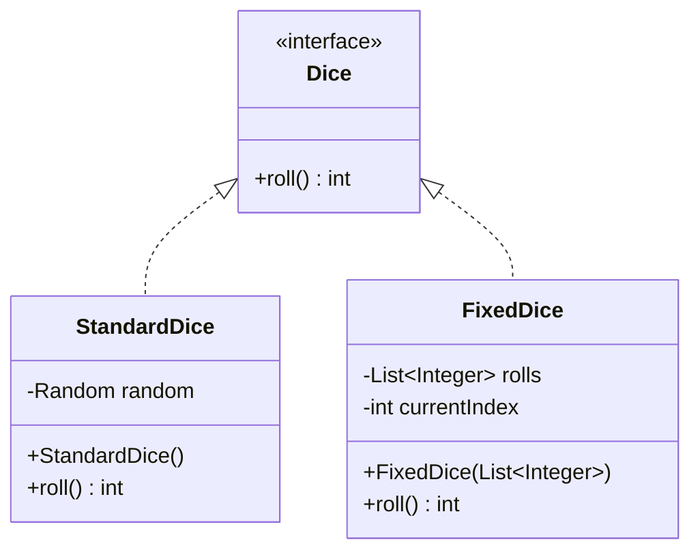

# Snake and Ladder: Low-Level Design

## Part 6 · Dice Design and Implementation

*One contract, two behaviors: random rolls for play, predictable rolls for demos.*

---

## Contents

1. [Objective](#1-objective)
2. [Identifying the Design Problem](#2-identifying-the-design-problem)
3. [Designing the Dice Interface](#3-designing-the-dice-interface)
4. [Implementing StandardDice](#4-implementing-standarddice)
5. [Implementing FixedDice](#5-implementing-fixeddice)
6. [Why Both Implementations Follow the Same Interface](#6-why-both-implementations-follow-the-same-interface)
7. [UML Class Diagram](#7-uml-class-diagram)
8. [Client Demonstration](#8-client-demonstration)
9. [Design Decisions and Trade-offs](#9-design-decisions-and-trade-offs)
10. [Complexity Analysis](#10-complexity-analysis)
11. [Checklist](#11-checklist)
12. [What's Next?](#12-whats-next)
13. [Git Commit Message](#13-git-commit-message)

---

## 1. Objective

In this part we design and implement the dice functionality for the game.

### What already exists

| Class    | Role                                                               |
|----------|--------------------------------------------------------------------|
| `Snake`  | Represents a snake by its head and tail positions                  |
| `Ladder` | Represents a ladder by its bottom and top positions                |
| `Board`  | Stores snakes and ladders and resolves a player's landing position |
| `Player` | Represents a player and maintains their current position           |

Now players need a way to roll a die during their turns.

### Requirements

1. The game uses one six-sided die.
2. A roll returns a number between 1 and 6.
3. Real gameplay uses random rolls.
4. Demonstrations support predictable rolls so game behavior can be verified.
5. The game can use either dice implementation **without changing its game logic**.

> The fifth requirement is the most important design consideration in this part.

---

## 2. Identifying the Design Problem

Imagine we roll the dice directly inside `Game`:

```java
Random random = new Random();
int diceValue = random.nextInt(6) + 1;
```

This works for real gameplay. But suppose we want to demonstrate that a player wins after a specific sequence of moves,
so the dice must return:

```
3 → 5 → 2 → 6 → 1
```

With the dice logic embedded in `Game`, controlling that sequence is awkward. We would have to change the game logic or
add special conditions just to support predictable demonstrations. That couples dice behavior to game behavior for no
good reason.

### Our solution

**Separate the dice contract from its implementation.**

| Type           | Role                                     |
|----------------|------------------------------------------|
| `Dice`         | An interface defining the dice operation |
| `StandardDice` | Generates random values                  |
| `FixedDice`    | Returns predetermined values             |

Both implementations follow the same contract, and `Game` depends on `Dice`, not on any particular implementation.

---

## 3. Designing the Dice Interface

We start with the simplest possible interface.

```java
public interface Dice {
    int roll();
}
```

### Why an interface?

It defines *what* a dice implementation must do without saying *how*. Any class implementing `Dice` must provide
`roll()`:

- `StandardDice` uses a random number generator.
- `FixedDice` takes the next value from a predefined sequence.

Both offer the same operation with different internal behavior.

### Why not a single concrete `Dice` class?

One class could generate random numbers, but supporting predictable sequences would mean modifying it or adding
conditional logic. An interface lets us introduce new implementations without changing the code that consumes them. This
is a practical use of **polymorphism**.

---

## 4. Implementing `StandardDice`

The first implementation generates random values.

```java
import java.util.Random;

public class StandardDice implements Dice {
    private final Random random;

    public StandardDice() {
        this.random = new Random();
    }

    @Override
    public int roll() {
        return random.nextInt(6) + 1;
    }
}
```

### Understanding the implementation

**The `Random` field.** We keep one `Random` instance in the class and initialize it in the constructor, so it can
generate values every time `roll()` is called.

**Generating a value from 1 to 6.** `random.nextInt(6)` produces an integer from 0 through 5, and adding 1 shifts that
to 1 through 6.

| `nextInt(6)` result | Dice result |
|:-------------------:|:-----------:|
|          0          |      1      |
|          1          |      2      |
|          2          |      3      |
|          3          |      4      |
|          4          |      5      |
|          5          |      6      |

So every call to `roll()` returns a valid six-sided-die value.

**Why `@Override`?** It marks the method as the implementation of `roll()` declared in `Dice`, and lets the compiler
catch certain mistakes, such as an incompatible method signature.

---

## 5. Implementing `FixedDice`

Now a dice class that returns a predetermined sequence. Suppose we want:

```
3 → 5 → 2 → 6 → 1
```

Each call to `roll()` returns the next value in the sequence.

```java
import java.util.List;

public class FixedDice implements Dice {
    private final List<Integer> rolls;
    private int currentIndex;

    public FixedDice(List<Integer> rolls) {
        if (rolls == null || rolls.isEmpty()) {
            throw new IllegalArgumentException(
                    "Dice rolls cannot be empty"
            );
        }
        for (Integer roll : rolls) {
            if (roll == null || roll < 1 || roll > 6) {
                throw new IllegalArgumentException(
                        "Each dice roll must be between 1 and 6"
                );
            }
        }
        this.rolls = List.copyOf(rolls);
        this.currentIndex = 0;
    }

    @Override
    public int roll() {
        if (currentIndex >= rolls.size()) {
            throw new IllegalStateException(
                    "No predetermined dice rolls remain"
            );
        }
        return rolls.get(currentIndex++);
    }
}
```

### Understanding the implementation

**Why store a list of rolls?** The list holds the sequence the dice will return, for example `List.of(3, 5, 2, 6, 1)`.
That is what makes the behavior predictable.

**Why `currentIndex`?** It tracks which value comes next. It starts at `0` and advances by one after each successful
roll. For `[3, 5, 2, 6, 1]`:

| Call | Index before | Returned value | Index after |
|:----:|:------------:|:--------------:|:-----------:|
|  1   |      0       |       3        |      1      |
|  2   |      1       |       5        |      2      |
|  3   |      2       |       2        |      3      |
|  4   |      3       |       6        |      4      |
|  5   |      4       |       1        |      5      |

The expression `rolls.get(currentIndex++)` returns the element at the current index and *then* increments it.

**Why validate the list?** A six-sided die cannot return 0, 7, or `null`. The constructor rejects:

- A `null` list
- An empty list
- `null` entries
- Values outside 1 through 6

An invalid sequence is therefore rejected before gameplay begins.

**Why `List.copyOf()`?**

```java
this.rolls =List.

copyOf(rolls);
```

This makes an unmodifiable copy. Without it, external code could change the original list after `FixedDice` is built and
silently alter the sequence mid-game.

**What happens when the sequence ends?** If the sequence holds five values and a sixth roll is requested, `roll()`
throws an `IllegalStateException`. That is better than silently restarting the sequence or returning an arbitrary value.
For a demonstration, supply enough rolls for the turns you plan to simulate.

---

## 6. Why Both Implementations Follow the Same Interface

Consider these declarations:

```java
Dice standardDice = new StandardDice();

Dice fixedDice = new FixedDice(
        List.of(3, 5, 2, 6, 1)
);
```

The two objects behave differently, yet both are used through a `Dice` reference:

```java
System.out.println(standardDice.roll());
        System.out.

println(fixedDice.roll());
```

The calling code only needs to know that the object supports `roll()`. It does not care whether the value is random or
predetermined. That is the key benefit of the interface.

### Connection to the `Game` class

When we build the game logic, `Game` will accept a `Dice` through its constructor. Conceptually:

```java
public Game(Board board, List<Player> players, Dice dice) {
    // Initialize game state.
}
```

Either implementation can then be supplied:

```java
Game gameWithRandomDice = new Game(
        board,
        players,
        new StandardDice()
);

Game gameWithFixedDice = new Game(
        board,
        players,
        new FixedDice(List.of(3, 5, 2, 6, 1))
);
```

The game rules do not change when the dice implementation changes.

> These examples illustrate the intended dependency design. The complete `Game` constructor and gameplay logic are
> implemented in their own stages.

---

## 7. UML Class Diagram



### Understanding the relationships

- `Dice <|.. StandardDice`: `StandardDice` implements the `Dice` interface.
- `Dice <|.. FixedDice`: `FixedDice` implements the same interface.

Both classes must provide `roll()`.

**Why no direct relationship between the two implementations?** `StandardDice` does not need to know about `FixedDice`,
and vice versa. They are independent implementations of one contract, which keeps the design simple and avoids
unnecessary coupling.

---

## 8. Client Demonstration

A small client verifies both implementations.

### `DiceClient.java`

```java
import java.util.List;

public class DiceClient {
    public static void main(String[] args) {
        Dice standardDice = new StandardDice();

        System.out.println("Random dice rolls:");
        for (int i = 0; i < 5; i++) {
            System.out.println(standardDice.roll());
        }

        Dice fixedDice = new FixedDice(
                List.of(3, 5, 2, 6, 1)
        );

        System.out.println("\nFixed dice rolls:");
        for (int i = 0; i < 5; i++) {
            System.out.println(fixedDice.roll());
        }
    }
}
```

### Example output

The random values vary between executions.

```text
Random dice rolls:
4
2
6
1
5

Fixed dice rolls:
3
5
2
6
1
```

The random output above is only an example. The fixed sequence is the same every time the client runs with the same
input.

### What did we verify?

1. `StandardDice` returns values between 1 and 6.
2. `FixedDice` returns values in the supplied order.
3. Both implementations can be referenced through the `Dice` interface.
4. The predetermined sequence is not modified by the dice implementation.
5. Exhausting the fixed sequence produces an explicit exception.

---

## 9. Design Decisions and Trade-offs

| # | Decision                                            | Reason                                                                                                                   |
|:-:|-----------------------------------------------------|--------------------------------------------------------------------------------------------------------------------------|
| 1 | Use an interface instead of a concrete `Dice` class | We need different dice behaviors without modifying the game logic.                                                       |
| 2 | Use `StandardDice` for real gameplay                | Real gameplay should generate random values.                                                                             |
| 3 | Use `FixedDice` for demonstrations                  | Predictable rolls make it easy to demonstrate snakes, ladders, overshooting, and winning.                                |
| 4 | Throw an exception when fixed rolls run out         | An exhausted sequence should not silently produce misleading gameplay results.                                           |
| 5 | Avoid unnecessary abstractions                      | No `DiceFactory`, `DiceManager`, or extra strategy classes are needed. The interface and two implementations are enough. |

This design resembles the **Strategy pattern**, but the pattern's name is not the point. What matters is that the game
can use different dice behaviors through a stable interface.

---

## 10. Complexity Analysis

| Class          | Per-roll time | Per-roll extra space | Other costs                                                                                                                          |
|----------------|:-------------:|:--------------------:|--------------------------------------------------------------------------------------------------------------------------------------|
| `StandardDice` |     O(1)      |         O(1)         | Generates one random integer per call                                                                                                |
| `FixedDice`    |     O(1)      |         O(1)         | For *N* predetermined rolls: storage O(N); construction and validation O(N), covering validation of every value and copying the list |

---

## 11. Checklist

### Design

- [x] Identified the need for multiple dice behaviors
- [x] Defined the `Dice` interface
- [x] Designed `StandardDice`
- [x] Designed `FixedDice`
- [x] Kept both implementations independent

### Implementation

- [x] Generated random values from 1 to 6
- [x] Returned predetermined values in order
- [x] Validated the fixed sequence
- [x] Prevented external modification of the stored sequence
- [x] Handled exhaustion of the fixed sequence
- [x] Created a client demonstration

### Integration

- [x] Established that `Game` should depend on `Dice`
- [ ] Integrated dice rolling into the game's turn logic
- [ ] Verified complete gameplay with predetermined rolls

The remaining integration work belongs to the game logic and orchestration stages.

---

## 12. What's Next?

In **Part 7: Game Logic and Turn Management** we implement the `Game` class responsibilities:

1. Track the current player.
2. Roll the dice.
3. Calculate the target position.
4. Handle overshooting the final square.
5. Resolve snakes and ladders through `Board`.
6. Update the player's position.
7. Detect the winner.
8. Advance to the next player's turn.

The `Dice` interface and both implementations are now ready for the game to use.

