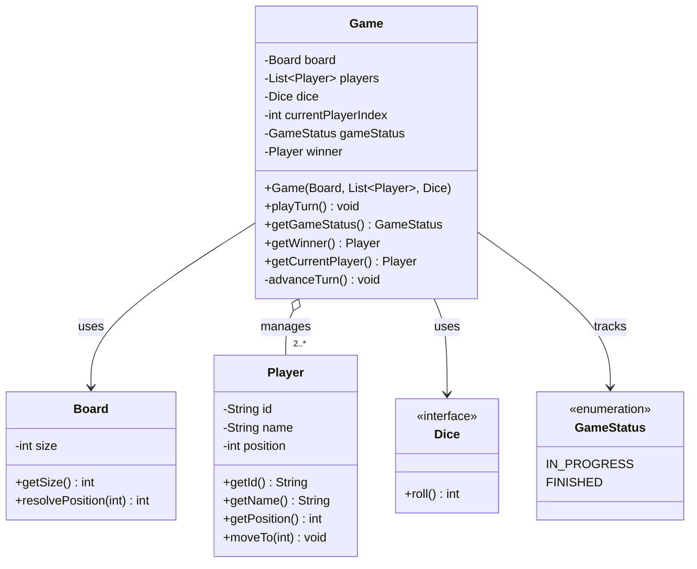

# Snake and Ladder: Low-Level Design

## Part 7 · Game Logic and Turn Management

*The `Game` class with an explicit `GameStatus` lifecycle, playing one turn at a time.*

---

## Contents

1. [Objective](#1-objective)
2. [Why Do We Need a Game Class?](#2-why-do-we-need-a-game-class)
3. [Designing the Game Class](#3-designing-the-game-class)
4. [GameStatus Enum](#4-gamestatus-enum)
5. [Managing Player Turns](#5-managing-player-turns)
6. [Understanding One Turn](#6-understanding-one-turn)
7. [Complete Game Implementation](#7-complete-game-implementation)
8. [Updated UML Class Diagram](#8-updated-uml-class-diagram)
9. [Design Decisions](#9-design-decisions)
10. [Edge Cases](#10-edge-cases)
11. [Complexity Analysis](#11-complexity-analysis)
12. [Completion Checklist](#12-completion-checklist)
13. [Next Part: Game Orchestration](#13-next-part-game-orchestration)
14. [Git Commit Message](#14-git-commit-message)

---

## 1. Objective

In this part we implement the core game logic for Snake and Ladder.

### What already exists

| Class          | Role                                                        |
|----------------|-------------------------------------------------------------|
| `Snake`        | Represents a snake by its head and tail positions           |
| `Ladder`       | Represents a ladder by its bottom and top positions         |
| `Board`        | Manages snakes and ladders and resolves landing positions   |
| `Player`       | Represents a player and maintains their current position    |
| `Dice`         | Defines the contract for rolling a die                      |
| `StandardDice` | Generates random values between 1 and 6                     |
| `FixedDice`    | Provides predetermined rolls for predictable demonstrations |

Now we need a class that coordinates these objects and implements the actual game rules.

### What `Game` is responsible for

1. Maintaining the list of players
2. Tracking whose turn it is
3. Rolling the dice
4. Calculating the target position
5. Handling overshooting the final square
6. Resolving snakes and ladders
7. Detecting the winner
8. Managing the game's lifecycle through a **status enum**

> **Scope:** this part implements the logic for playing **one turn at a time**. The continuous game loop comes in the
> next part.

---

## 2. Why Do We Need a Game Class?

Each existing class has one specific job.

| Class          | Responsibility                                              |
|----------------|-------------------------------------------------------------|
| `Player`       | Stores player information and position                      |
| `Dice`         | Defines the dice-rolling contract                           |
| `StandardDice` | Generates random dice values                                |
| `FixedDice`    | Generates predetermined dice values                         |
| `Board`        | Manages snakes and ladders and resolves landing positions   |
| `Game`         | Coordinates gameplay, turn management, and winner detection |

Without `Game`, the logic for rolling dice, moving players, resolving positions, and determining the winner would have
to be coordinated somewhere else. `Game` brings these operations together without taking over the responsibilities of
`Player`, `Dice`, or `Board`.

---

## 3. Designing the Game Class

First, the state a game must maintain.

### Fields

| Field                | Type           | Purpose                            |
|----------------------|----------------|------------------------------------|
| `board`              | `Board`        | The board used for gameplay        |
| `players`            | `List<Player>` | All participating players          |
| `dice`               | `Dice`         | Provides dice values for each turn |
| `currentPlayerIndex` | `int`          | The player whose turn it is        |
| `gameStatus`         | `GameStatus`   | The current state of the game      |
| `winner`             | `Player`       | The winning player, if one exists  |

The board, player collection, and dice are supplied at construction. The current player index, game status, and winner
change as play progresses.

### Why does Game depend on the `Dice` interface?

The game should not depend directly on `StandardDice`. It depends on the interface:

```java
private final Dice dice;
```

That lets us supply either implementation:

```java
Dice dice = new StandardDice();
```

```java
Dice dice = new FixedDice(List.of(3, 4, 2, 6, 1));
```

The game logic stays the same. This is programming to an interface, which reduces coupling between the game and the dice
implementation.

---

## 4. GameStatus Enum

Instead of a `boolean gameOver` field, we represent the game's lifecycle with an enum.

### Implementation

```java
public enum GameStatus {
    IN_PROGRESS,
    FINISHED
}
```

### The states

| State         | Meaning                                           |
|---------------|---------------------------------------------------|
| `IN_PROGRESS` | The game is active and players can take turns     |
| `FINISHED`    | A player has won and no further turns are allowed |

### Why an enum instead of a boolean?

A boolean has only two values, and its meaning depends on interpretation:

```java
private boolean gameOver;
```

A reader must remember what `true` and `false` stand for. With an enum the meaning is explicit:

```java
private GameStatus gameStatus;
```

```java
gameStatus ==GameStatus.IN_PROGRESS
gameStatus ==GameStatus.FINISHED
```

An enum can also grow new states later if the requirements call for them. For the current scope, `IN_PROGRESS` and
`FINISHED` are enough.

We do **not** need a `NOT_STARTED` state, because the game begins in `IN_PROGRESS` as soon as its constructor completes.

---

## 5. Managing Player Turns

Suppose three players participate:

| Index | Player  |
|:-----:|---------|
|   0   | Alice   |
|   1   | Bob     |
|   2   | Charlie |

The game keeps the index of the current player:

```java
private int currentPlayerIndex;
```

To retrieve the current player:

```java
public Player getCurrentPlayer() {
    return players.get(currentPlayerIndex);
}
```

### Advancing to the next player

After a turn finishes, we move to the next player:

```java
private void advanceTurn() {
    currentPlayerIndex =
            (currentPlayerIndex + 1) % players.size();
}
```

The modulo operator wraps the index back to zero. For three players the sequence is:

```
0 → 1 → 2 → 0 → 1 → 2 → ...
```

This works for any number of players, with no separate logic for two, three, or more. The method is `private` because
changing the turn index is an internal game operation.

---

## 6. Understanding One Turn

A turn consists of several steps.

### Step 1: Check the game status

Before processing a turn, verify that the game has not finished.

```java
if(gameStatus ==GameStatus.FINISHED){
        throw new

IllegalStateException(
            "The game has already finished"
);
}
```

This prevents further turns after a winner has been determined.

### Step 2: Identify the current player

```java
Player currentPlayer = getCurrentPlayer();
```

### Step 3: Roll the dice

```java
int diceValue = dice.roll();
```

The value is between 1 and 6 for our current dice implementations.

### Step 4: Calculate the target position

```java
int currentPosition = currentPlayer.getPosition();

int targetPosition = currentPosition + diceValue;
```

Example: current position 12, roll 4, target **16**. The player intends to move to square 16.

### Step 5: Handle overshooting

The board has 100 squares, and the player must land **exactly** on square 100 to win. At position 97, a roll of 5 gives:

```
97 + 5 = 102
```

The target exceeds the board size, so the player stays at 97. The game should:

1. Leave the player's position unchanged.
2. Finish the current turn.
3. Advance to the next player.
4. Avoid calling `Board.resolvePosition()` for the invalid target.

The relevant condition:

```java
if(targetPosition >board.

getSize()){

advanceTurn();
    return;
            }
```

The early `return` stops the remaining movement logic from running.

### Step 6: Resolve snakes and ladders

If the target is within the board, ask the board to resolve the landing position.

```java
int resolvedPosition = board.resolvePosition(targetPosition);

currentPlayer.

moveTo(resolvedPosition);
```

| Target square | Board configuration  | Player finishes at |
|:-------------:|----------------------|:------------------:|
|      16       | Snake from 16 to 6   |         6          |
|      16       | Ladder from 16 to 35 |         35         |
|      16       | Nothing at 16        |         16         |

`Game` never inspects the board's internal snake and ladder maps. It delegates that to `Board`.

### Step 7: Check for a winner

```java
if(resolvedPosition ==board.

getSize()){
winner =currentPlayer;
gameStatus =GameStatus.FINISHED;
    return;
            }
```

We store the winner and set the status to `FINISHED`. The early `return` is essential: the game must end immediately
after a player wins.

### Step 8: Advance the turn

If the player has not won:

```java
advanceTurn();
```

This completes one turn.

### The whole turn at a glance

```
Check status ─► Identify player ─► Roll dice ─► Compute target
                                                     │
                                        target > board size?
                                      ┌──────────────┴──────────────┐
                                     yes                            no
                                      │                             │
                          Stay put, advance turn          Resolve snake / ladder
                                                                    │
                                                            Move player
                                                                    │
                                                    Reached final square?
                                                 ┌──────────────┴──────────────┐
                                                yes                            no
                                                 │                             │
                                  Set winner, status = FINISHED        Advance to next player
```

---

## 7. Complete Game Implementation

This combines constructor validation, turn management, overshooting, snake-and-ladder resolution, and winner detection.

```java
import java.util.HashSet;
import java.util.List;
import java.util.Set;

public class Game {
    private final Board board;
    private final List<Player> players;
    private final Dice dice;

    private int currentPlayerIndex;
    private GameStatus gameStatus;
    private Player winner;

    public Game(Board board, List<Player> players, Dice dice) {
        if (board == null) {
            throw new IllegalArgumentException(
                    "Board cannot be null"
            );
        }
        if (players == null || players.size() < 2) {
            throw new IllegalArgumentException(
                    "At least two players are required"
            );
        }
        if (dice == null) {
            throw new IllegalArgumentException(
                    "Dice cannot be null"
            );
        }

        Set<String> playerIds = new HashSet<>();
        for (Player player : players) {
            if (player == null) {
                throw new IllegalArgumentException(
                        "Player cannot be null"
                );
            }
            if (!playerIds.add(player.getId())) {
                throw new IllegalArgumentException(
                        "Player IDs must be unique"
                );
            }
        }

        this.board = board;
        this.players = List.copyOf(players);
        this.dice = dice;
        this.currentPlayerIndex = 0;
        this.gameStatus = GameStatus.IN_PROGRESS;
        this.winner = null;
    }

    public void playTurn() {
        if (gameStatus == GameStatus.FINISHED) {
            throw new IllegalStateException(
                    "The game has already finished"
            );
        }

        Player currentPlayer = getCurrentPlayer();
        int diceValue = dice.roll();
        int currentPosition = currentPlayer.getPosition();
        int targetPosition = currentPosition + diceValue;

        System.out.println(
                currentPlayer.getName()
                        + " rolled " + diceValue
        );

        if (targetPosition > board.getSize()) {
            System.out.println(
                    currentPlayer.getName()
                            + " cannot move because the roll overshoots "
                            + board.getSize()
            );
            advanceTurn();
            return;
        }

        int resolvedPosition = board.resolvePosition(targetPosition);
        currentPlayer.moveTo(resolvedPosition);

        System.out.println(
                currentPlayer.getName()
                        + " moved from " + currentPosition
                        + " to " + resolvedPosition
        );

        if (resolvedPosition == board.getSize()) {
            winner = currentPlayer;
            gameStatus = GameStatus.FINISHED;
            System.out.println(
                    currentPlayer.getName() + " wins!"
            );
            return;
        }

        advanceTurn();
    }

    private void advanceTurn() {
        currentPlayerIndex =
                (currentPlayerIndex + 1) % players.size();
    }

    public GameStatus getGameStatus() {
        return gameStatus;
    }

    public Player getWinner() {
        return winner;
    }

    public Player getCurrentPlayer() {
        return players.get(currentPlayerIndex);
    }
}
```

### Important implementation details

**Constructor validation.** The constructor validates its dependencies before initializing the game. It ensures:

- A board is provided.
- At least two players participate.
- A dice implementation is provided.
- No player entry is `null`.
- Every player has a unique ID.

A `HashSet` detects duplicate player IDs efficiently.

**Defensive copying of players.**

```java
this.players =List.

copyOf(players);
```

This creates an unmodifiable copy of the supplied list, so external code cannot add or remove players through the
original list and change the game's player collection. The `Player` objects themselves stay mutable, because their
positions must change during play.

**Why does `playTurn()` print messages?** For this initial command-line version, printing turn results makes the
behavior easy to demonstrate. In a larger application we could separate presentation from game rules by returning a
structured turn result or using a dedicated output component. The current requirements do not need that extra
abstraction.

---

## 8. Updated UML Class Diagram

The diagram now includes the `GameStatus` enum.



### Relationship explanations

| Relationship        | Meaning                                                     |
|---------------------|-------------------------------------------------------------|
| `Game → Board`      | The game delegates landing-position resolution to the board |
| `Game → Player`     | The game manages participating players and their turns      |
| `Game → Dice`       | The game obtains dice values through the interface          |
| `Game → GameStatus` | The game tracks its lifecycle using the enum                |

No separate `TurnManager` is introduced, because turn management is simple enough to stay inside `Game`.

---

## 9. Design Decisions

### Decision 1: use `GameStatus` instead of a boolean

An enum expresses the game's state explicitly. The current states are `IN_PROGRESS` and `FINISHED`, and more can be
added later if requirements justify them.

### Decision 2: keep turn management inside `Game`

The game already coordinates player movement and knows when a turn finishes. A separate `TurnManager` would add
complexity without a meaningful benefit at this stage.

### Decision 3: let `Board` resolve snakes and ladders

The game calculates the target square, but the board determines the resolved landing position. This keeps the board's
internal representation encapsulated.

### Decision 4: store the winner as a `Player` reference

The `winner` field gives direct access to the winning player. It is `null` before the game finishes and references the
winner afterward.

### Decision 5: require an exact landing on square 100

A player wins only when their resolved position equals the board size. Overshooting leaves their position unchanged.

### Decision 6: avoid unnecessary abstractions

We do not introduce separate classes for turn management, winner detection, or movement calculations. These operations
are simple enough to remain in `Game` for the current requirements.

---

## 10. Edge Cases

| Scenario                              | Expected behavior                         |
|---------------------------------------|-------------------------------------------|
| Player rolls a normal value           | Calculate and resolve the target position |
| Player lands on a snake head          | Move the player to the snake's tail       |
| Player lands on a ladder bottom       | Move the player to the ladder's top       |
| Player overshoots square 100          | Keep the player at their current position |
| Player reaches square 100             | Mark the player as the winner             |
| A player wins                         | Set status to `FINISHED`                  |
| Another turn is attempted after a win | Throw `IllegalStateException`             |
| Board is `null`                       | Reject construction                       |
| Dice is `null`                        | Reject construction                       |
| Fewer than two players supplied       | Reject construction                       |
| Duplicate player IDs supplied         | Reject construction                       |
| Player list contains `null`           | Reject construction                       |

> **Board configuration consideration:** the board should not permit a snake head on the winning square. Otherwise, a
> player landing on square 100 could be moved away from the winning position. Consider adding this restriction to `Board`
> validation if it is not already enforced.

---

## 11. Complexity Analysis

Let **P** be the number of players, **S** the number of snakes, and **L** the number of ladders.

| Operation         |     Time      | Space | Notes                                                                                                                                             |
|-------------------|:-------------:|:-----:|---------------------------------------------------------------------------------------------------------------------------------------------------|
| Game construction |     O(P)      | O(P)  | Expected O(P) to validate IDs, O(P) to copy the list. Space covers the copied list and the temporary validation set. Excludes board construction. |
| Playing one turn  | Expected O(1) | O(1)  | A constant number of operations; map-based board lookups are expected O(1).                                                                       |

The total number of turns needed to finish a game is variable.

---

## 12. Completion Checklist

### Game design

- [x] Identified the responsibilities of `Game`
- [x] Designed the game state
- [x] Introduced the `GameStatus` enum
- [x] Replaced the boolean `gameOver` field
- [x] Designed turn management using `currentPlayerIndex`

### Implementation

- [x] Implemented constructor validation
- [x] Enforced unique player IDs
- [x] Implemented `playTurn()`
- [x] Integrated dice rolling
- [x] Implemented overshooting behavior
- [x] Integrated board position resolution
- [x] Implemented winner detection
- [x] Prevented further turns after the game finishes
- [x] Implemented the required getters

### Integration

- [x] Established the interaction between `Game`, `Player`, `Board`, and `Dice`
- [ ] Implemented the complete game loop
- [ ] Demonstrated a complete game using `FixedDice`

The last two items belong to the next part.

---

## 13. Next Part: Game Orchestration

In **Part 8** we implement game orchestration. Right now `playTurn()` executes one turn at a time, and we need a
mechanism that invokes it repeatedly until the game finishes. Conceptually:

```java
while(game.getGameStatus() ==GameStatus.IN_PROGRESS){
        game.

playTurn();
}
```

We will decide where this loop belongs and how the `Client` should start the game. Then we demonstrate a complete game
using a configured board, multiple players, and predetermined dice rolls.

