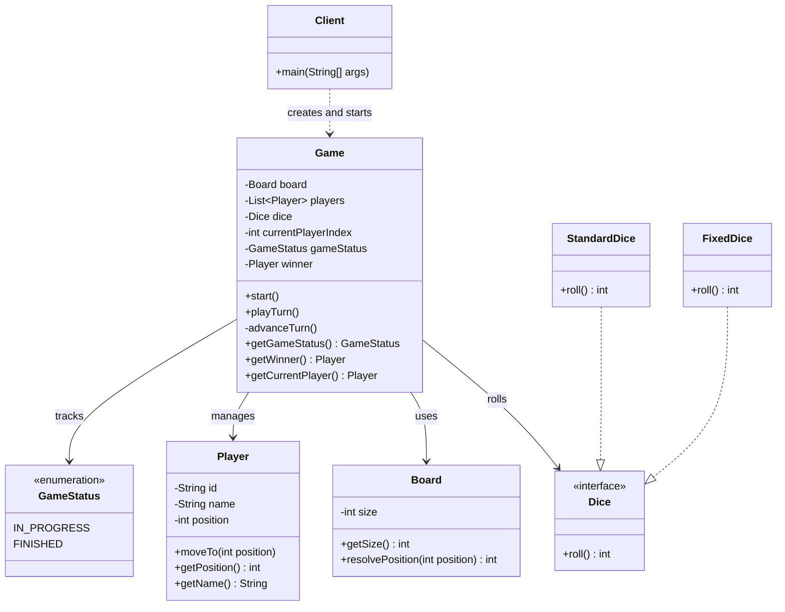

# Snake and Ladder: Low-Level Design

## Part 8 · Game Orchestration

*Adding `start()` so the game runs itself, turn after turn, until someone wins.*

---

## Contents

1. [Objective](#1-objective)
2. [Understanding the Problem](#2-understanding-the-problem)
3. [Introducing the start() Method](#3-introducing-the-start-method)
4. [Why Should start() Belong to Game?](#4-why-should-start-belong-to-game)
5. [Updated Game Class](#5-updated-game-class)
6. [Updated UML Class Diagram](#6-updated-uml-class-diagram)
7. [Important Consideration: Predetermined Dice Rolls](#7-important-consideration-predetermined-dice-rolls)
8. [Important Design Decisions](#8-important-design-decisions)
9. [Edge Cases to Keep in Mind](#9-edge-cases-to-keep-in-mind)
10. [Complexity Analysis](#10-complexity-analysis)
11. [Practice Questions](#11-practice-questions)
12. [Key Takeaways](#12-key-takeaways)
13. [Git Commit Message](#13-git-commit-message)
14. [Progress Checklist](#14-progress-checklist)

---

## 1. Objective

In the previous part we implemented the `Game` class, which manages the game state and executes one player's turn at a
time through:

```java
public void playTurn() {
    // Execute one player's turn
}
```

A single call performs a full turn:

1. Identify the current player.
2. Roll the dice.
3. Calculate the target position.
4. Check whether the move overshoots the board.
5. Resolve snakes and ladders.
6. Update the player's position.
7. Check whether the player has won.
8. Advance to the next player when appropriate.

But calling `playTurn()` by hand for every turn is inconvenient:

```java
game.playTurn();
game.

playTurn();
game.

playTurn();
game.

playTurn();
game.

playTurn();
```

We do not know in advance how many turns a game will take.

> **Our objective:** introduce a `start()` method that runs the game automatically until a winner is found.

---

## 2. Understanding the Problem

Consider a game with two players, Alice and Bob. Alice goes first.

| Turn | Player | Dice roll | Result                        |
|:----:|--------|:---------:|-------------------------------|
|  1   | Alice  |     4     | Moves to position 4           |
|  2   | Bob    |     3     | Moves to position 3           |
|  3   | Alice  |     5     | Moves to position 9           |
|  4   | Bob    |     6     | Moves to position 9           |
|  …   | …      |     …     | …                             |
|  N   | Alice  |     2     | Reaches position 100 and wins |

The game must continue until someone reaches the final position. We need a mechanism that keeps invoking `playTurn()`
while the game remains in progress.

---

## 3. Introducing the `start()` Method

We already have the `GameStatus` enum:

```java
public enum GameStatus {
    IN_PROGRESS,
    FINISHED
}
```

It represents the current state of the game, which makes it a natural condition for a loop.

### Implementation

Add this method to the existing `Game` class:

```java
public void start() {
    while (gameStatus == GameStatus.IN_PROGRESS) {
        playTurn();
    }
}
```

### How does it work?

**Step 1: check the game status.** The constructor initializes the game with:

```java
this.gameStatus =GameStatus.IN_PROGRESS;
```

So the loop begins.

**Step 2: execute a turn.** The loop calls `playTurn()`, which executes one complete player turn.

**Step 3: check the status again.** If no player has won, the status is still `IN_PROGRESS` and the loop runs another
turn.

**Step 4: stop when someone wins.** When a player reaches the final position, `playTurn()` updates the game state:

```java
winner =currentPlayer;
gameStatus =GameStatus.FINISHED;
```

The next loop condition evaluates to `false`, and the game stops.

### Execution flow

```text
start()
   │
   ▼
Is game IN_PROGRESS? ── No ──► Exit
   │
  Yes
   │
   ▼
playTurn()
   │
   ▼
Did a player win? ── No ──► Repeat from the status check
   │
  Yes
   │
   ▼
Set status to FINISHED
   │
   ▼
Exit the loop
```

> **Important:** `start()` does not implement turn logic itself. It delegates each turn to `playTurn()`, which keeps the
> responsibilities clear.

---

## 4. Why Should `start()` Belong to `Game`?

One alternative is to put the loop in the `Client`:

```java
while(game.getGameStatus() ==GameStatus.IN_PROGRESS){
        game.

playTurn();
}
```

It works, but it makes the client responsible for controlling the game's lifecycle. The client should mainly create the
required objects and start the game.

`Game` already knows:

- Whether the game is in progress
- Whose turn it is
- How to execute a turn
- When a player wins
- When the game must stop

So it is reasonable for `Game` to own the orchestration. The client simply calls:

```java
game.start();
```

> **Design principle:** keep game execution logic inside `Game`; keep object creation and application startup inside
`Client`.

For this small, single-threaded game, we do not need another class just to manage the loop.

---

## 5. Updated Game Class

The only new method in this part is `start()`. The relevant structure:

```java
public class Game {
    private final Board board;
    private final List<Player> players;
    private final Dice dice;

    private int currentPlayerIndex;
    private GameStatus gameStatus;
    private Player winner;

    // Constructor

    public void start() {
        while (gameStatus == GameStatus.IN_PROGRESS) {
            playTurn();
        }
    }

    public void playTurn() {
        // Execute one player's turn.
    }

    private void advanceTurn() {
        // Move to the next player.
    }

    public GameStatus getGameStatus() {
        return gameStatus;
    }

    public Player getWinner() {
        return winner;
    }

    public Player getCurrentPlayer() {
        return players.get(currentPlayerIndex);
    }
}
```

> **Note:** the `playTurn()` shown here is abbreviated. Keep the complete implementation from Part 7, including dice
> rolling, overshoot handling, board resolution, player movement, and winner detection.

---

## 6. Updated UML Class Diagram

`Game` now exposes both `start()` and `playTurn()`.



The diagram focuses on the classes relevant to orchestration. The complete diagram from earlier parts also includes
`Snake` and `Ladder`, which are associated with the board configuration.

### What changed?

`Game` now exposes:

- `start()`: runs the game until it finishes.
- `playTurn()`: executes one turn.

The `Client` does not need to know how the game loop works.

---

## 7. Important Consideration: Predetermined Dice Rolls

We have two implementations of the `Dice` interface:

| Implementation | Behavior                               |
|----------------|----------------------------------------|
| `StandardDice` | Generates random rolls                 |
| `FixedDice`    | Returns a predefined sequence of rolls |

With `StandardDice`, the game can keep rolling until a winner is found. With `FixedDice`, the number of available rolls
is limited. For example:

```java
Dice dice = new FixedDice(List.of(3, 5, 2, 6, 1));
```

Only five rolls exist. If the game needs a sixth, `FixedDice` throws an `IllegalStateException`. This is intentional:
the implementation should not silently invent a value when its sequence runs out.

When we implement the `Client` in the next part, we should supply a sequence long enough to complete the demonstration,
or use `StandardDice` for a real random game. A predictable sequence is great for showing particular scenarios, but it
must be chosen carefully if the game is expected to finish.

---

## 8. Important Design Decisions

### Decision 1: use `GameStatus` instead of a boolean

```java
private GameStatus gameStatus;
```

rather than:

```java
private boolean gameOver;
```

The enum makes the game's state explicit and lets us add states later if requirements change. For now, `IN_PROGRESS` and
`FINISHED` are sufficient.

### Decision 2: keep `playTurn()` separate from `start()`

We could put all the turn logic inside the loop in `start()`, but that would mix two responsibilities:

- Orchestrating the overall game
- Executing an individual turn

Separate methods are easier to understand and maintain.

### Decision 3: stop immediately after a win

When a player wins, `playTurn()` sets the status to `FINISHED` and returns without advancing the turn. This stops the
next player from taking an extra turn after the game has ended.

### Decision 4: do not introduce a separate orchestrator

A `GameRunner` or `TurnManager` class is unnecessary for the current requirements. `Game` already owns the state and
coordinates the turns, so another class would add complexity without a meaningful benefit.

### Decision 5: keep the client simple

The client should eventually:

1. Create the board and configure snakes and ladders.
2. Create the players.
3. Select a dice implementation.
4. Create the game.
5. Call `game.start()`.
6. Display the final result if necessary.

It should not manage the turn loop manually.

---

## 9. Edge Cases to Keep in Mind

| Scenario                                    | Expected behavior                                |
|---------------------------------------------|--------------------------------------------------|
| Game starts normally                        | `start()` begins executing turns                 |
| No player has won                           | The loop continues                               |
| A player reaches the final position         | The game finishes                                |
| A player overshoots the final position      | The player stays in place and the game continues |
| A player lands on a snake                   | The player moves to the snake's tail             |
| A player lands on a ladder                  | The player moves to the ladder's top             |
| `start()` is called after the game finishes | The loop performs no additional turns            |
| Predetermined dice rolls run out            | `FixedDice` throws an exception                  |

The existing `playTurn()` also rejects direct calls after the game has finished.

> **One important distinction:** calling `start()` after the game finishes does nothing, because the loop condition is
> already `false`. Calling `playTurn()` directly after the game finishes throws an `IllegalStateException`.

---

## 10. Complexity Analysis

Let **T** be the total number of turns played before the game finishes, **P** the number of players, **S** the number of
snakes, and **L** the number of ladders.

| Measure      |      Result       | Why                                                                                                                                                                                        |
|--------------|:-----------------:|--------------------------------------------------------------------------------------------------------------------------------------------------------------------------------------------|
| Time         | **O(T)** expected | `start()` calls `playTurn()` once per turn, and each turn takes expected O(1), including the board's map lookups. Excludes the one-time cost of constructing the board, players, and game. |
| Extra space  |     **O(1)**      | The loop uses constant additional space, not growing with the number of turns.                                                                                                             |
| Stored state | **O(P + S + L)**  | Players and board configuration.                                                                                                                                                           |

---

## 11. Practice Questions

**Q1. Why do we need `start()` if `playTurn()` already exists?**

`playTurn()` executes a single turn, whereas `start()` repeatedly executes turns until the game finishes. It provides a
simple entry point for running the whole game.

**Q2. Why does `start()` use a `while` loop?**

We do not know beforehand how many turns the game will take. The loop continues while the game is in progress and ends
when a player wins.

**Q3. Should the `Client` contain the game loop?**

Not in our current design. `Game` already owns the game state and turn management, so the client should initialize the
game and call `start()`.

**Q4. What happens if a player wins during `playTurn()`?**

The game records the winner, changes the status to `FINISHED`, and returns. The `start()` loop then terminates.

**Q5. What happens if `start()` is called again after the game finishes?**

The loop condition is `false`, so no additional turns are played.

**Q6. Why might a game using `FixedDice` fail before reaching the end?**

The predetermined sequence may run out before a winner is found. The client must supply enough rolls for its
demonstration, or use `StandardDice`.

**Q7. Why not put all the turn logic inside `start()`?**

That would combine overall orchestration with individual turn execution. Separating `start()` and `playTurn()` keeps
each method focused on one responsibility.

---

## 12. Key Takeaways

- `start()` runs the complete game.
- `playTurn()` executes one player's turn.
- `GameStatus` controls whether the game loop continues.
- The game stops when a player reaches the final board position.
- `Game` owns turn orchestration, while `Client` initializes and starts the game.
- `StandardDice` supports random gameplay; `FixedDice` supports predictable demonstrations.
- A separate orchestration class is unnecessary for our current scope.
lidated README