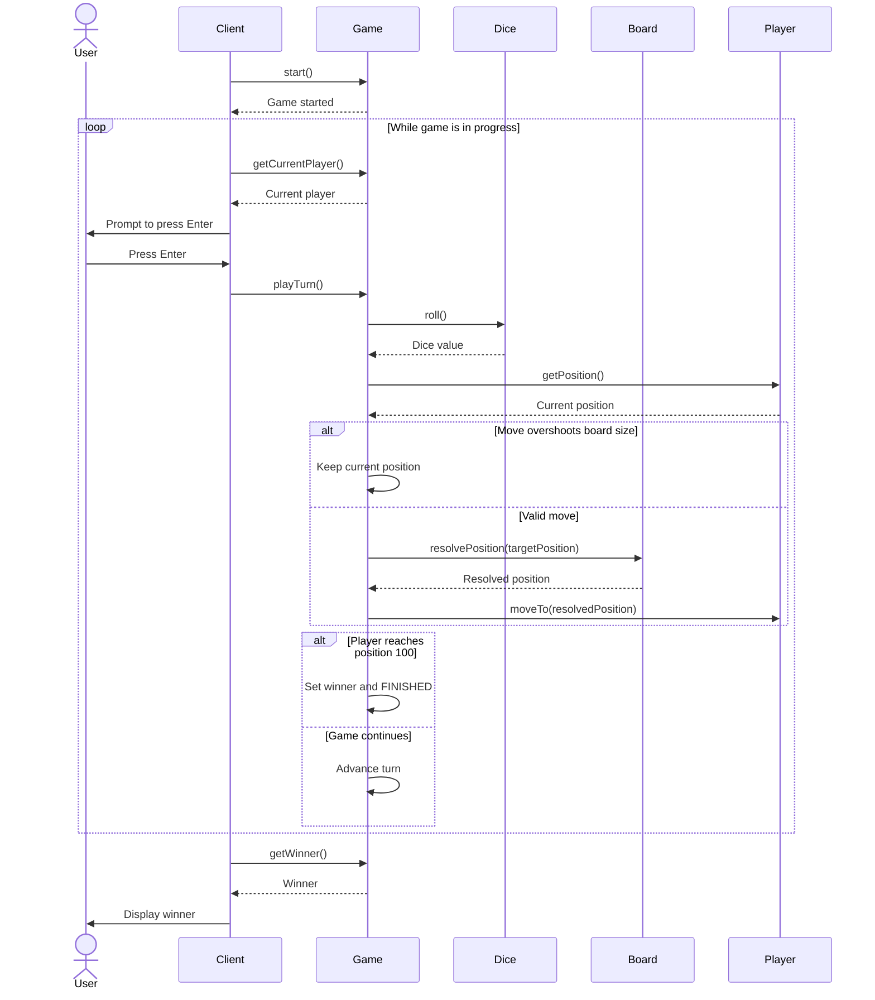

# Snake and Ladder: Low-Level Design

## Part 10 · Manual Turn-Based Gameplay

*From an automatic game loop to player-controlled turns: press Enter to roll.*

---

## Contents

1. [Objective](#1-objective)
2. [Why Change the Existing Implementation?](#2-why-change-the-existing-implementation)
3. [Updated Game Orchestration](#3-updated-game-orchestration)
4. [Updated Client Implementation](#4-updated-client-implementation)
5. [Example Gameplay](#5-example-gameplay)
6. [Why Does Scanner Belong in Client?](#6-why-does-scanner-belong-in-client)
7. [Updated Class Responsibilities](#7-updated-class-responsibilities)
8. [Updated Sequence Diagram](#8-updated-sequence-diagram)
9. [Important Design Considerations](#9-important-design-considerations)
10. [Complexity Analysis](#10-complexity-analysis)
11. [Key Takeaways](#11-key-takeaways)
12. [Git Commit Message](#12-git-commit-message)

---

## 1. Objective

Until now, the game automatically executed every player's turn until someone won. We want it to behave more like a
physical board game, such as Ludo.

### Expected gameplay

1. The game starts.
2. The current player's name is displayed.
3. The player presses **Enter** when ready to roll the dice.
4. The dice rolls.
5. The player moves according to the dice result.
6. If the player lands on a snake or ladder, their position is adjusted accordingly.
7. The next player's turn begins.
8. The process continues until someone reaches position 100.

> **The key change:** the game executes **one turn at a time**, waiting for the player before each turn.

---

## 2. Why Change the Existing Implementation?

Previously, `Game` contained this method:

```java
public void start() {
    while (gameStatus == GameStatus.IN_PROGRESS) {
        playTurn();
    }
}
```

It executes every turn automatically, so players never get to decide when to roll. We need to separate two kinds of
responsibility:

| Responsibility                     | Class                  |
|------------------------------------|------------------------|
| Wait for the player to press Enter | `Client`               |
| Read keyboard input                | `Client`               |
| Decide whose turn it is            | `Game`                 |
| Roll the dice                      | `Game`, through `Dice` |
| Calculate the target position      | `Game`                 |
| Resolve snakes and ladders         | `Board`                |
| Update the player's position       | `Player`               |
| Determine the winner               | `Game`                 |

The `Client` handles interaction with the user. The `Game` stays responsible for the game rules.

---

## 3. Updated Game Orchestration

### Previous approach

`Game.start()` controlled the entire game loop:

```java
public void start() {
    while (gameStatus == GameStatus.IN_PROGRESS) {
        playTurn();
    }
}
```

### New approach

`Game.start()` no longer runs the whole game. Instead, the client controls the interaction loop and calls `playTurn()`
whenever the current player is ready.

`Game` keeps its existing turn logic:

| Method               | Role                                              |
|----------------------|---------------------------------------------------|
| `start()`            | Announces the beginning of the game               |
| `playTurn()`         | Executes exactly one turn                         |
| `getCurrentPlayer()` | Identifies whose turn it is                       |
| `getGameStatus()`    | Indicates whether the game is still running       |
| `getWinner()`        | Returns the winning player when the game finishes |

The `playTurn()` implementation from Part 7 is unchanged. The updated `start()`:

```java
public void start() {
    System.out.println("Snake and Ladder game started!");
}
```

> **Important:** this method only announces the start. It does not execute any turns or wait for keyboard input.

---

## 4. Updated Client Implementation

The `Client` now controls when each turn begins, using Java's `Scanner` to wait for the player to press Enter.

### Complete implementation

```java
import java.util.List;
import java.util.Scanner;

public class Client {

    public static void main(String[] args) {
        Board board = createBoard();

        List<Player> players = List.of(
                new Player("P1", "Alice"),
                new Player("P2", "Bob")
        );

        Dice dice = new StandardDice();

        Game game = new Game(board, players, dice);

        game.start();

        try (Scanner scanner = new Scanner(System.in)) {
            while (game.getGameStatus() == GameStatus.IN_PROGRESS) {
                Player currentPlayer = game.getCurrentPlayer();

                System.out.println(
                        "\n" + currentPlayer.getName()
                                + "'s turn. Press Enter to roll the dice."
                );

                scanner.nextLine();
                game.playTurn();
            }
        }

        System.out.println("\nGame Over!");

        Player winner = game.getWinner();
        if (winner != null) {
            System.out.println(
                    "Winner: " + winner.getName()
            );
        }
    }

    private static Board createBoard() {
        List<Snake> snakes = List.of(
                new Snake(16, 6),
                new Snake(47, 26),
                new Snake(64, 60),
                new Snake(93, 73)
        );

        List<Ladder> ladders = List.of(
                new Ladder(3, 22),
                new Ladder(8, 30),
                new Ladder(20, 41),
                new Ladder(63, 81)
        );

        return new Board(100, snakes, ladders);
    }
}
```

### How it works

**Step 1: initialize the game.** The client creates the board, players, dice, and game.

**Step 2: start the game.** `game.start()` announces that the game has begun.

**Step 3: check the game status.** The loop continues only while:

```java
game.getGameStatus() ==GameStatus.IN_PROGRESS
```

Once a player wins, the loop ends.

**Step 4: identify the current player.**

```java
Player currentPlayer = game.getCurrentPlayer();
```

`Game` maintains the current-player index and advances it after each non-winning turn.

**Step 5: wait for input.**

```java
System.out.println(
        "\n"+currentPlayer.getName()
                +"'s turn. Press Enter to roll the dice."
                        );

                        scanner.

nextLine();
```

`nextLine()` blocks until the player presses Enter or the input stream closes.

**Step 6: execute one turn.**

```java
game.playTurn();
```

Exactly one turn runs. `Game` rolls the dice, processes movement, resolves snakes or ladders, checks for a winner, and
advances the turn when appropriate.

**Step 7: display the winner.** After the game finishes, the client retrieves and shows the winner.

---

## 5. Example Gameplay

An illustrative run. Actual rolls vary, because `StandardDice` is random.

```text
Snake and Ladder game started!

Alice's turn. Press Enter to roll the dice.
Alice rolled 4
Alice moved from 0 to 4

Bob's turn. Press Enter to roll the dice.
Bob rolled 3
Bob moved from 0 to 22

Alice's turn. Press Enter to roll the dice.
Alice rolled 5
Alice moved from 4 to 9

Bob's turn. Press Enter to roll the dice.
Bob rolled 6
Bob moved from 22 to 28

…

Alice's turn. Press Enter to roll the dice.
Alice rolled 3
Alice moved from 97 to 100
Alice wins!

Game Over!
Winner: Alice
```

The exact sequence depends on the random dice results and the configured board (Bob's roll of 3 took him up the ladder
from 3 to 22). Each turn waits for the player to press Enter, and the next turn does not begin until the current one has
finished.

---

## 6. Why Does Scanner Belong in Client?

An important design decision is keeping `Scanner` **outside** the `Game` class. Consider this alternative:

```java
public void playTurn(Scanner scanner) {
    scanner.nextLine();

    // Execute the turn.
}
```

That would couple the game logic to console input, so `Game` would need to know how players interact with the
application. It becomes a problem if we later want to support:

- A graphical interface
- A web application
- A mobile application
- An automated simulation
- A test that runs turns without keyboard input

With `Scanner` in `Client`, the responsibilities stay separate. The same `Game` works with different interfaces without
any change to the game rules.

> **Design principle:** user interaction belongs to the presentation layer; game rules belong to the game logic.

---

## 7. Updated Class Responsibilities

| Class          | Responsibility                                                                                          |
|----------------|---------------------------------------------------------------------------------------------------------|
| `Client`       | Initializes objects, accepts keyboard input, controls when turns are triggered, and displays the winner |
| `Game`         | Maintains game state, identifies the current player, executes one turn, and determines the winner       |
| `Player`       | Stores player identity, name, and current position                                                      |
| `Board`        | Stores board configuration and resolves snakes and ladders                                              |
| `Snake`        | Represents a snake's head and tail                                                                      |
| `Ladder`       | Represents a ladder's bottom and top                                                                    |
| `Dice`         | Defines the dice-rolling contract                                                                       |
| `StandardDice` | Generates random dice values                                                                            |
| `FixedDice`    | Supplies predetermined dice values for demonstrations                                                   |

`Game` does not need to know whether a turn was triggered by a keyboard, a button, or another application component. It
only needs to know that a turn should be executed.

---

## 8. Updated Sequence Diagram

The diagram shows how the user, client, game, dice, board, and player state interact.



---

## 9. Important Design Considerations

### 9.1 One call to `playTurn()` means one turn

`playTurn()` must not contain a loop that runs several turns. Its job is to process a single player's turn.

### 9.2 The client controls the waiting

The client waits for the user to press Enter before calling `playTurn()`. The game logic itself never blocks on keyboard
input.

### 9.3 Overshooting position 100

The existing rule is unchanged. A player at 97 who rolls a 5 stays at 97, because the target would exceed 100. The turn
still ends and the next player gets to play.

### 9.4 Winning ends the game immediately

When a player reaches position 100 exactly, `Game` sets the winner and changes the status to `FINISHED`. The client's
loop then exits without prompting the next player.

### 9.5 No extra turn for rolling a six

Although this is a turn-based game similar to Ludo, we are not adding Ludo-specific rules. Rolling a six does not grant
an additional turn; the next player goes normally unless the game has finished.

### 9.6 `StandardDice` versus `FixedDice`

For ordinary gameplay:

```java
Dice dice = new StandardDice();
```

For predictable demonstrations:

```java
Dice dice = new FixedDice(List.of(3, 5, 2, 6, 1));
```

Remember that `FixedDice` throws an `IllegalStateException` if every predetermined roll has been used while the game is
still in progress. Make sure the sequence has enough rolls for the demonstration.

---

## 10. Complexity Analysis

The manual interaction loop does not change the core game's algorithmic complexity.

| Operation                            |  Complexity   |
|--------------------------------------|:-------------:|
| Retrieve current player              |     O(1)      |
| Roll the standard die                |     O(1)      |
| Calculate target position            |     O(1)      |
| Resolve a snake or ladder using maps | Expected O(1) |
| Advance to the next player           |     O(1)      |
| Execute one turn                     | Expected O(1) |

The game as a whole takes as many turns as needed to reach the winning condition, which depends on the dice results and
board configuration. Waiting for a user to press Enter adds real-world waiting time, but it does not change the
algorithmic complexity of processing a turn.

---

## 11. Key Takeaways

1. Automatic gameplay has been replaced with manual, player-controlled turns.
2. The client waits for the current player to press Enter.
3. Each call to `Game.playTurn()` processes exactly one turn.
4. `Game` remains independent of console input.
5. The existing snake, ladder, overshoot, and winning rules are unchanged.
6. The game ends immediately when a player reaches position 100.
7. `StandardDice` supports ordinary gameplay, while `FixedDice` supports predictable demonstrations.
8. No additional turn manager is necessary for this simple game.
