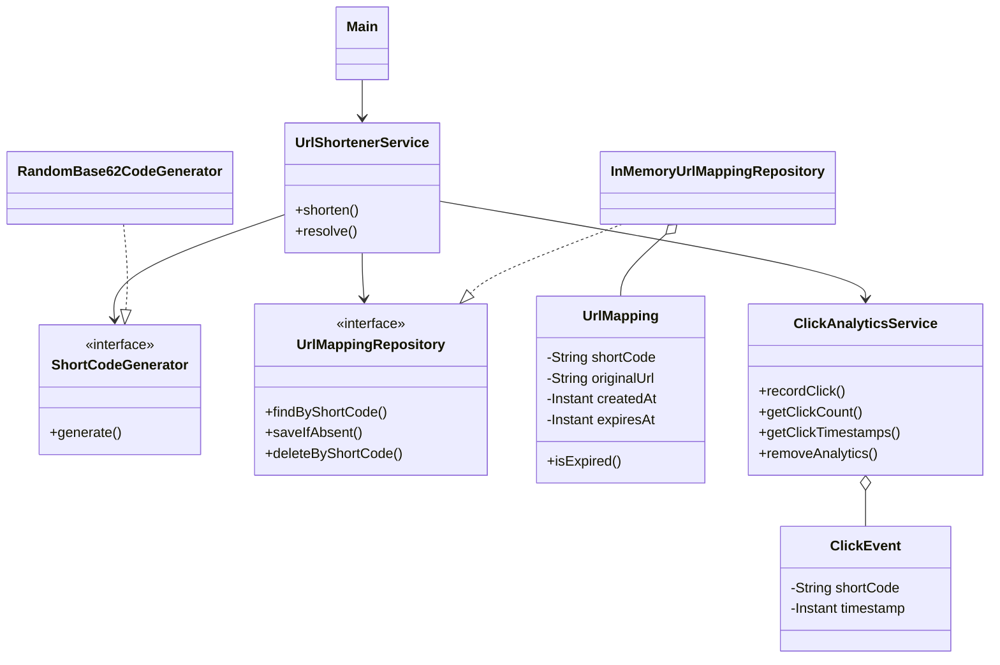

# URL Shortener — Class Identification and Responsibilities

Phase 2 of the URL Shortener LLD: identifying the classes and interfaces needed to implement the finalized requirements,
and assigning each a clear responsibility.

> **Scope reminder:** an in-memory Java application with a hardcoded `Main` client. No database, REST API, or
> command-line menu at this stage.

---

## Table of Contents

1. [Objective](#1-objective)
2. [What the System Needs to Do](#2-what-the-system-needs-to-do)
3. [Identified Components](#3-identified-components)
4. [UrlMapping](#4-urlmapping)
5. [ShortCodeGenerator](#5-shortcodegenerator)
6. [RandomBase62CodeGenerator](#6-randombase62codegenerator)
7. [UrlMappingRepository](#7-urlmappingrepository)
8. [InMemoryUrlMappingRepository](#8-inmemoryurlmappingrepository)
9. [ClickEvent](#9-clickevent)
10. [ClickAnalyticsService](#10-clickanalyticsservice)
11. [UrlShortenerService](#11-urlshortenerservice)
12. [Main](#12-main)
13. [Dependency Relationships](#13-dependency-relationships)
14. [Why Separate These Responsibilities?](#14-why-separate-these-responsibilities)
15. [Design Decisions and Trade-Offs](#15-design-decisions-and-trade-offs)
16. [Edge Cases to Preserve](#16-edge-cases-to-preserve)
17. [What We Are Not Building Yet](#17-what-we-are-not-building-yet)
18. [Implementation Roadmap](#18-implementation-roadmap)
19. [Key Takeaways](#19-key-takeaways)
20. [Git Commit Message](#20-git-commit-message)

---

## 1. Objective

In the previous phase we finalized the functional requirements and business rules. In this phase we identify the classes
and interfaces needed to implement them.

**Goals**

- Identify the main domain entities.
- Assign clear responsibilities to each class.
- Separate business logic from storage and code generation.
- Separate click analytics from URL mappings.
- Define how the classes collaborate.
- Prepare for the UML class diagram before writing implementation code.

---

## 2. What the System Needs to Do

The application must support:

1. Shortening a long URL.
2. Generating a unique short code.
3. Creating a short URL with a custom alias.
4. Configuring an optional expiration time.
5. Resolving a short code to its original URL.
6. Rejecting invalid URLs and aliases.
7. Distinguishing expired mappings from unknown codes.
8. Recording successful clicks with timestamps.
9. Retrieving click counts and timestamps.
10. Reusing an expired custom alias according to the business rules.

Instead of putting all of this into one large class, we separate it into focused components.

---

## 3. Identified Components

| Component                      | Type      | Primary Responsibility                                                    |
|--------------------------------|-----------|---------------------------------------------------------------------------|
| `UrlMapping`                   | Class     | Represents a short-code-to-original-URL mapping                           |
| `ShortCodeGenerator`           | Interface | Contract for generating short codes                                       |
| `RandomBase62CodeGenerator`    | Class     | Generates random seven-character Base62 codes                             |
| `UrlMappingRepository`         | Interface | Operations for storing and retrieving mappings                            |
| `InMemoryUrlMappingRepository` | Class     | Stores URL mappings in memory                                             |
| `ClickEvent`                   | Class     | Represents a successful click event                                       |
| `ClickAnalyticsService`        | Class     | Records and retrieves click analytics                                     |
| `UrlShortenerService`          | Class     | Coordinates shortening, validation, resolution, expiration, and analytics |
| `Main`                         | Class     | Demonstrates the application through a hardcoded Java client              |

The sections below explain why each component exists.

---

## 4. UrlMapping

### 4.1 Why do we need it?

A URL shortener must maintain a relationship between a short code and its original URL, for example:

- Original URL: `https://example.com/articles/java`
- Short code: `aB3xYz9`

`UrlMapping` is the object representing this relationship.

### 4.2 Responsibilities

`UrlMapping` represents one URL mapping and its lifecycle information. It contains the short code, the original URL, the
creation timestamp, and the optional expiration timestamp.

### 4.3 Proposed attributes

| Attribute     | Type      | Purpose                                        |
|---------------|-----------|------------------------------------------------|
| `shortCode`   | `String`  | Identifies the mapping                         |
| `originalUrl` | `String`  | Stores the original URL                        |
| `createdAt`   | `Instant` | Records when the mapping was created           |
| `expiresAt`   | `Instant` | Expiration time, or `null` if it never expires |

### 4.4 Important design decisions

- **The short code is the mapping's identity.** A custom alias and a generated code both identify a `UrlMapping`, so no
  separate mapping classes are needed for each.
- **The mapping does not generate its own code.** Code generation is a separate responsibility.
- **The mapping does not store click analytics.** Click events belong to a separate analytics component.
- **The mapping does not manage itself in the repository.** It represents data and may expose a method to determine
  whether it has expired at a supplied point in time.

The expiration rule:

```text
currentTime >= expiresAt      (if expiresAt is null, the mapping never expires)
```

Modeled as:

```java
isExpired(Instant currentTime)
```

Passing the current time explicitly makes the behavior deterministic and easier to test.

---

## 5. ShortCodeGenerator

### 5.1 Why an interface?

The application must generate short codes when the user doesn't supply a custom alias, but the service shouldn't need to
know the details of the algorithm. The `ShortCodeGenerator` interface defines the required behavior.

### 5.2 Responsibility

Conceptually: `generate()` returns a candidate short code.

The interface does **not** decide whether the code is unique. Uniqueness is checked against existing mappings.

### 5.3 Why use an interface?

We start with random Base62 codes, but may later want to replace the algorithm with:

- A different random-code generator
- A sequential-code generator
- Another code-generation strategy

The service shouldn't need substantial changes when the algorithm changes. This is programming against an abstraction
rather than a concrete implementation.

---

## 6. RandomBase62CodeGenerator

### 6.1 Responsibility

`RandomBase62CodeGenerator` implements `ShortCodeGenerator`. It generates a seven-character code from these 62
characters:

- Lowercase letters: `a-z`
- Uppercase letters: `A-Z`
- Digits: `0-9`

Illustrative examples (not guaranteed outputs): `aB3xYz9`, `K8mP2qR`, `7cD4nWx`.

### 6.2 Randomness is not uniqueness

Two generated codes can collide: the generator could produce `aB3xYz9` twice. So the generator only produces a
*candidate*, and the application workflow does the rest:

1. Generate a candidate.
2. Check whether it already exists.
3. If it exists, generate another candidate.
4. If it does not exist, create the mapping.

The uniqueness check belongs to the application workflow, not the generator.

---

## 7. UrlMappingRepository

### 7.1 Why a repository abstraction?

The application must save mappings and retrieve them by short code. We could put a `HashMap` directly inside
`UrlShortenerService`, but that would make the service responsible for both business logic and storage details.
`UrlMappingRepository` separates them.

### 7.2 Responsibility

The interface defines the operations for managing URL mappings:

- Find a mapping by short code.
- Save a mapping when the code is available.
- Remove a mapping by short code.

Possible signatures (to be finalized during implementation):

```java
findByShortCode(String shortCode)

saveIfAbsent(UrlMapping mapping)

deleteByShortCode(String shortCode)
```

> Lookup must preserve the distinction between an unknown code and an existing-but-expired mapping. Expired mappings
> must **not** be automatically deleted during lookup.

### 7.3 Why not a database yet?

Current requirements specify an in-memory implementation. The repository interface keeps the service independent of the
storage mechanism, so we can use a `HashMap` now and consider a database-backed implementation later. We don't need to
build that today.

---

## 8. InMemoryUrlMappingRepository

### 8.1 Responsibility

`InMemoryUrlMappingRepository` implements `UrlMappingRepository` and stores mappings in a map:

```java
Map<String, UrlMapping>
```

The key is the short code; the value is the mapping.

| Key (short code) | Original URL (inside the `UrlMapping` value) |
|------------------|----------------------------------------------|
| `aB3xYz9`        | `https://example.com/articles/java`          |
| `K8mP2qR`        | `https://example.com/tutorials/spring`       |
| `my-guide`       | `https://example.com/guides`                 |

### 8.2 Why a map?

Our primary lookup is *given a short code, find the mapping*. A map avoids scanning a list of all mappings on every
lookup.

### 8.3 Expired mapping considerations

Expired mappings must remain distinguishable from unknown codes, so the repository does not remove an expired mapping
when it is retrieved.

When a user attempts to reuse an expired custom alias, the **service** explicitly removes the old mapping and its
analytics before creating the replacement. This keeps lifecycle policy in the service rather than hidden inside the
storage implementation.

### 8.4 Scope limitation

The application is designed for a single-process, sequential demonstration. Distributed storage, database transactions,
and concurrent uniqueness guarantees are out of scope for this phase.

---

## 9. ClickEvent

### 9.1 Why a separate class?

For every successful resolution we must record when the click occurred. Rather than putting click information inside
`UrlMapping`, each successful click is modeled as its own object: `ClickEvent`.

### 9.2 Proposed attributes

| Attribute   | Type      | Purpose                                  |
|-------------|-----------|------------------------------------------|
| `shortCode` | `String`  | Identifies the mapping that was accessed |
| `timestamp` | `Instant` | When the successful click occurred       |

Resolving the same short code three times might produce (timestamps illustrative):

| Short code | Timestamp              |
|------------|------------------------|
| `aB3xYz9`  | `2026-10-24T10:00:00Z` |
| `aB3xYz9`  | `2026-10-24T10:03:00Z` |
| `aB3xYz9`  | `2026-10-24T10:10:00Z` |

### 9.3 Why not store only a counter?

A counter says how many clicks occurred, but not *when*. Requirements include both count and timestamps, so we store
individual events and derive the count from the number of recorded events (three events → count of three).

---

## 10. ClickAnalyticsService

### 10.1 Responsibility

`ClickAnalyticsService` manages click-event recording and retrieval. It:

- Records a successful click.
- Retrieves click timestamps.
- Calculates the click count.
- Removes analytics for a mapping when that mapping is reclaimed.

### 10.2 Conceptual operations

```java
recordClick(String shortCode)

getClickCount(String shortCode)

getClickTimestamps(String shortCode)

removeAnalytics(String shortCode)
```

Return types will be decided during implementation.

### 10.3 When should a click be recorded?

Only when the short code resolves successfully. This prevents failed attempts from inflating analytics.

| Resolution result     | Record click? |
|-----------------------|---------------|
| Valid, active mapping | Yes           |
| Unknown short code    | No            |
| Expired mapping       | No            |

### 10.4 Analytics lifecycle

Analytics are retained in memory while their mapping remains active. When an expired custom alias is reclaimed:

1. The previous mapping is removed.
2. Its associated analytics are removed.
3. The new mapping is created.
4. Future successful resolutions record events for the new mapping.

No separate analytics database is needed for the initial implementation.

---

## 11. UrlShortenerService

### 11.1 Why the main business service?

Several components participate in shortening and resolving URLs. Creating a short URL may require:

- Validating the original URL
- Validating an optional custom alias
- Checking whether a compatible mapping already exists
- Generating a candidate short code when necessary
- Checking code availability
- Creating and saving a `UrlMapping`

A component must coordinate these steps: `UrlShortenerService`.

### 11.2 Responsibilities

The service coordinates:

1. URL validation
2. Custom-alias validation
3. Short-code generation
4. Mapping creation and storage
5. Duplicate-URL handling
6. Expiration checks
7. URL resolution
8. Successful-click recording
9. Expired-alias reclamation

It **uses** other components rather than implementing everything itself: it asks the generator for a candidate code,
asks the repository to store a mapping, and asks the analytics service to record clicks.

### 11.3 Conceptual operations

- Shorten a URL without a custom alias.
- Shorten a URL with a custom alias and optional TTL.
- Resolve a short code to its original URL.
- Retrieve analytics for a short code, if exposed through the main service.

Method signatures, return types, and the error-handling strategy will be finalized before implementation.

### 11.4 URL validation

Valid URLs are absolute HTTP or HTTPS URLs with a valid host. Reject:

- `null`
- Empty or whitespace-only strings
- `example.com/page` (no scheme)
- `ftp://example.com/file`
- `javascript:alert(1)`

We validate structure only; we do not make network requests to check reachability. Validation lives in private helper
methods of `UrlShortenerService`. A separate validator class is unnecessary at this scope.

### 11.5 Custom-alias validation

- Length: 3–30 characters
- Allowed characters: letters, digits, hyphens, underscores
- Case-sensitive identity
- Reserved aliases rejected case-insensitively
- An active alias cannot be overwritten
- An expired alias may be reclaimed

Generated codes and custom aliases share one namespace, so a custom alias cannot take a code already used by another
active mapping.

### 11.6 Expiration handling

- No TTL → the mapping never expires.
- Positive TTL → accepted.
- Zero or negative TTL → rejected.
- A mapping expires when `currentTime >= expiresAt`.

Expiration is checked when resolving a short code; no background cleanup job is needed.

> For reliable testing, **inject a `Clock`** into the service instead of calling `Instant.now()` directly. This lets us
> simulate the passage of time without waiting for the real clock.

### 11.7 Resolution outcomes

| Situation                      | Expected behavior                                       |
|--------------------------------|---------------------------------------------------------|
| Active mapping exists          | Return the original URL and record a click              |
| Mapping does not exist         | Report an unknown short code                            |
| Mapping exists but has expired | Report an expired short code; do **not** record a click |

The precise Java representation of these outcomes will be chosen during implementation. Returning the original URL
simulates the result of a redirect; we are not implementing an HTTP redirect response.

---

## 12. Main

### 12.1 Responsibility

`Main` is the entry point and demonstration client. It creates the required objects, wires their dependencies, and
demonstrates behavior such as:

1. Shortening a URL
2. Shortening a URL with a custom alias
3. Resolving an active short code
4. Resolving an unknown code
5. Resolving an expired mapping
6. Retrieving click analytics
7. Attempting to create an invalid URL or alias
8. Reclaiming an expired alias

### 12.2 What `Main` should not do

`Main` must not contain business logic. It should not:

- Generate short codes
- Validate aliases
- Check expiration rules
- Store mappings directly
- Calculate analytics

Those belong to the service and supporting components; `Main` just calls the service.

---

## 13. Dependency Relationships

### 13.1 High-level interaction

1. `Main` invokes `UrlShortenerService`.
2. `UrlShortenerService` requests a candidate code from `ShortCodeGenerator`.
3. The concrete `RandomBase62CodeGenerator` generates the candidate.
4. `UrlShortenerService` uses `UrlMappingRepository` to look up or store mappings.
5. The concrete `InMemoryUrlMappingRepository` manages the map-based storage.
6. On successful resolution, `UrlShortenerService` asks `ClickAnalyticsService` to record a click.
7. `ClickAnalyticsService` stores `ClickEvent` objects.
8. `UrlMapping` represents the stored mapping.

### 13.2 Dependency diagram



> **Note:** this is a preliminary diagram. Operations are conceptual, not final Java signatures. Attributes, return
> types, and relationships will be refined before implementation.

---

## 14. Why Separate These Responsibilities?

Consider a single `UrlShortener` class containing random-code generation, URL validation, alias validation, mapping
storage, expiration checks, click-event storage, and analytics calculations. It might work for a tiny demo, but it would
have too many reasons to change:

- Changing the code-generation algorithm would affect the same class as URL validation.
- Changing the storage mechanism would affect the business logic.
- Changing analytics behavior would affect URL resolution code.

Separating responsibilities makes the system easier to understand, maintain, and extend. We should still **avoid
unnecessary abstractions**: only the components justified by current requirements.

---

## 15. Design Decisions and Trade-Offs

| Decision                              | Reason                                                                |
|---------------------------------------|-----------------------------------------------------------------------|
| `UrlMapping` as the domain entity     | Represents the relationship between a short code and its original URL |
| `ShortCodeGenerator` interface        | Separates the generation contract from the algorithm                  |
| Repository interface                  | Separates business logic from storage                                 |
| In-memory repository                  | Meets the current scope without a database                            |
| Store click events separately         | Supports both click counts and timestamps                             |
| Dedicated analytics service           | Separates analytics from URL mapping                                  |
| Coordinate in `UrlShortenerService`   | Centralizes the application's business workflow                       |
| Validation as private service helpers | Avoids unnecessary classes in the first version                       |
| Hardcoded `Main` client               | Demonstrates behavior without REST, CLI menus, or frameworks          |
| Inject a clock into the service       | Makes expiration behavior deterministic and testable                  |
| Keep the application sequential       | Avoids concurrency complexity before it is required                   |

---

## 16. Edge Cases to Preserve

**Short-code generation**

- A generated code already exists.
- Multiple mappings use the same short code.
- A generated code conflicts with a custom alias.

**Custom aliases**

- Alias is too short or too long.
- Alias contains unsupported characters.
- Alias is reserved.
- Alias is already used by an active mapping.
- Alias belongs to an expired mapping and is being reclaimed.

**Expiration**

- Mapping has no expiration.
- Mapping is still active.
- Current time equals expiration time.
- Mapping has expired.
- An expired mapping is accessed before its alias is reclaimed.

**URL resolution**

- Short code exists and is active.
- Short code does not exist.
- Short code exists but has expired.

**Analytics**

- Successful resolution records one click.
- Unknown code does not record a click.
- Expired mapping does not record a click.
- Click timestamps can be retrieved.
- Click count equals the number of recorded events.
- Reclaiming an expired alias removes its old analytics.

---

## 17. What We Are Not Building Yet

- Database persistence
- REST controllers and HTTP redirect responses
- A command-line menu
- A web interface
- Distributed deployment
- Concurrency guarantees
- Background expiration cleanup
- External destination-URL reachability checks
- Advanced analytics (geographic location, referrer, browser information)
- Authentication and user accounts

These may be explored as future extensions but are not necessary for the initial LLD exercise.

---

## 18. Implementation Roadmap

Design work proceeds in this order:

1. Finalize functional requirements.
2. Clarify business rules and edge cases.
3. Identify the required classes and interfaces.
4. Assign responsibilities to each component.
5. Establish preliminary dependency relationships.
6. Finalize the UML class diagram.
7. Finalize Java method signatures and return types.
8. Implement the domain entity.
9. Implement the code generator.
10. Implement the in-memory repository.
11. Implement click analytics.
12. Implement the URL-shortening service.
13. Create the hardcoded `Main` demonstration.
14. Verify the required scenarios through the demonstration client.

---

## 19. Key Takeaways

1. **Identify responsibilities before writing code.** Requirements should drive the class design.
2. **Keep the domain entity focused.** `UrlMapping` represents a mapping; it doesn't generate codes or record analytics.
3. **Use abstractions where they provide real value.** The generator and repository interfaces isolate implementation
   details.
4. **Don't confuse randomness with uniqueness.** The service must check candidate codes against existing mappings.
5. **Separate mapping data from analytics.** A click event is not a property of the mapping itself.
6. **Keep business decisions in the service.** It coordinates validation, mapping creation, resolution, expiration, and
   analytics.
7. **Preserve lifecycle behavior.** Expired mappings must remain distinguishable from unknown codes until explicitly
   reclaimed.
8. **Avoid overengineering.** No separate class for every validation rule, and no framework for this exercise.
9. **Finalize the UML before implementation.** The next phase refines classes, relationships, attributes, and operations
   into a consistent diagram.
