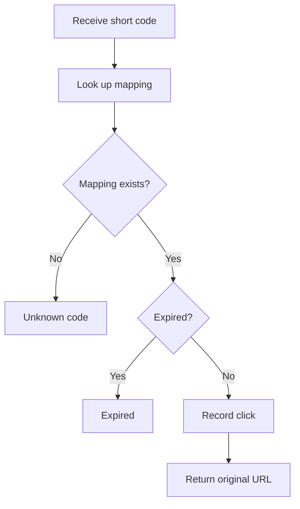

# URL Shortener — Low-Level Design (LLD)

A Bitly-style URL shortening service, designed and implemented in Java as an object-oriented design exercise. It
supports custom aliases, optional expiration, and click analytics, using in-memory storage and a hardcoded client.

> **Status:** Requirements clarification is complete for the initial implementation. Next phase: class identification,
> responsibility assignment, and the UML class diagram.

---

## Table of Contents

1. [Overview](#1-overview)
2. [Project Scope](#2-project-scope)
3. [Functional Requirements](#3-functional-requirements)
4. [Design Decisions](#4-design-decisions)
5. [Non-Functional Requirements](#5-non-functional-requirements)
6. [Planned Java Client Demonstration](#6-planned-java-client-demonstration)
7. [Acceptance Criteria](#7-acceptance-criteria)
8. [Implementation Roadmap](#8-implementation-roadmap)
9. [Final Decisions Summary](#9-final-decisions-summary)
10. [Current Status](#10-current-status)

---

## 1. Overview

The system converts long URLs into short, unique URLs. When someone accesses a short URL, the service resolves the short
code and returns the original destination for redirection.

It also supports **custom aliases**, **configurable expiration**, and **click analytics**.

**Primary objective:** practice object-oriented design by identifying class responsibilities, defining class
relationships, and implementing the core business logic in Java.

**Example**

|              |                                                    |
|--------------|----------------------------------------------------|
| Original URL | `https://example.com/products/electronics/laptops` |
| Short URL    | `https://bit.ly/aB12xY7`                           |

Accessing `https://bit.ly/aB12xY7` resolves the short code `aB12xY7` and returns the original destination.

---

## 2. Project Scope

The initial implementation covers the core URL-shortening functionality without unnecessary infrastructure.

| Component             | Decision                       |
|-----------------------|--------------------------------|
| Programming language  | Java                           |
| Storage               | In-memory collections          |
| Database              | Not required                   |
| Framework             | None initially                 |
| Interaction           | Hardcoded Java client (`Main`) |
| REST API              | Out of scope                   |
| CLI menu              | Out of scope                   |
| URL mapping lookup    | Map-based                      |
| Short-code generation | Random Base62 codes            |
| Expiration            | Optional                       |
| Click analytics       | Separate responsibility        |
| Diagrams              | Mermaid                        |

**Why in-memory storage?**
It lets us focus on business logic and OO design, with no database setup, connections, or SQL. The trade-off is that all
mappings and analytics are lost when the application terminates. Persistent storage can be added later without changing
the core business rules.

**Why a hardcoded client?**
It invokes the application's operations directly, so we can demonstrate creation, redirection, expiration, aliases, and
analytics without building a CLI or REST layer. The client demonstrates functionality; it must not contain business
logic.

---

## 3. Functional Requirements

| ID    | Requirement                  |
|-------|------------------------------|
| FR-01 | Create short URLs            |
| FR-02 | Generate unique short codes  |
| FR-03 | Redirect to the original URL |
| FR-04 | Support custom aliases       |
| FR-05 | Support URL expiration       |
| FR-06 | Track click counts           |
| FR-07 | Track click timestamps       |

### FR-01: Create Short URLs

Accept a valid long URL and generate a corresponding short URL.

```text
Input:   https://example.com/products
Output:  https://bit.ly/aB12xY7
```

### FR-02: Generate Unique Short Codes

- The initial implementation uses **random Base62 codes of 7 characters**.
- Base62 = 26 lowercase letters + 26 uppercase letters + 10 digits.
- Code space: `62^7 = 3,521,614,606,208` possible codes.
- Collisions are still possible, so the system must check whether a generated code is already assigned. If so, it
  generates another candidate.
- An existing mapping must **never** be silently overwritten.

### FR-03: Redirect to the Original URL

When a short code is requested, the system must:

1. Look up the mapping.
2. Determine whether the mapping exists.
3. Check its expiration status.
4. Return the original URL if the mapping is valid.
5. Reject the request if the mapping is unknown or expired.
6. Record a click event for a successful redirect result.

In this implementation, returning the original URL simulates the destination-resolution part of an HTTP redirect.

### FR-04: Support Custom Aliases

Users can choose a custom alias. The system validates the alias and rejects conflicts.

```text
Original URL:  https://example.com/my-portfolio
Custom alias:  myportfolio
Short URL:     https://bit.ly/myportfolio
```

### FR-05: Support URL Expiration

- A TTL may be specified when creating a short URL.
- A URL **without** a TTL never expires.
- A URL with a positive TTL expires at the calculated expiration timestamp.

### FR-06: Track Click Counts

Track the number of successful redirect operations for each short URL.

### FR-07: Track Click Timestamps

Record a timestamp for every successful redirect. The click count and timestamps must be retrievable per short URL.

---

## 4. Design Decisions

Each subsection records a clarification question, the alternatives considered, and the final decision.

### 4.1 Should we use a database?

| Option                                  | Advantages                                                    | Disadvantages                                  |
|-----------------------------------------|---------------------------------------------------------------|------------------------------------------------|
| **A. In-memory storage**                | Simple, fast lookup, no configuration, suits core-logic demos | Data lost on exit; not shared across instances |
| **B. Relational DB** (MySQL/PostgreSQL) | Persistence, transactions, query capabilities                 | Requires setup; adds persistence concerns      |
| **C. NoSQL DB**                         | Suits high-volume key-based lookups; flexible scaling         | Extra infrastructure and design decisions      |

**Decision:** Use in-memory Java collections. Persistent storage is a possible future extension.

### 4.2 How will users interact with the system?

| Option                             | Advantages                                                                          | Disadvantages                                                     |
|------------------------------------|-------------------------------------------------------------------------------------|-------------------------------------------------------------------|
| **A. Hardcoded Java client**       | Minimal setup; easy scenario demos; focused on LLD; suits machine-coding interviews | Not interactive                                                   |
| **B. CLI menu**                    | Interactive; arbitrary input; shows validation                                      | Extra menu/input-handling code                                    |
| **C. REST API** (e.g. Spring Boot) | Resembles a real service; integrates with other apps                                | Adds controllers, validation, HTTP status codes, framework config |

**Decision:** Use a hardcoded Java client in a `Main` class.

```java
public class Main {
    public static void main(String[] args) {
        // Demonstrate URL creation.
        // Demonstrate redirection.
        // Demonstrate custom aliases.
        // Demonstrate expiration.
        // Demonstrate analytics.
    }
}
```

### 4.3 What happens when the same long URL is submitted multiple times?

Options considered:

- Generate a new short URL for every request.
- Always reuse the existing short URL.
- Reuse an existing mapping only when its configuration is compatible.

**Decision:** Reuse an existing mapping only when its configuration is compatible. The system considers the original
URL, alias request, and expiration policy.

| Scenario                                            | Expected behavior                                   |
|-----------------------------------------------------|-----------------------------------------------------|
| Same URL, compatible configuration                  | Reuse the existing mapping                          |
| Same URL, different custom alias                    | Create a separate mapping if the alias is available |
| Same URL, different expiration configuration        | Create a separate mapping                           |
| Same alias requested for a different URL            | Reject the request                                  |
| Same alias requested with conflicting configuration | Reject the conflicting request                      |

Multiple short URLs may point to the same original URL, but a short code identifies only one active mapping.

### 4.4 What rules apply to custom aliases?

| Rule               | Decision                              |
|--------------------|---------------------------------------|
| Minimum length     | 3 characters                          |
| Maximum length     | 30 characters                         |
| Allowed characters | Letters, digits, hyphens, underscores |
| Case sensitivity   | Case-sensitive                        |
| Duplicate aliases  | Rejected when the mapping is active   |
| Reserved aliases   | Rejected                              |
| Expired aliases    | Eligible for reuse                    |
| Namespace          | Shared with generated short codes     |

**Allowed characters**

| Valid          | Invalid                        |
|----------------|--------------------------------|
| `myportfolio`  | `my portfolio`                 |
| `my-portfolio` | `my@portfolio`                 |
| `my_portfolio` | `my/portfolio`                 |
| `portfolio123` | `ab` (fewer than 3 characters) |

**Case sensitivity.** Ordinary aliases are case-sensitive: `myPortfolio` and `myportfolio` are different aliases.

**Reserved aliases.** Reserved-name validation is **case-insensitive**. Examples: `api`, `admin`, `help`. Their case
variations (e.g. `API`, `Admin`) are also rejected.

**Uniqueness.** A custom alias must not overwrite an existing mapping, and the same rule applies to generated codes. If
`abc1234` already exists, the generator must not create a second mapping with that code.

**Expired alias reuse.** Suppose `myportfolio → https://example.com/old` has expired, and a new request asks for
`myportfolio → https://example.com/new`. The system may reclaim the alias: the old mapping is removed from the active
store, and its associated analytics are **not** retained. This keeps historical analytics management out of the initial
scope.

### 4.5 How should URL expiration work?

**Decision:** Expiration is optional, with no expiration by default. If no TTL is specified, the short URL stays valid
until explicitly removed or otherwise invalidated.

**TTL examples**

```text
With a TTL:
  Created at:  October 24, 2026, 10:00 AM
  TTL:         24 hours
  Expires at:  October 25, 2026, 10:00 AM

Without a TTL:
  Created at:  October 24, 2026, 10:00 AM
  TTL:         Not specified
  Expiration:  None
```

**TTL validation**

| TTL input         | Expected behavior |
|-------------------|-------------------|
| Positive duration | Accept            |
| Zero duration     | Reject            |
| Negative duration | Reject            |
| Not specified     | URL never expires |

**Expiration boundary.** A mapping is expired when:

```java
currentTime >=expiresAt
```

It is valid only while the current time is earlier than its expiration timestamp.

**Expired vs. unknown.**

- *Unknown code:* no corresponding mapping exists.
- *Expired mapping:* a mapping exists but is no longer valid.

The service must distinguish these outcomes while the expired mapping remains available for inspection.

**Cleanup strategy.**

- Expiration is checked during URL access.
- There is no background cleanup job.
- An expired mapping can be removed when its code or alias needs to be reclaimed.
- Use Java's time API with a **replaceable time source**, so expiration can be demonstrated without waiting for a real
  TTL to elapse.

### 4.6 How should short codes be generated?

**Decision:** Use random seven-character Base62 codes.

**Generation process**

1. Generate a random Base62 code.
2. Check whether the code is assigned.
3. If assigned, generate another candidate.
4. If available, create the mapping.
5. Return the short URL.

- **Collision handling:** a generated code must never overwrite an existing mapping; on collision, generate another
  candidate.
- **Separation of responsibility:** code generation stays independent of the service that manages URL creation, so the
  strategy can be replaced later without rewriting the business logic.
- **Namespace rule:** generated codes and custom aliases share one namespace. A custom alias cannot claim an existing
  generated code, and the generator cannot claim an existing custom alias.
- **Concurrency scope:** the initial implementation assumes a single-process, sequential demonstration. Thread-safe
  allocation and distributed uniqueness are out of scope. A production system would need atomic uniqueness enforcement
  at the storage layer.

### 4.7 How should click analytics work?

| Option                                   | Advantages                                                                  | Disadvantages                                                       |
|------------------------------------------|-----------------------------------------------------------------------------|---------------------------------------------------------------------|
| **A. Analytics inside the URL mapping**  | Simple; convenient retrieval                                                | Mixes mapping and analytics responsibilities; mapping grows complex |
| **B. Separate analytics responsibility** | Clear separation; easier to extend; no mixing of URL metadata and analytics | Redirect must coordinate with the analytics component               |

**Decision:** Separate click analytics from URL mapping management. The mapping holds URL-related information; a
separate component manages click events.

**Click event.** Each successful redirect records a click event with a timestamp.

```text
ClickEvent
 └── timestamp
```

The exact class structure will be finalized during class identification.

**Click count.** The total is derived from recorded events, not stored separately, so it cannot become inconsistent.

```text
Total clicks = Number of recorded click events
```

**What counts as a click?** A click is counted when the service successfully resolves a valid short URL and produces its
redirect result. We do not try to determine whether the browser actually loaded the destination.

| Scenario                              | Counts as a click? |
|---------------------------------------|--------------------|
| Valid short URL resolves successfully | Yes                |
| Unknown short code                    | No                 |
| Expired URL                           | No                 |
| Invalid input                         | No                 |

**Retention.** Click events are stored in memory and remain available while their mapping remains active. When an
expired mapping is reclaimed, its analytics are not retained.

### 4.8 How should original URLs be validated?

**Decision:** Accept valid absolute HTTP and HTTPS URLs only.

| Valid                               | Invalid                  |
|-------------------------------------|--------------------------|
| `https://example.com`               | `example.com/products`   |
| `http://example.com/products`       | `ftp://example.com/file` |
| `https://example.com/search?q=java` | `javascript:alert(1)`    |
|                                     | empty string, `null`     |

**Validation rules**

- The input must not be null or blank.
- The URL must be absolute.
- The scheme must be HTTP or HTTPS (unsupported schemes are rejected).
- The URL must contain a valid host.

We will **not** make external network requests to check whether the destination exists, and will not implement domain
reputation checks or abuse detection.

### 4.9 What should happen during redirection?

**Decision:** The redirect operation resolves the mapping, checks expiration, records a click event, and returns the
destination.



| Condition       | Outcome                      |
|-----------------|------------------------------|
| Valid mapping   | Return the original URL      |
| Unknown code    | Report a not-found condition |
| Expired mapping | Report an expired condition  |
| Invalid input   | Reject the request           |

In a future REST API, the valid case would produce an HTTP redirect response. For now, the client displays the resolved
destination.

### 4.10 How should URL mappings be stored?

**Decision:** Use an in-memory map keyed by short code, enabling efficient lookup.

```java
Map<String, UrlMapping> urlsByCode;
```

- The mapping store manages URL mappings; the analytics component manages click events. Do not combine them in one
  class.
- Every active short code identifies exactly one mapping.
- Custom aliases and generated codes share the same namespace.
- Existing mappings cannot be silently overwritten.
- Expired aliases may be reclaimed.
- An application restart clears all mappings and analytics.
- No database is required.

The final interface and class structure will be decided during class identification.

---

## 5. Non-Functional Requirements

| ID     | Requirement        | Description                                                                                                               |
|--------|--------------------|---------------------------------------------------------------------------------------------------------------------------|
| NFR-01 | Low-latency lookup | Short-code lookup is efficient; the initial implementation uses a map keyed by short code.                                |
| NFR-02 | Correctness        | Active-mapping uniqueness is preserved and accidental overwrites are prevented.                                           |
| NFR-03 | Maintainability    | URL creation, code generation, mapping storage, expiration handling, and analytics have clear, separate responsibilities. |
| NFR-04 | Extensibility      | Future improvements are possible without a complete rewrite.                                                              |

**Possible future extensions** (not part of the initial implementation)

- Database persistence
- REST API integration
- Caching
- User accounts
- Rate limiting
- Analytics aggregation
- Background cleanup
- Concurrent request handling
- Distributed deployment

---

## 6. Planned Java Client Demonstration

The `Main` class demonstrates the required behavior. It calls the business classes directly and contains no core
URL-shortening or analytics logic.

**Scenarios to cover**

- Create a short URL using a generated code
- Create a short URL using a custom alias
- Reject a duplicate alias
- Reject an invalid alias
- Reject a reserved alias
- Reject an invalid original URL
- Reject a zero or negative TTL
- Resolve a valid short URL
- Reject an unknown short code
- Reject an expired URL
- Record multiple successful clicks
- Retrieve the click count
- Retrieve click timestamps
- Reclaim an expired alias
- Confirm that existing mappings are not overwritten

---

## 7. Acceptance Criteria

The implementation is complete when:

- Valid URLs can be shortened.
- Short codes are generated using the selected strategy.
- Code collisions are handled without overwriting mappings.
- Repeated URL submissions follow the agreed reuse policy.
- Custom aliases are validated.
- Reserved aliases are rejected.
- Duplicate aliases are rejected.
- Expired aliases can be reclaimed.
- TTL is optional.
- Invalid TTL values are rejected.
- Expired URLs cannot be redirected.
- Unknown codes are distinguished from expired mappings.
- Valid redirects produce the original destination.
- Successful redirects record click events.
- Click counts can be retrieved.
- Click timestamps can be retrieved.
- Analytics are managed separately from URL mapping logic.
- The core functionality is demonstrated through a Java client.
- No database or REST API is required.

---

## 8. Implementation Roadmap

| Step | Task                                  | Details                                                                                                                        |
|------|---------------------------------------|--------------------------------------------------------------------------------------------------------------------------------|
| 1    | Identify classes and responsibilities | Determine the needed classes and their responsibilities before finalizing any diagram.                                         |
| 2    | Define attributes and methods         | Identify the data and operations for each class.                                                                               |
| 3    | Draw the Mermaid class diagram        | Show classes, attributes, methods, and relationships.                                                                          |
| 4    | Review the design                     | Check for unclear or duplicate responsibilities, unnecessary dependencies, inappropriate coupling, and missing business rules. |
| 5    | Implement core logic                  | Build the Java classes incrementally.                                                                                          |
| 6    | Demonstrate the system                | Use `Main` to exercise all required scenarios.                                                                                 |
| 7    | Review the final implementation       | Verify it satisfies the acceptance criteria and the agreed design.                                                             |

---

## 9. Final Decisions Summary

| Topic                    | Final decision                            |
|--------------------------|-------------------------------------------|
| Storage                  | In-memory collections                     |
| Database                 | Not required                              |
| Interaction              | Hardcoded Java client                     |
| REST API                 | Not required                              |
| Code generation          | Random Base62                             |
| Code length              | 7 characters                              |
| Code uniqueness          | Required                                  |
| Repeated URL submissions | Reuse compatible mappings                 |
| Custom aliases           | Supported                                 |
| Alias length             | 3–30 characters                           |
| Alias characters         | Letters, digits, hyphens, underscores     |
| Alias case sensitivity   | Case-sensitive                            |
| Reserved names           | Rejected case-insensitively               |
| Expired alias reuse      | Allowed                                   |
| URL schemes              | HTTP and HTTPS                            |
| TTL                      | Optional                                  |
| Default expiration       | Never                                     |
| Invalid TTL              | Rejected                                  |
| Expiration check         | During redirect processing                |
| Background cleanup       | Not required                              |
| Click analytics          | Separate responsibility                   |
| Click count              | Derived from recorded events              |
| Click timestamps         | Stored for successful redirects           |
| Analytics retention      | Until the associated mapping is reclaimed |
| Concurrency              | Outside initial scope                     |
| UML                      | Mermaid                                   |
| Implementation language  | Java                                      |

---

## 10. Current Status

**Requirements clarification: complete for the initial implementation.**

Established so far: system scope, business rules, storage approach, interaction method, URL validation, expiration
behavior, code generation, and analytics requirements.

**Next phase:** class identification and responsibility assignment. We will identify the necessary classes, explain why
each is needed, and create the UML class diagram before starting the Java implementation.

The design should stay simple enough for an LLD machine-coding interview while satisfying all finalized requirements.