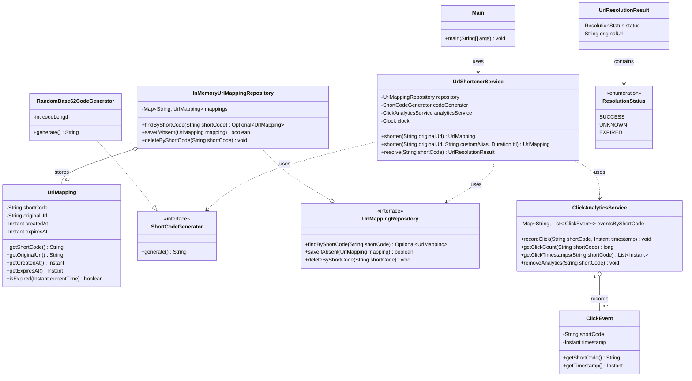
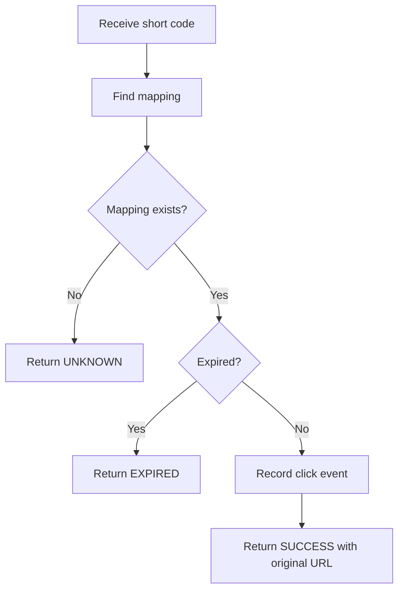

# URL Shortener — UML Class Diagram and Relationships

Phase 3 of the URL Shortener LLD: translating the identified classes and responsibilities into a UML class diagram with
attributes, operations, and relationships.

> **Approach:** finalize the design first; begin implementation only after the class diagram and method contracts are
> clear.

---

## Table of Contents

1. [Objective](#1-objective)
2. [Final Class Inventory](#2-final-class-inventory)
3. [Final UML Class Diagram](#3-final-uml-class-diagram)
4. [Understanding Each Class](#4-understanding-each-class)
5. [Understanding the UML Relationships](#5-understanding-the-uml-relationships)
6. [Important Business Workflows](#6-important-business-workflows)
7. [Package Structure](#7-package-structure)
8. [Design Decisions and Trade-Offs](#8-design-decisions-and-trade-offs)
9. [Edge Cases to Verify](#9-edge-cases-to-verify)
10. [Outside the Current Scope](#10-outside-the-current-scope)
11. [Implementation Roadmap](#11-implementation-roadmap)
12. [Key Takeaways](#12-key-takeaways)
13. [Git Commit Message](#13-git-commit-message)

---

## 1. Objective

**Completed in earlier phases**

- Finalized the functional requirements.
- Clarified the business rules and edge cases.
- Identified the required classes and interfaces.
- Assigned responsibilities to each component.

**Goals of this phase**

1. Define the attributes and operations of each class.
2. Establish relationships between classes.
3. Understand dependency, realization, and aggregation.
4. Finalize how the service collaborates with the repository, code generator, and analytics service.
5. Resolve important design gaps before implementation.

---

## 2. Final Class Inventory

| Component                      | Type            | Responsibility                                   |
|--------------------------------|-----------------|--------------------------------------------------|
| `Main`                         | Class           | Demonstrates the application                     |
| `UrlShortenerService`          | Class           | Coordinates URL shortening and resolution        |
| `UrlMapping`                   | Class           | Represents a short-code-to-original-URL mapping  |
| `ShortCodeGenerator`           | Interface       | Defines the code-generation contract             |
| `RandomBase62CodeGenerator`    | Class           | Generates seven-character Base62 codes           |
| `UrlMappingRepository`         | Interface       | Defines mapping storage operations               |
| `InMemoryUrlMappingRepository` | Class           | Stores mappings in memory                        |
| `ClickEvent`                   | Class           | Represents a successful click event              |
| `ClickAnalyticsService`        | Class           | Records and retrieves click analytics            |
| `UrlResolutionResult`          | Class or record | Represents the outcome of resolving a short code |
| `ResolutionStatus`             | Enum            | Defines the possible resolution outcomes         |

> `UrlResolutionResult` (with `ResolutionStatus`) was **added in this phase** to represent successful, expired, and
> unknown resolution outcomes explicitly.

---

## 3. Final UML Class Diagram



> **Note:** this is a design-level diagram. Exact Java signatures, and whether `UrlResolutionResult` is a record or a
> class, will be finalized during implementation. Dependency arrows are drawn dashed (`..>`) to match standard UML
> dependency notation.

---

## 4. Understanding Each Class

### 4.1 UrlMapping

Represents one association between a short code and an original URL, e.g. `aB3xYz9` →
`https://example.com/articles/java`.

| Attribute     | Type      | Purpose                                                    |
|---------------|-----------|------------------------------------------------------------|
| `shortCode`   | `String`  | Identifies the mapping                                     |
| `originalUrl` | `String`  | Stores the original URL                                    |
| `createdAt`   | `Instant` | Records the creation time                                  |
| `expiresAt`   | `Instant` | Expiration instant, or `null` if the mapping never expires |

**Important decisions**

- The short code is the identity of the mapping.
- Custom aliases and generated codes use the same `UrlMapping` class.
- Code generation is not the mapping's responsibility.
- Analytics are not stored inside the mapping.
- The expiration check accepts the current time as an argument.

**Expiration rule:**

```text
currentTime >= expiresAt      (if expiresAt is null, the mapping never expires)
```

Passing the current time explicitly makes expiration behavior easier to test.

### 4.2 ShortCodeGenerator

Defines the contract for generating a candidate short code via `generate()`.

- The interface does **not** guarantee uniqueness, because a randomly generated code may already exist. The application
  must check availability before saving a mapping.
- **Why an interface?** It separates the code-generation strategy from business logic, so the service can depend on
  `ShortCodeGenerator` without knowing how codes are created.

### 4.3 RandomBase62CodeGenerator

Implements `ShortCodeGenerator`. Generates seven-character codes from 62 characters: `a-z`, `A-Z`, `0-9`. Illustrative
examples: `aB3xYz9`, `K8mP2qR`.

The generator only creates candidates. `UrlShortenerService` checks whether a candidate is available; if it already
exists, the service requests another.

### 4.4 UrlMappingRepository

Defines the operations required to manage mappings:

- `findByShortCode(String shortCode)`
- `saveIfAbsent(UrlMapping mapping)`
- `deleteByShortCode(String shortCode)`

Lookup returns an `Optional<UrlMapping>` so the caller can distinguish found from missing.

The repository does **not** automatically delete expired mappings. Expiration and alias-reclamation decisions belong to
the service. This keeps an expired code distinguishable from an unknown code until its mapping is explicitly reclaimed.

### 4.5 InMemoryUrlMappingRepository

Implements `UrlMappingRepository` using `Map<String, UrlMapping>`, keyed by short code. A map fits because the main
lookup is by short code.

It provides storage operations only, without taking responsibility for URL validation, expiration policy, or analytics.

### 4.6 ClickEvent

Represents one successful click.

| Attribute   | Type      | Purpose                         |
|-------------|-----------|---------------------------------|
| `shortCode` | `String`  | Identifies the mapping accessed |
| `timestamp` | `Instant` | Records when the click occurred |

Each successful resolution creates a separate event (resolving a code three times produces three events). This supports
both click counts and timestamp retrieval.

### 4.7 ClickAnalyticsService

Manages click events. It:

- Records successful clicks.
- Retrieves click counts.
- Retrieves click timestamps.
- Removes analytics when an expired alias is reclaimed.

The click count is derived from recorded events; no separate counter is maintained.

| Resolution outcome    | Record click? |
|-----------------------|---------------|
| Successful resolution | Yes           |
| Unknown short code    | No            |
| Expired mapping       | No            |

The service receives the timestamp explicitly when recording a click. `UrlShortenerService` obtains it from its injected
clock, keeping time handling consistent across the application.

### 4.8 UrlShortenerService

Coordinates the application's business logic. It:

1. Validates original URLs.
2. Validates custom aliases.
3. Applies the duplicate-URL reuse policy.
4. Requests candidate short codes.
5. Checks short-code availability.
6. Creates and stores mappings.
7. Checks mapping expiration.
8. Resolves short codes.
9. Records successful clicks.
10. Reclaims expired custom aliases.

It collaborates with the repository, generator, and analytics service rather than implementing everything itself.

**Why inject `Clock`?** It lets tests use a fixed or adjustable clock instead of waiting for real time to pass, and
ensures expiration and click timestamps come from one consistent time source.

### 4.9 UrlResolutionResult

A resolution request can have several outcomes, and returning only a `String` can't represent them clearly.
`UrlResolutionResult` contains:

- A resolution status.
- The original URL when resolution succeeds.

| Status    | Meaning                                 |
|-----------|-----------------------------------------|
| `SUCCESS` | The mapping exists and is active        |
| `UNKNOWN` | No mapping exists for the supplied code |
| `EXPIRED` | A mapping exists, but it has expired    |

For `UNKNOWN` and `EXPIRED`, the original URL must not be returned as a successful result. This makes behavior explicit
for the `Main` client. A Java **record** is a reasonable implementation since the result mostly carries data.

### 4.10 ResolutionStatus

An enum of the possible resolution outcomes: `SUCCESS`, `UNKNOWN`, `EXPIRED`. Using an enum prevents arbitrary strings
like `"success"` or `"expired"` from circulating and makes the outcomes explicit in code.

### 4.11 Main

The entry point for the hardcoded demonstration. It creates the objects, wires dependencies, and demonstrates behavior.
It must not implement business logic; for example, it calls the service to shorten a URL rather than generating the code
itself.

---

## 5. Understanding the UML Relationships

### 5.1 Dependency

One class **uses** another.

- `Main` uses `UrlShortenerService`.
- `UrlShortenerService` uses `UrlMappingRepository`, `ShortCodeGenerator`, and `ClickAnalyticsService`.

Shown as dashed arrows (`..>`). The service depends on the *interfaces* for generation and storage, not their concrete
implementations.

### 5.2 Realization

A class **implements** an interface. Shown with `..|>`.

- `RandomBase62CodeGenerator` implements `ShortCodeGenerator`.
- `InMemoryUrlMappingRepository` implements `UrlMappingRepository`.

### 5.3 Aggregation

A whole-part relationship where the parts are not necessarily exclusively owned by the whole. Shown with `o--`.

- The repository maintains a collection of `UrlMapping` objects.
- The analytics service maintains a collection of `ClickEvent` objects.

These describe collection membership, not automatic object destruction.

### 5.4 Association with the result enum

`UrlResolutionResult` contains a `ResolutionStatus`, making the result's possible states explicit.

| Relationship | Mermaid notation | Used between                                                 |
|--------------|------------------|--------------------------------------------------------------|
| Dependency   | `..>`            | Main → service; service → repository / generator / analytics |
| Realization  | `..\|>`          | Implementations → their interfaces                           |
| Aggregation  | `o--`            | Repository → mappings; analytics → click events              |
| Association  | `-->`            | Result → status enum                                         |

---

## 6. Important Business Workflows

### 6.1 Shortening a URL

1. Receive the original URL and optional configuration.
2. Validate the URL.
3. Validate the custom alias if one was supplied.
4. Check whether an existing mapping can be reused under the duplicate-URL policy.
5. If a custom alias was supplied, check whether it is available.
6. If an expired alias is being reclaimed, remove the previous mapping and its analytics.
7. Otherwise, generate a candidate code and check its availability.
8. Create a `UrlMapping`.
9. Save the mapping.
10. Return the resulting mapping to the caller.

Generated-code collisions are handled by generating another candidate.

### 6.2 Resolving a short code



An unsuccessful resolution must not create a click event.

### 6.3 Reclaiming an expired alias

Suppose the alias `java-guide` belongs to an expired mapping. When a new request tries to use it:

1. The service finds the existing mapping.
2. It checks the mapping's expiration.
3. If the mapping is still active, the request is rejected.
4. If it has expired, the service removes the old mapping.
5. It removes the old mapping's analytics.
6. It creates and saves the new mapping.

An ordinary lookup must not automatically remove an expired mapping.

---

## 7. Package Structure

All classes live in the `urlshortener` package for the initial implementation. Separate packages per component are
unnecessary at this stage.

```text
src/
└── urlshortener/
    ├── Main.java
    ├── UrlShortenerService.java
    ├── UrlMapping.java
    ├── ShortCodeGenerator.java
    ├── RandomBase62CodeGenerator.java
    ├── UrlMappingRepository.java
    ├── InMemoryUrlMappingRepository.java
    ├── ClickEvent.java
    ├── ClickAnalyticsService.java
    ├── UrlResolutionResult.java
    └── ResolutionStatus.java
```

---

## 8. Design Decisions and Trade-Offs

| Decision                            | Reason                                                                   |
|-------------------------------------|--------------------------------------------------------------------------|
| `UrlMapping` as the domain entity   | Represents a short-code-to-URL mapping                                   |
| `ShortCodeGenerator`                | Separates the generation contract from its implementation                |
| `UrlMappingRepository`              | Separates business logic from storage                                    |
| In-memory map                       | Meets current requirements without a database                            |
| Keep analytics separate             | Supports click counts and timestamps without bloating the mapping entity |
| `UrlShortenerService`               | Coordinates the business workflows                                       |
| `Clock` injection                   | Makes expiration and timestamp behavior deterministic in tests           |
| `UrlResolutionResult`               | Represents successful, expired, and unknown outcomes explicitly          |
| `ResolutionStatus`                  | Restricts resolution outcomes to defined values                          |
| Validation in the service initially | Avoids unnecessary validator classes                                     |
| Hardcoded `Main` client             | Demonstrates behavior without REST or a CLI menu                         |
| Sequential application              | Avoids unnecessary concurrency complexity                                |

---

## 9. Edge Cases to Verify

**Code generation**

- A generated code already exists.
- A generated code conflicts with a custom alias.
- A generated code is regenerated after a collision.

**Custom aliases**

- Alias is shorter than three characters.
- Alias exceeds thirty characters.
- Alias contains unsupported characters.
- Alias is reserved.
- Alias is already used by an active mapping.
- Alias belongs to an expired mapping and is being reclaimed.

**Expiration**

- Mapping never expires.
- Mapping has not expired yet.
- Current time equals expiration time.
- Mapping has expired.
- An expired mapping is accessed before being reclaimed.

**Resolution**

- A valid active code resolves successfully.
- An unknown code returns `UNKNOWN`.
- An expired code returns `EXPIRED`.

**Analytics**

- Successful resolution records one event.
- Failed resolution records no event.
- Click count matches the number of events.
- Timestamps can be retrieved.
- Reclaiming an expired alias removes its old analytics.

---

## 10. Outside the Current Scope

- Database persistence
- REST endpoints or actual HTTP redirects
- A web interface
- A command-line menu
- User accounts or authentication
- Distributed deployment
- Concurrency guarantees
- Background expiration cleanup
- External URL reachability checks
- Advanced click analytics

These can be added later if requirements expand.

---

## 11. Implementation Roadmap

1. Finalize functional requirements.
2. Clarify business rules and edge cases.
3. Identify classes and interfaces.
4. Assign responsibilities.
5. Define UML relationships.
6. Design the resolution result type.
7. Define the package structure.
8. Implement `UrlMapping`.
9. Implement `ResolutionStatus` and `UrlResolutionResult`.
10. Implement `ShortCodeGenerator` and `RandomBase62CodeGenerator`.
11. Implement `UrlMappingRepository` and `InMemoryUrlMappingRepository`.
12. Implement `ClickEvent` and `ClickAnalyticsService`.
13. Implement `UrlShortenerService`.
14. Implement `Main`.
15. Demonstrate the required scenarios.

---

## 12. Key Takeaways

1. A class diagram communicates both structure and relationships.
2. Interfaces let business logic depend on contracts instead of concrete implementations.
3. Repository and service responsibilities should remain separate.
4. A generated short code is only a candidate until its availability is checked.
5. Mapping expiration and analytics lifecycle must follow explicit business rules.
6. Unknown and expired codes are different outcomes and should be represented separately.
7. Injecting `Clock` makes time-dependent behavior testable.
8. A design should satisfy current requirements without unnecessary classes.
9. Implementation should follow the dependency structure established in the class diagram.

