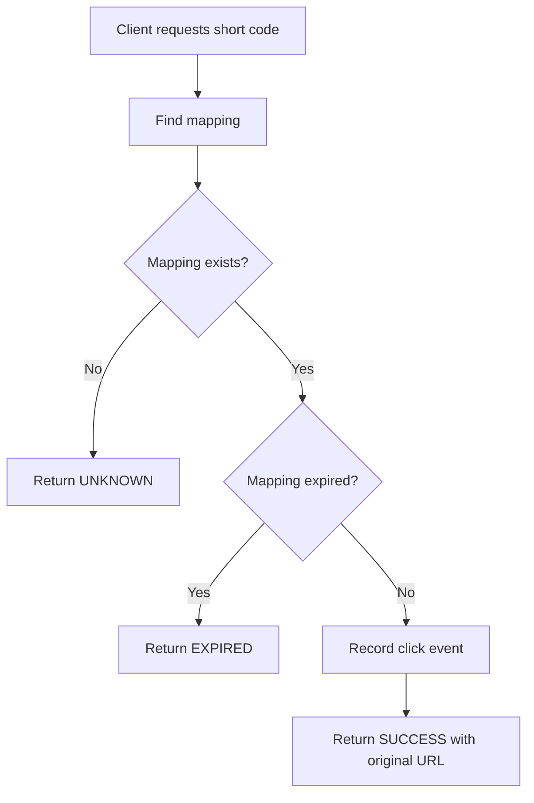
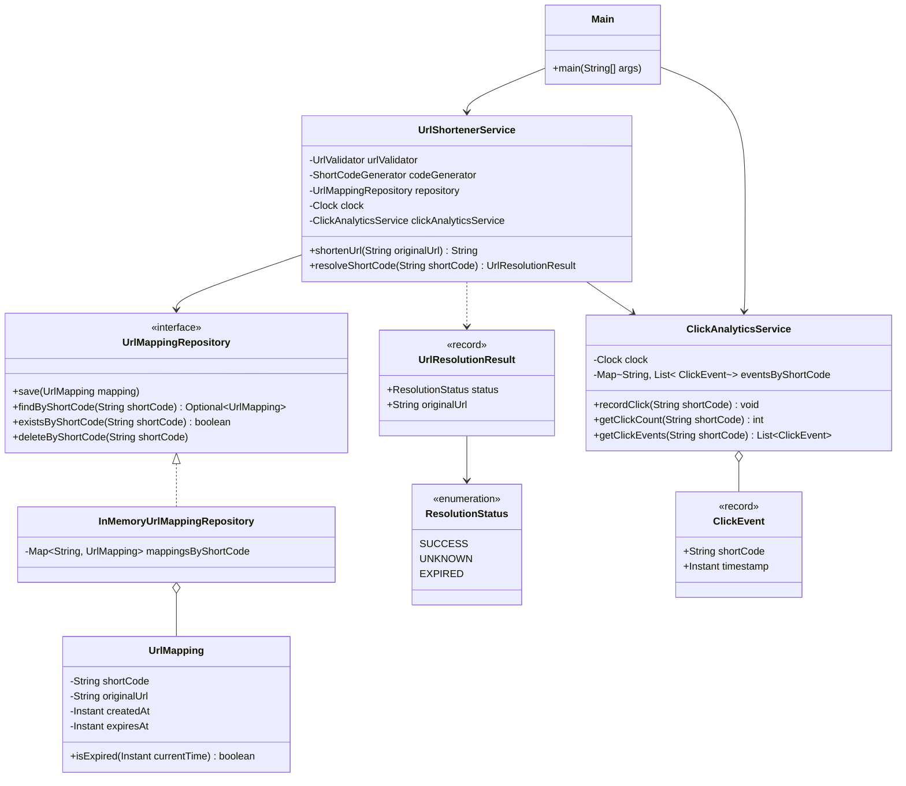

# URL Shortener — Phase 9: Click Analytics

> Tracks how frequently each short URL is accessed by recording a timestamped event for every successful resolution.

## Table of Contents

1. [Objective](#1-objective)
2. [Identify the Classes](#2-identify-the-classes)
3. [Implement `ClickEvent.java`](#3-implement-clickeventjava)
4. [Implement `ClickAnalyticsService.java`](#4-implement-clickanalyticsservicejava)
5. [Integrate Analytics with `UrlShortenerService`](#5-integrate-analytics-with-urlshortenerservice)
6. [Complete `Main.java`](#6-complete-mainjava)
7. [Updated UML Class Diagram](#7-updated-uml-class-diagram)
8. [Complexity Analysis](#8-complexity-analysis)
9. [Design Decisions](#9-design-decisions)
10. [Phase 9 Checklist](#10-phase-9-checklist)
11. [What's Next?](#11-whats-next)

---

## 1. Objective

In Phase 8, we implemented short-code resolution. The service can now retrieve the original URL for a valid short code.

In this phase, we extend the URL shortener to track how frequently each short URL is accessed.

**Example**

- Short URL: `https://short.ly/aB12xYz`
- Number of successful resolutions: `3`
- Click history: three events, each containing a timestamp.

### Requirements

The analytics implementation must:

- Record each successful short-code resolution.
- Store the short code associated with each event.
- Record the timestamp of each event.
- Retrieve the total number of recorded clicks for a short code.
- Retrieve the click-event history for a short code.
- Avoid recording unknown or expired short codes.
- Keep analytics separate from URL mapping responsibilities.
- Use an injected `Clock` for timestamps.

### Scope

We continue using in-memory storage and a Java `Main` client. We do **not** introduce a database, HTTP server, REST API,
or testing framework.

---

## 2. Identify the Classes

We introduce two new classes and update an existing service.

| Class                   | Responsibility                                         |
|-------------------------|--------------------------------------------------------|
| `ClickEvent`            | Represents one successful short-code resolution event. |
| `ClickAnalyticsService` | Records click events and retrieves analytics.          |
| `UrlShortenerService`   | Integrates analytics into short-code resolution.       |

### Why keep analytics separate?

`UrlMapping` represents the relationship between a short code and an original URL. Analytics represents the *activity*
associated with that short code.

Keeping them separate lets analytics evolve independently. For example, we could later add daily statistics, click
history, or a dedicated analytics database without changing the URL mapping's core responsibilities.

---

## 3. Implement `ClickEvent.java`

**File:** `src/urlshortener/ClickEvent.java`

```java
package urlshortener;

import java.time.Instant;
import java.util.Objects;

public record ClickEvent(
        String shortCode,
        Instant timestamp
) {
    public ClickEvent {
        Objects.requireNonNull(
                shortCode,
                "shortCode cannot be null"
        );

        Objects.requireNonNull(
                timestamp,
                "timestamp cannot be null"
        );

        if (shortCode.isBlank()) {
            throw new IllegalArgumentException(
                    "shortCode cannot be blank"
            );
        }
    }
}
```

### Why use a record?

A click event is a simple data carrier. Java records automatically provide:

- A constructor.
- Accessors such as `shortCode()` and `timestamp()`.
- `equals()`, `hashCode()`, and `toString()`.

Records also make their component fields final, so the event's references cannot be reassigned after construction.

```java
ClickEvent event = new ClickEvent(
        "aB12xYz",
        Instant.now()
);

System.out.

println(event.shortCode());
        System.out.

println(event.timestamp());
```

The timestamp represents when the event was recorded. In the actual service, we use the injected `Clock` rather than
calling `Instant.now()` directly.

---

## 4. Implement `ClickAnalyticsService.java`

**File:** `src/urlshortener/ClickAnalyticsService.java`

We need a data structure that associates each short code with its click events. A suitable choice is:

```java
Map<String, List<ClickEvent>>
```

The key is the short code; the value is the list of events recorded for that code.

```java
package urlshortener;

import java.time.Clock;
import java.util.ArrayList;
import java.util.HashMap;
import java.util.List;
import java.util.Map;
import java.util.Objects;

public class ClickAnalyticsService {

    private final Clock clock;
    private final Map<String, List<ClickEvent>> eventsByShortCode =
            new HashMap<>();

    public ClickAnalyticsService(Clock clock) {
        this.clock = Objects.requireNonNull(
                clock,
                "clock cannot be null"
        );
    }

    public void recordClick(String shortCode) {
        ClickEvent event = new ClickEvent(
                shortCode,
                clock.instant()
        );

        eventsByShortCode
                .computeIfAbsent(
                        shortCode,
                        key -> new ArrayList<>()
                )
                .add(event);
    }

    public int getClickCount(String shortCode) {
        return eventsByShortCode
                .getOrDefault(shortCode, List.of())
                .size();
    }

    public List<ClickEvent> getClickEvents(String shortCode) {
        return List.copyOf(
                eventsByShortCode.getOrDefault(
                        shortCode,
                        List.of()
                )
        );
    }
}
```

### 4.1 Understanding the data structure

Conceptually, the map stores:

```text
eventsByShortCode
|
|-- "aB12xYz"
|       |
|       |-- ClickEvent(timestamp1)
|       |-- ClickEvent(timestamp2)
|       |-- ClickEvent(timestamp3)
|
|-- "pQ45mNr"
        |
        |-- ClickEvent(timestamp1)
        |-- ClickEvent(timestamp2)
```

Every short code can have multiple click events.

### 4.2 `recordClick()`

```java
public void recordClick(String shortCode) {
    ClickEvent event = new ClickEvent(
            shortCode,
            clock.instant()
    );

    eventsByShortCode
            .computeIfAbsent(
                    shortCode,
                    key -> new ArrayList<>()
            )
            .add(event);
}
```

The method:

1. Creates a new event.
2. Captures the current timestamp.
3. Retrieves the list associated with the short code.
4. Creates a new list if necessary.
5. Appends the event.

`computeIfAbsent()` creates the list only when the map does not already contain one for that key.

### 4.3 `getClickCount()`

```java
public int getClickCount(String shortCode) {
    return eventsByShortCode
            .getOrDefault(shortCode, List.of())
            .size();
}
```

Returns the number of recorded events, or `0` if the short code has none. The count is derived from the event list
rather than maintained as a separate counter.

### 4.4 `getClickEvents()`

```java
public List<ClickEvent> getClickEvents(String shortCode) {
    return List.copyOf(
            eventsByShortCode.getOrDefault(
                    shortCode,
                    List.of()
            )
    );
}
```

Returns an **immutable snapshot** of the events for the short code. Callers can inspect the events without modifying the
internal list maintained by the analytics service.

---

## 5. Integrate Analytics with `UrlShortenerService`

The analytics service exists, but it does not yet receive any events. We need to integrate it with `resolveShortCode()`.

> **Business rule:** Only *successful* resolutions are recorded. An unknown or expired short code must **not** increment
> the click count.

### Resolution flow



### Step 1: Add the analytics dependency

Add this field to `UrlShortenerService`:

```java
private final ClickAnalyticsService clickAnalyticsService;
```

### Step 2: Update the constructor

Add `ClickAnalyticsService` as a constructor parameter and initialize it:

```java
public UrlShortenerService(
        UrlValidator urlValidator,
        ShortCodeGenerator codeGenerator,
        UrlMappingRepository repository,
        Clock clock,
        ClickAnalyticsService clickAnalyticsService
) {
    this.urlValidator = Objects.requireNonNull(
            urlValidator,
            "urlValidator cannot be null"
    );
    this.codeGenerator = Objects.requireNonNull(
            codeGenerator,
            "codeGenerator cannot be null"
    );
    this.repository = Objects.requireNonNull(
            repository,
            "repository cannot be null"
    );
    this.clock = Objects.requireNonNull(
            clock,
            "clock cannot be null"
    );
    this.clickAnalyticsService = Objects.requireNonNull(
            clickAnalyticsService,
            "clickAnalyticsService cannot be null"
    );
}
```

The constructor now receives all dependencies the service requires.

### Step 3: Update `resolveShortCode()`

```java
public UrlResolutionResult resolveShortCode(String shortCode) {
    if (shortCode == null || shortCode.isBlank()) {
        return UrlResolutionResult.unknown();
    }

    UrlMapping mapping = repository.findByShortCode(shortCode)
            .orElse(null);

    if (mapping == null) {
        return UrlResolutionResult.unknown();
    }

    if (mapping.isExpired(clock.instant())) {
        return UrlResolutionResult.expired();
    }

    clickAnalyticsService.recordClick(shortCode);

    return UrlResolutionResult.success(mapping.getOriginalUrl());
}
```

The only new operation is:

```java
clickAnalyticsService.recordClick(shortCode);
```

It runs after the mapping has been found and confirmed active, so unknown and expired mappings never generate click
events.

> **Important observation:** In this implementation, a "click" means a successful call to `resolveShortCode()`. It does
> not necessarily mean a browser completed an HTTP redirect, since no HTTP server exists yet.

---

## 6. Complete `Main.java`

**File:** `src/urlshortener/Main.java`

The client will:

1. Shorten a URL.
2. Resolve the generated short code three times.
3. Attempt to resolve an unknown code.
4. Print the click count.
5. Print the recorded events.

```java
package urlshortener;

import java.time.Clock;

public class Main {

    public static void main(String[] args) {
        Clock clock = Clock.systemUTC();

        UrlValidator urlValidator = new UrlValidator();
        ShortCodeGenerator codeGenerator =
                new RandomBase62CodeGenerator();
        UrlMappingRepository repository =
                new InMemoryUrlMappingRepository();
        ClickAnalyticsService analyticsService =
                new ClickAnalyticsService(clock);

        UrlShortenerService service = new UrlShortenerService(
                urlValidator,
                codeGenerator,
                repository,
                clock,
                analyticsService
        );

        String originalUrl =
                "https://example.com/products/electronics";

        // Shorten the URL.
        String shortCode = service.shortenUrl(originalUrl);

        System.out.println("Short code: " + shortCode);

        // Resolve it three times.
        for (int i = 1; i <= 3; i++) {
            UrlResolutionResult result =
                    service.resolveShortCode(shortCode);

            System.out.println(
                    "Resolution " + i + ": " + result.status()
            );
        }

        // Attempt to resolve an unknown code.
        UrlResolutionResult unknownResult =
                service.resolveShortCode("unknown123");

        System.out.println(
                "\nUnknown code status: " + unknownResult.status()
        );

        // Display analytics.
        System.out.println(
                "\nTotal clicks: " +
                        analyticsService.getClickCount(shortCode)
        );

        System.out.println("Click events:");

        for (ClickEvent event :
                analyticsService.getClickEvents(shortCode)) {
            System.out.println(
                    event.shortCode() + " -> " + event.timestamp()
            );
        }

        System.out.println(
                "\nUnknown code clicks: " +
                        analyticsService.getClickCount("unknown123")
        );
    }
}
```

### Expected output

The short code and timestamps vary between executions; the values below are illustrative.

```text
Short code: aB12xYz
Resolution 1: SUCCESS
Resolution 2: SUCCESS
Resolution 3: SUCCESS

Unknown code status: UNKNOWN

Total clicks: 3
Click events:
aB12xYz -> 2026-10-27T04:00:00Z
aB12xYz -> 2026-10-27T04:00:01Z
aB12xYz -> 2026-10-27T04:00:02Z

Unknown code clicks: 0
```

The unknown code has zero clicks because the service returns `UNKNOWN` before invoking `recordClick()`.

---

## 7. Updated UML Class Diagram



### Relationships

- `Main` creates and connects the services.
- `UrlShortenerService` uses `UrlMappingRepository` to retrieve mappings.
- `UrlShortenerService` delegates event recording and analytics queries to `ClickAnalyticsService`.
- `ClickAnalyticsService` stores `ClickEvent` objects.
- `InMemoryUrlMappingRepository` stores `UrlMapping` objects.
- `UrlResolutionResult` represents the outcome of a resolution.

The URL mapping repository and analytics service remain independent of each other's storage structures.

---

## 8. Complexity Analysis

Let *k* be the number of click events for a particular short code.

| Operation                                            | Average time complexity |
|------------------------------------------------------|-------------------------|
| Record a click                                       | O(1) amortized          |
| Retrieve click count                                 | O(1)                    |
| Retrieve all click events                            | O(*k*)                  |
| Resolve a short code (excluding event-list resizing) | O(1) average            |

`getClickEvents()` takes O(*k*) because `List.copyOf()` creates a snapshot of the matching events.

### Space complexity

Let *N* be the total number of click events recorded across all short codes. The analytics service requires **O(*N*)**
space for its event data, excluding map and list overhead.

Every successful resolution adds one event, so memory grows with the number of recorded resolutions. A high-traffic
production system would need a persistent event store, retention policies, aggregation, or another strategy to prevent
unbounded memory growth.

---

## 9. Design Decisions

### 9.1 Why store events instead of just a counter?

An alternative would be:

```java
Map<String, Integer> clickCounts;
```

That is sufficient if the only requirement is counting clicks. Storing individual events additionally provides:

- Total click count.
- Individual event timestamps.
- The ability to calculate daily or hourly statistics.
- The ability to inspect click history.

The trade-off is increased storage consumption.

### 9.2 Why inject `Clock`?

Both services receive a `Clock`. This provides a consistent source of time and makes timestamp behavior controllable in
future tests. A fixed or adjustable clock can verify that events receive the expected timestamps.

### 9.3 Why return an immutable list?

`getClickEvents()` uses `List.copyOf()`, which prevents callers from adding or removing elements through the returned
list and altering the service's internal collection. The snapshot does not change when new events are recorded later.

### 9.4 Does every request count as a click?

Not necessarily. The current implementation counts successful calls to `resolveShortCode()`. A production service may
need additional rules for:

- Bots and crawlers.
- Repeated requests.
- Monitoring traffic.
- Retries.
- Whether to count an access before or after the HTTP redirect succeeds.

These policies are outside the current scope.

### 9.5 Is the implementation thread-safe?

**No.** It uses `HashMap` and `ArrayList` without synchronization. That is fine for this sequential learning example,
but a concurrent production service would need a thread-safe design and appropriate persistence guarantees.

---

## 10. Phase 9 Checklist

- [x] Identify the responsibilities of the analytics classes.
- [x] Implement `ClickEvent`.
- [x] Implement `ClickAnalyticsService`.
- [x] Store events by short code.
- [x] Record timestamps using `Clock`.
- [x] Retrieve click counts.
- [x] Retrieve click-event history.
- [x] Integrate analytics into `UrlShortenerService`.
- [x] Record events only for successful resolutions.
- [x] Demonstrate analytics through `Main.java`.
- [x] Update the UML class diagram.
- [x] Analyze time and space complexity.
- [x] Document design decisions and limitations.

---

## 11. What's Next?

### Phase 10: Custom Aliases

So far, the URL shortener generates a random short code for each new URL. In the next phase, we'll let users request a
meaningful alias.

```text
Original URL:
https://example.com/products/electronics

Requested alias:
electronics

Short URL:
https://short.ly/electronics
```

We'll implement:

- Custom alias support.
- Alias validation.
- Minimum and maximum alias lengths.
- Allowed characters.
- Reserved aliases.
- Collision handling.
- A shared namespace for generated codes and custom aliases.
- Protection against overwriting an existing active mapping.

We'll also consider how expired aliases should behave when a user requests them again.