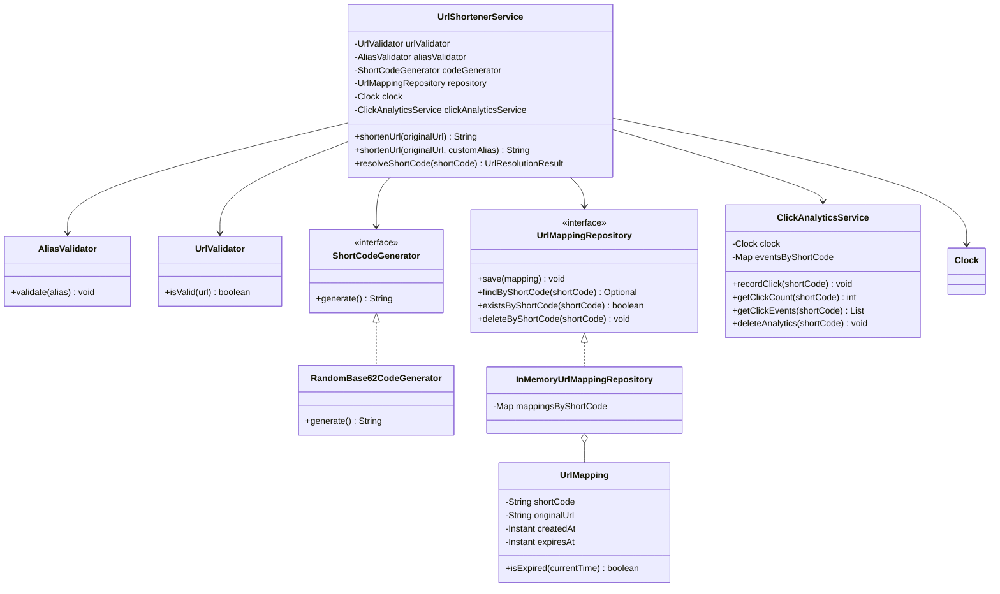

# URL Shortener — Phase 10: Custom Aliases

> Lets users choose their own memorable alias instead of a random short code, with validation, reserved names, conflict
> detection, and expired-alias reclamation.

## Table of Contents

1. [Objective](#1-objective)
2. [Requirements and Business Rules](#2-requirements-and-business-rules)
3. [Design Approach](#3-design-approach)
4. [Implementing `AliasValidator`](#4-implementing-aliasvalidator)
5. [Updating `ClickAnalyticsService`](#5-updating-clickanalyticsservice)
6. [Updating `UrlShortenerService`](#6-updating-urlshortenerservice)
7. [Updating `Main`](#7-updating-main)
8. [Updated Class Diagram](#8-updated-class-diagram)
9. [Complexity Analysis](#9-complexity-analysis)
10. [Important Design Decisions](#10-important-design-decisions)
11. [Practice Checklist](#11-practice-checklist)
12. [Current Implementation Status](#12-current-implementation-status)

---

## 1. Objective

In previous phases, we built a URL shortener that generates a random short code for a given URL.

- Original URL: `https://www.example.com/products/electronics/mobile-phones`
- Generated short code: `aB7xK2p`

Random codes are not always easy to remember, so we want users to create their own aliases.

- Original URL: `https://www.example.com/products/electronics/mobile-phones`
- Custom alias: `electronics`

The resulting short URL is conceptually:

```text
https://short.example/electronics
```

> In our Java implementation, we store and return the alias. No HTTP server or actual browser redirect is implemented.

### Goals

By the end of this phase, we support:

- Creating a short URL with a custom alias.
- Validating aliases.
- Rejecting reserved aliases.
- Preventing an active alias from being overwritten.
- Allowing an expired alias to be reclaimed.
- Removing old click analytics when an expired alias is reclaimed.
- Resolving custom aliases using the existing resolution mechanism.

---

## 2. Requirements and Business Rules

Before implementation, we define the rules for custom aliases.

### 2.1 Alias length

An alias must contain **3 to 30 characters**, inclusive.

| Alias                                       | Valid? | Reason                     |
|---------------------------------------------|--------|----------------------------|
| `docs`                                      | Yes    | Within range               |
| `shop123`                                   | Yes    | Within range               |
| `my-blog`                                   | Yes    | Within range               |
| `user_profile`                              | Yes    | Within range               |
| `ab`                                        | No     | Fewer than 3 characters    |
| `this-alias-is-far-too-long-to-be-accepted` | No     | Exceeds the maximum length |

### 2.2 Allowed characters

Aliases may contain:

- Uppercase letters: `A-Z`
- Lowercase letters: `a-z`
- Digits: `0-9`
- Hyphens: `-`
- Underscores: `_`

Regular expression:

```regex
[a-zA-Z0-9_-]+
```

| Alias     | Valid? | Reason                 |
|-----------|--------|------------------------|
| `shop123` | Yes    | Letters and digits     |
| `my-blog` | Yes    | Letters and hyphen     |
| `my_blog` | Yes    | Letters and underscore |
| `my blog` | No     | Contains a space       |
| `my@blog` | No     | Contains `@`           |
| `my.blog` | No     | Contains a period      |

### 2.3 Reserved aliases

Certain aliases must not be available to users because they may conflict with application routes:

`admin`, `api`, `login`, `logout`, `register`, `signup`, `signin`, `help`, `support`, `about`, `terms`, `privacy`

Reserved-alias validation is **case-insensitive**. For example, `admin`, `ADMIN`, and `Admin` are all rejected.

### 2.4 Alias uniqueness

An alias must not overwrite an existing **active** mapping.

Suppose the repository contains:

```text
electronics -> https://example.com/old-products
```

A user attempts to create:

```text
electronics -> https://example.com/new-products
```

The request must **fail** because the alias is already in use. The service must not silently replace the original
mapping.

### 2.5 Expired aliases

An expired alias can be **reclaimed**:

1. An alias named `electronics` points to URL A.
2. Its mapping expires.
3. A user requests `electronics` for URL B.
4. The service removes the expired mapping and its associated analytics.
5. The new mapping is saved.

> TTL-based expiration is implemented in a later phase. The current implementation establishes the reclamation behavior,
> but its normal creation methods currently create mappings without expiration.

### 2.6 Shared namespace

Generated short codes and custom aliases use the **same namespace**. If a generated code is `shop123`, a user cannot
create a custom alias `shop123` while that mapping remains active.

This works because both are stored in the same repository, keyed by short code.

### 2.7 Alias case sensitivity

Aliases are **case-sensitive** when identifying mappings. `MyShop` and `myshop` are different aliases. Reserved-alias
checks, however, remain case-insensitive.

---

## 3. Design Approach

We introduce an `AliasValidator` class responsible for validating aliases. The existing `UrlShortenerService`
coordinates the operation.

Overall flow:

1. Validate the original URL.
2. Validate the requested alias.
3. Search the repository for the alias.
4. If the alias is actively in use, reject the request.
5. If the existing mapping has expired, delete the old mapping and its analytics.
6. Create a new `UrlMapping`.
7. Save it in the repository.
8. Return the alias.

No separate repository for custom aliases is needed, because aliases and generated codes share the same storage model.

---

## 4. Implementing `AliasValidator`

**File:** `src/urlshortener/AliasValidator.java`

The class validates alias length, allowed characters, and reserved names.

```java
package urlshortener;

import java.util.Locale;
import java.util.Objects;
import java.util.Set;
import java.util.regex.Pattern;

public class AliasValidator {

    private static final int MIN_LENGTH = 3;
    private static final int MAX_LENGTH = 30;

    private static final Pattern VALID_ALIAS_PATTERN =
            Pattern.compile("[a-zA-Z0-9_-]+");

    private static final Set<String> RESERVED_ALIASES = Set.of(
            "admin",
            "api",
            "login",
            "logout",
            "register",
            "signup",
            "signin",
            "help",
            "support",
            "about",
            "terms",
            "privacy"
    );

    public void validate(String alias) {
        Objects.requireNonNull(alias, "alias cannot be null");

        if (alias.length() < MIN_LENGTH
                || alias.length() > MAX_LENGTH) {
            throw new IllegalArgumentException(
                    "Alias length must be between 3 and 30 characters"
            );
        }

        if (!VALID_ALIAS_PATTERN.matcher(alias).matches()) {
            throw new IllegalArgumentException(
                    "Alias can contain only letters, digits, hyphens, and underscores"
            );
        }

        if (RESERVED_ALIASES.contains(
                alias.toLowerCase(Locale.ROOT))) {
            throw new IllegalArgumentException(
                    "Alias is reserved: " + alias
            );
        }
    }
}
```

### Why use a separate validator?

Alias validation is a distinct responsibility. Without a separate class, `UrlShortenerService` would need to manage:

- URL validation.
- Alias length checks.
- Alias character checks.
- Reserved-name checks.
- Short-code generation.
- Mapping persistence.
- Resolution.
- Analytics.

Keeping alias validation separate makes the service easier to understand and maintain.

### Why use `Locale.ROOT`?

We want reserved-name comparison to be independent of the machine's default locale.

```java
alias.toLowerCase(Locale.ROOT)
```

This converts the alias to a predictable lowercase form before checking the reserved-name set. The original alias is *
*not** converted before saving, so mapping lookup remains case-sensitive.

---

## 5. Updating `ClickAnalyticsService`

The analytics service stores click events by short code. When an expired alias is reclaimed, its old click history
should not be attributed to the new URL.

Add this method to `ClickAnalyticsService.java`:

```java
public void deleteAnalytics(String shortCode) {
    Objects.requireNonNull(
            shortCode,
            "shortCode cannot be null"
    );

    eventsByShortCode.remove(shortCode);
}
```

### Why remove analytics?

Consider this sequence:

1. `electronics` points to URL A.
2. URL A receives 100 successful resolutions.
3. The mapping expires.
4. `electronics` is reclaimed for URL B.

If the old analytics were retained, URL B would incorrectly appear to have received those 100 clicks. Removing them on
reclamation ensures the new mapping starts with a fresh history.

> **Important:** Analytics are removed when *reclamation* occurs, not merely when a mapping expires. Until reclamation,
> analytics for the expired mapping remain stored.

---

## 6. Updating `UrlShortenerService`

The service now depends on six collaborators:

- `UrlValidator`
- `AliasValidator`
- `ShortCodeGenerator`
- `UrlMappingRepository`
- `Clock`
- `ClickAnalyticsService`

Update the constructor accordingly:

```java
public UrlShortenerService(
        UrlValidator urlValidator,
        AliasValidator aliasValidator,
        ShortCodeGenerator codeGenerator,
        UrlMappingRepository repository,
        Clock clock,
        ClickAnalyticsService clickAnalyticsService
)
```

Store each dependency in a corresponding `private final` field and validate constructor arguments with
`Objects.requireNonNull`. The existing generated-code shortening and resolution methods remain available.

### 6.1 Adding the custom-alias overload

Add this method to `UrlShortenerService.java`:

```java
public String shortenUrl(String originalUrl, String customAlias) {
    if (!urlValidator.isValid(originalUrl)) {
        throw new IllegalArgumentException(
                "Invalid URL: " + originalUrl
        );
    }

    aliasValidator.validate(customAlias);

    UrlMapping existingMapping = repository
            .findByShortCode(customAlias)
            .orElse(null);

    if (existingMapping != null) {
        if (!existingMapping.isExpired(clock.instant())) {
            throw new IllegalArgumentException(
                    "Alias is already in use: " + customAlias
            );
        }

        repository.deleteByShortCode(customAlias);
        clickAnalyticsService.deleteAnalytics(customAlias);
    }

    UrlMapping mapping = new UrlMapping(
            customAlias,
            originalUrl,
            clock.instant(),
            null
    );

    repository.save(mapping);

    return customAlias;
}
```

### 6.2 Understanding the implementation

| Step                           | What happens                                                                                                                                   |
|--------------------------------|------------------------------------------------------------------------------------------------------------------------------------------------|
| 1. Validate the URL            | An invalid original URL is rejected before any mapping is created.                                                                             |
| 2. Validate the alias          | Length, allowed characters, and reserved status are checked.                                                                                   |
| 3. Find an existing mapping    | Because aliases and generated codes share a namespace, this lookup also detects conflicts with generated codes.                                |
| 4. Reject an active mapping    | If the mapping exists and has not expired, an `IllegalArgumentException` is thrown. The mapping is **not** overwritten.                        |
| 5. Reclaim an expired mapping  | If the existing mapping has expired, both the mapping and its analytics are removed so the alias can be reused.                                |
| 6. Create and save the mapping | A new `UrlMapping` is created with the alias as its short code. `expiresAt` is `null`, so it does not expire under the current implementation. |
| 7. Return the alias            | The chosen alias is returned to the caller.                                                                                                    |

### 6.3 Why reuse `UrlMapping`?

A custom alias does not require a different domain model. Generated codes and custom aliases share the same essential
properties:

- Short code.
- Original URL.
- Creation time.
- Optional expiration time.

The only difference is how the short code is obtained: generated codes come from `ShortCodeGenerator`, while custom
aliases come from the caller. That is why both can use the same `UrlMapping` class and repository.

---

## 7. Updating `Main`

`Main` demonstrates how the components work together. Create the dependencies and pass them into `UrlShortenerService`.

```java
package urlshortener;

import java.time.Clock;

public class Main {

    public static void main(String[] args) {
        Clock clock = Clock.systemUTC();

        UrlValidator urlValidator = new UrlValidator();
        AliasValidator aliasValidator = new AliasValidator();
        ShortCodeGenerator codeGenerator =
                new RandomBase62CodeGenerator();
        UrlMappingRepository repository =
                new InMemoryUrlMappingRepository();
        ClickAnalyticsService clickAnalyticsService =
                new ClickAnalyticsService(clock);

        UrlShortenerService service = new UrlShortenerService(
                urlValidator,
                aliasValidator,
                codeGenerator,
                repository,
                clock,
                clickAnalyticsService
        );

        String originalUrl =
                "https://www.example.com/products/electronics";

        // Generate a random short code.
        String generatedCode = service.shortenUrl(originalUrl);
        System.out.println("Generated code: " + generatedCode);

        // Create a custom alias.
        String customAlias = service.shortenUrl(
                originalUrl,
                "electronics"
        );
        System.out.println("Custom alias: " + customAlias);

        // Resolve the custom alias.
        UrlResolutionResult result =
                service.resolveShortCode(customAlias);

        if (result.status() == ResolutionStatus.SUCCESS) {
            System.out.println(
                    "Resolved URL: " + result.originalUrl()
            );
        }

        // Display click analytics.
        System.out.println(
                "Alias click count: "
                        + clickAnalyticsService.getClickCount(customAlias)
        );

        // Attempt to reuse an active alias.
        try {
            service.shortenUrl(
                    "https://www.example.com/another-page",
                    "electronics"
            );
        } catch (IllegalArgumentException exception) {
            System.out.println(
                    "Alias rejected: " + exception.getMessage()
            );
        }
    }
}
```

### Expected behavior

- The generated code differs on each run.
- The custom alias `electronics` is returned as requested.
- Its first successful resolution records a click event, so its click count is **1**.
- The final operation is rejected because the alias is already active.

---

## 8. Updated Class Diagram

The custom-alias implementation introduces `AliasValidator` and adds an analytics-cleanup operation.



### Key relationships

- `UrlShortenerService` coordinates shortening and resolution.
- `AliasValidator` validates caller-provided aliases.
- `UrlValidator` validates original URLs.
- `ShortCodeGenerator` generates random codes when no alias is provided.
- `UrlMappingRepository` abstracts mapping persistence.
- `ClickAnalyticsService` records successful resolutions and maintains click history.
- `UrlMapping` represents both generated-code mappings and custom-alias mappings.

---

## 9. Complexity Analysis

Let:

- *n* = number of mappings stored in the repository
- *k* = number of click events for a particular short code
- *a* = length of the alias

The repository uses a `HashMap`.

| Operation             | Average-case time | Explanation                               |
|-----------------------|-------------------|-------------------------------------------|
| Validate alias        | O(*a*)            | Length, pattern, and reserved-name checks |
| Find existing mapping | O(1)              | Hash-map lookup                           |
| Save mapping          | O(1)              | Hash-map insertion                        |
| Delete mapping        | O(1)              | Hash-map deletion                         |
| Delete analytics      | O(1)              | Removes the analytics entry from the map  |
| Get click count       | O(1)              | Reads the stored event list and its size  |
| Get click events      | O(*k*)            | Copies the events into an immutable list  |

Alias validation is linear in alias length because pattern matching must inspect the input; with a maximum length of 30,
this cost is small. Hash-map operations are average-case O(1), not unconditional worst-case guarantees.

---

## 10. Important Design Decisions

### 10.1 One repository for generated codes and aliases

We do not create a separate alias repository. Both kinds of identifier are stored as `UrlMapping.shortCode`, which
naturally enforces a shared namespace during sequential execution.

### 10.2 Separate alias validation

`AliasValidator` owns alias-specific rules, while `UrlValidator` owns URL-specific rules. This keeps validation
responsibilities clear.

### 10.3 Active aliases cannot be overwritten

The service rejects duplicate active aliases instead of silently replacing their destination. This prevents a caller
from unexpectedly changing the destination of an existing short URL.

### 10.4 Expired aliases can be reclaimed

An expired mapping is removed only when a caller attempts to reuse its alias. Its click analytics are removed at the
same time.

### 10.5 No expiration configuration yet

The custom-alias method currently creates mappings with `expiresAt = null`, so mappings created through it do not
expire. TTL support will be added in a later phase.

### 10.6 Sequential implementation only

This implementation is intended for learning and a single-process demonstration. Two concurrent requests could both
check that an alias is available before either saves it. The repository has no atomic create-if-absent operation, so
alias uniqueness is **not guaranteed under concurrent access**.

A production implementation would need atomic uniqueness enforcement, typically through a database unique constraint or
an equivalent concurrency-safe storage operation.

---

## 11. Practice Checklist

Use this checklist to verify your understanding and implementation.

### Alias validation

- [ ] Accept aliases with valid lengths.
- [ ] Reject aliases shorter than 3 characters.
- [ ] Reject aliases longer than 30 characters.
- [ ] Accept letters, digits, hyphens, and underscores.
- [ ] Reject spaces and unsupported special characters.
- [ ] Reject reserved aliases regardless of letter case.

### Custom alias creation

- [ ] Create a mapping using a custom alias.
- [ ] Reject an invalid original URL.
- [ ] Reject an invalid alias.
- [ ] Reject an alias already used by an active mapping.
- [ ] Reject an alias that conflicts with an active generated code.
- [ ] Save the mapping in the existing repository.
- [ ] Return the requested alias.

### Analytics and expiration

- [ ] Record successful resolutions of custom aliases.
- [ ] Do not record unknown or expired resolutions as clicks.
- [ ] Remove old analytics when reclaiming an expired alias.
- [ ] Confirm that normal alias creation currently uses no expiration.
- [ ] Add tests or client demonstrations for expired-alias reclamation when TTL support is implemented.

### Design understanding

- [ ] Explain why a separate `AliasValidator` is useful.
- [ ] Explain why generated codes and aliases share one repository.
- [ ] Explain why active aliases cannot be overwritten.
- [ ] Explain why expired aliases need their old analytics removed.
- [ ] Explain why the current implementation does not guarantee uniqueness under concurrent requests.

---

## 12. Current Implementation Status

After this phase, the URL shortener supports:

- Random Base62 short-code generation.
- In-memory URL mapping storage.
- URL validation.
- Short-code resolution.
- Success, unknown, and expired resolution statuses.
- Click counts and timestamped click events.
- Custom aliases with validation.
- Reserved-alias rejection.
- Active-alias conflict detection.
- Expired-alias reclamation and analytics cleanup.

### Still to implement

- Configurable TTL and expiration.
- A more complete client demonstration of expiration behavior.
- Optional improvements for concurrency and persistence beyond the in-memory learning implementation.