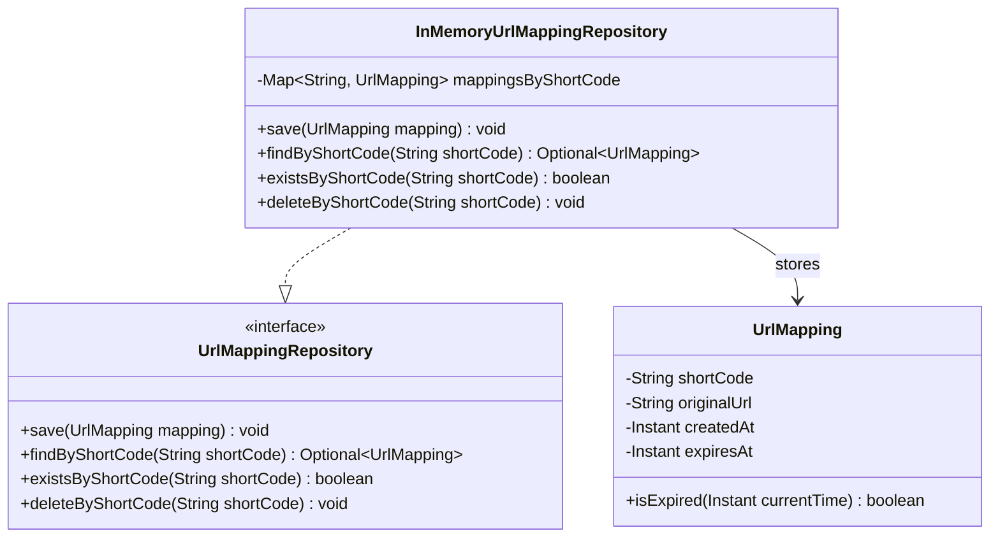
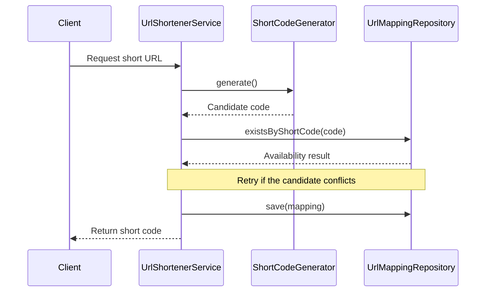

# URL Shortener — Phase 6: Repository Implementation

> Implements the repository layer that stores, retrieves, checks, and deletes URL mappings using an in-memory `HashMap`.

## Table of Contents

1. [Objective](#1-objective)
2. [Repository Design](#2-repository-design)
3. [Why Use a Repository?](#3-why-use-a-repository)
4. [Implement `UrlMappingRepository`](#4-implement-urlmappingrepository)
5. [Implement `InMemoryUrlMappingRepository`](#5-implement-inmemoryurlmappingrepository)
6. [Demonstrating Repository Operations](#6-demonstrating-repository-operations)
7. [Repository Interaction with the Service](#7-repository-interaction-with-the-service)
8. [Design Limitations and Future Improvements](#8-design-limitations-and-future-improvements)
9. [Complexity Analysis](#9-complexity-analysis)
10. [Current Package Structure](#10-current-package-structure)
11. [Phase 6 Checklist](#11-phase-6-checklist)
12. [Key Takeaways](#12-key-takeaways)
13. [Next Phase](#13-next-phase-url-shortening-service)

---

## 1. Objective

Implement the repository layer responsible for **storing, retrieving, checking, and deleting** URL mappings.

Previously, we implemented the domain classes and the short-code generator. Now we need a mechanism to store generated
codes alongside their original URLs.

| Short Code | Original URL                   |
|------------|--------------------------------|
| `aZ81kLm`  | `https://example.com/products` |
| `P0x7bQa`  | `https://example.com/about`    |
| `mN4cY2z`  | `https://example.com/contact`  |

For this project, we use an in-memory `HashMap`.

### Scope

This phase covers:

- Defining the repository abstraction.
- Implementing an in-memory repository.
- Saving URL mappings.
- Finding mappings by short code.
- Checking whether a code exists.
- Deleting mappings.
- Demonstrating repository operations using `Main.java`.

### Out of Scope

The repository is **not** responsible for:

- Generating short codes.
- Validating original URLs.
- Creating shortened URLs.
- Managing expiration policies.
- Recording click analytics.
- Resolving expired URLs into business-level responses.
- Handling HTTP redirects.

These responsibilities belong to other components.

---

## 2. Repository Design

Two components are introduced:

| Component                      | Role                                       |
|--------------------------------|--------------------------------------------|
| `UrlMappingRepository`         | Defines the storage contract.              |
| `InMemoryUrlMappingRepository` | Implements the contract using a `HashMap`. |

### Class Diagram



### Design Principle

The application depends on `UrlMappingRepository`, **not** directly on `HashMap` or `InMemoryUrlMappingRepository`. This
makes it possible to replace the in-memory implementation with another storage implementation later.

```text
UrlShortenerService
        |
        v
UrlMappingRepository
        |
        +-- InMemoryUrlMappingRepository
        |
        +-- DatabaseUrlMappingRepository (future)
```

The service keeps using the same repository contract regardless of the storage implementation.

---

## 3. Why Use a Repository?

Without a repository abstraction, the service might manage a map directly:

```java
Map<String, UrlMapping> mappingsByShortCode = new HashMap<>();
```

It would then be responsible for both business operations and storage management, which creates unnecessary coupling as
the application grows.

The repository separates these responsibilities:

| Component                      | Responsibility                                 |
|--------------------------------|------------------------------------------------|
| `UrlShortenerService`          | Coordinates URL-shortening business operations |
| `UrlMappingRepository`         | Defines mapping-storage operations             |
| `InMemoryUrlMappingRepository` | Implements storage operations using a map      |
| `UrlMapping`                   | Represents a stored URL mapping                |

The repository hides the details of how mappings are stored.

---

## 4. Implement `UrlMappingRepository`

**File:** `src/urlshortener/UrlMappingRepository.java`

```java
package urlshortener;

import java.util.Optional;

public interface UrlMappingRepository {

    void save(UrlMapping mapping);

    Optional<UrlMapping> findByShortCode(String shortCode);

    boolean existsByShortCode(String shortCode);

    void deleteByShortCode(String shortCode);
}
```

### 4.1 `save()`

```java
void save(UrlMapping mapping);
```

Stores a mapping in the repository. The caller supplies the complete `UrlMapping` object, including the short code,
original URL, creation timestamp, and optional expiration timestamp. The interface does not prescribe how the mapping is
stored.

### 4.2 `findByShortCode()`

```java
Optional<UrlMapping> findByShortCode(String shortCode);
```

Finds a mapping by its short code. A lookup has two possible outcomes:

- A mapping exists.
- No mapping exists.

`Optional<UrlMapping>` represents both outcomes without returning `null`.

```java
Optional<UrlMapping> mapping =
        repository.findByShortCode("aZ81kLm");
```

The caller then handles the result:

```java
mapping.ifPresent(found ->
        System.out.

println(found.getOriginalUrl())
        );
```

### 4.3 `existsByShortCode()`

```java
boolean existsByShortCode(String shortCode);
```

Checks whether a short code is present in the repository. The service will use this when checking a generated candidate
against existing mappings. It returns `true` when the code is stored and `false` otherwise.

### 4.4 `deleteByShortCode()`

```java
void deleteByShortCode(String shortCode);
```

Removes the mapping associated with the specified code. This will be useful when an expired alias is reclaimed under the
project's established business rules. The interface defines the operation without exposing the underlying data
structure.

---

## 5. Implement `InMemoryUrlMappingRepository`

**File:** `src/urlshortener/InMemoryUrlMappingRepository.java`

```java
package urlshortener;

import java.util.HashMap;
import java.util.Map;
import java.util.Objects;
import java.util.Optional;

public class InMemoryUrlMappingRepository
        implements UrlMappingRepository {

    private final Map<String, UrlMapping> mappingsByShortCode =
            new HashMap<>();

    @Override
    public void save(UrlMapping mapping) {
        Objects.requireNonNull(mapping, "mapping cannot be null");
        mappingsByShortCode.put(mapping.getShortCode(), mapping);
    }

    @Override
    public Optional<UrlMapping> findByShortCode(String shortCode) {
        Objects.requireNonNull(shortCode, "shortCode cannot be null");
        return Optional.ofNullable(
                mappingsByShortCode.get(shortCode)
        );
    }

    @Override
    public boolean existsByShortCode(String shortCode) {
        Objects.requireNonNull(shortCode, "shortCode cannot be null");
        return mappingsByShortCode.containsKey(shortCode);
    }

    @Override
    public void deleteByShortCode(String shortCode) {
        Objects.requireNonNull(shortCode, "shortCode cannot be null");
        mappingsByShortCode.remove(shortCode);
    }
}
```

### 5.1 Choosing the data structure

```java
private final Map<String, UrlMapping> mappingsByShortCode =
        new HashMap<>();
```

The map associates each short code with its mapping:

```text
Key           Value

"aZ81kLm"  -> UrlMapping object
"P0x7bQa"  -> UrlMapping object
"mN4cY2z"  -> UrlMapping object
```

- **`String` key:** the short code is the identifier used to look up a mapping.
- **`UrlMapping` value:** it holds all information associated with that code.

### 5.2 Why `private`?

The map is an internal implementation detail. Other components should use the repository's public methods rather than
modifying the map directly.

### 5.3 Why `final`?

The reference to the map cannot be reassigned after initialization. The map's *contents* remain mutable, so mappings can
still be added and removed.

### 5.4 Implementing `save()`

```java

@Override
public void save(UrlMapping mapping) {
    Objects.requireNonNull(mapping, "mapping cannot be null");

    mappingsByShortCode.put(mapping.getShortCode(), mapping);
}
```

The method:

1. Rejects a `null` mapping.
2. Extracts the mapping's short code.
3. Stores the mapping using that code as the key.

> **Important:** `HashMap.put()` replaces the existing value when the key already exists. This implementation therefore
> does **not** independently enforce short-code uniqueness. The service and repository integration must handle conflicts
> appropriately.

### 5.5 Implementing `findByShortCode()`

```java

@Override
public Optional<UrlMapping> findByShortCode(String shortCode) {
    Objects.requireNonNull(shortCode, "shortCode cannot be null");

    return Optional.ofNullable(
            mappingsByShortCode.get(shortCode)
    );
}
```

`HashMap.get()` returns the matching value, or `null` if none is found. `Optional.ofNullable()` converts that result
into an `Optional`.

```java
Optional<UrlMapping> existing =
        repository.findByShortCode("aZ81kLm");

Optional<UrlMapping> missing =
        repository.findByShortCode("unknown");
```

The first result contains a mapping if the code exists; the second is empty.

### 5.6 Implementing `existsByShortCode()`

```java

@Override
public boolean existsByShortCode(String shortCode) {
    Objects.requireNonNull(shortCode, "shortCode cannot be null");

    return mappingsByShortCode.containsKey(shortCode);
}
```

`containsKey()` directly checks whether the map contains the key, which is clearer than retrieving a value just to test
for existence.

### 5.7 Implementing `deleteByShortCode()`

```java

@Override
public void deleteByShortCode(String shortCode) {
    Objects.requireNonNull(shortCode, "shortCode cannot be null");

    mappingsByShortCode.remove(shortCode);
}
```

`remove()` deletes the entry for the specified key. If the key does not exist, the map is unchanged.

---

## 6. Demonstrating Repository Operations

Update `Main.java`:

```java
package urlshortener;

import java.time.Instant;

public class Main {

    public static void main(String[] args) {
        UrlMappingRepository repository =
                new InMemoryUrlMappingRepository();

        UrlMapping mapping = new UrlMapping(
                "aZ81kLm",
                "https://example.com/products",
                Instant.now(),
                null
        );

        repository.save(mapping);

        System.out.println(
                "Exists: " +
                        repository.existsByShortCode("aZ81kLm")
        );

        repository.findByShortCode("aZ81kLm")
                .ifPresent(found ->
                        System.out.println(found.getOriginalUrl())
                );

        repository.deleteByShortCode("aZ81kLm");

        System.out.println(
                "Exists after deletion: " +
                        repository.existsByShortCode("aZ81kLm")
        );
    }
}
```

### Expected output

```text
Exists: true
https://example.com/products
Exists after deletion: false
```

### Execution walkthrough

| Step                     | Code                                                                             | What happens                                                                      |
|--------------------------|----------------------------------------------------------------------------------|-----------------------------------------------------------------------------------|
| 1. Create the repository | `UrlMappingRepository repository = new InMemoryUrlMappingRepository();`          | The variable uses the interface type; the object is the in-memory implementation. |
| 2. Create a mapping      | `new UrlMapping("aZ81kLm", "https://example.com/products", Instant.now(), null)` | The mapping never expires because `expiresAt` is `null`.                          |
| 3. Save the mapping      | `repository.save(mapping);`                                                      | Stored in the map under the key `aZ81kLm`.                                        |
| 4. Check existence       | `repository.existsByShortCode("aZ81kLm");`                                       | Returns `true`.                                                                   |
| 5. Retrieve the mapping  | `repository.findByShortCode("aZ81kLm");`                                         | Returns the stored mapping inside an `Optional`.                                  |
| 6. Delete the mapping    | `repository.deleteByShortCode("aZ81kLm");`                                       | Mapping removed; a later existence check returns `false`.                         |

---

## 7. Repository Interaction with the Service

The repository is now ready to support the URL-shortening workflow. The intended interaction:



This diagram illustrates the intended integration; the service is implemented in the next phase. The repository does not
decide *when* a mapping should be created. It only performs the requested storage operations.

---

## 8. Design Limitations and Future Improvements

### 8.1 In-memory persistence

All mappings live in the application's memory.

- Mappings disappear when the application stops.
- Multiple application instances do not share mappings.
- The data is not suitable for a production service requiring persistence.

A future database-backed implementation could preserve the same repository contract.

### 8.2 Thread safety

`HashMap` is **not** thread-safe. The current project uses a sequential, single-process demonstration, so this is
sufficient for learning the repository abstraction. A concurrent production implementation would need appropriate
synchronization or a concurrency-safe storage mechanism.

### 8.3 Uniqueness enforcement

`save()` uses `put()`, which overwrites an existing value for the same key. The service must not assume that calling
`existsByShortCode()` followed by `save()` guarantees uniqueness under concurrent access.

A production system should enforce uniqueness atomically, for example through a database unique constraint or a
concurrency-safe repository operation.

### 8.4 Expired mappings remain stored

The repository does not automatically remove expired mappings. This is intentional: the application must be able to
distinguish an **expired** mapping from an **unknown** code.

The service will check expiration using `UrlMapping.isExpired()` and the injected `Clock`. Expired mappings can remain
available for this distinction until a permitted cleanup or alias-reclamation operation removes them.

---

## 9. Complexity Analysis

Let *n* be the number of stored mappings. Under typical `HashMap` hashing assumptions:

| Operation             | Average-case time |
|-----------------------|-------------------|
| `save()`              | O(1)              |
| `findByShortCode()`   | O(1)              |
| `existsByShortCode()` | O(1)              |
| `deleteByShortCode()` | O(1)              |

These are average-case complexities, not unconditional worst-case guarantees.

**Space complexity:** O(*n*), since each stored mapping occupies an entry in the map.

---

## 10. Current Package Structure

```text
src/urlshortener/
├── UrlMapping.java
├── ResolutionStatus.java
├── UrlResolutionResult.java
├── ShortCodeGenerator.java
├── RandomBase62CodeGenerator.java
├── UrlMappingRepository.java
├── InMemoryUrlMappingRepository.java
└── Main.java
```

### Component responsibilities

| Class                          | Responsibility                                          |
|--------------------------------|---------------------------------------------------------|
| `UrlMapping`                   | Represents a URL mapping and its expiration information |
| `ResolutionStatus`             | Defines resolution outcomes                             |
| `UrlResolutionResult`          | Represents the result of resolving a code               |
| `ShortCodeGenerator`           | Defines the short-code generation contract              |
| `RandomBase62CodeGenerator`    | Generates random Base62 codes                           |
| `UrlMappingRepository`         | Defines mapping-storage operations                      |
| `InMemoryUrlMappingRepository` | Stores mappings in a `HashMap`                          |
| `Main`                         | Demonstrates the current functionality                  |

---

## 11. Phase 6 Checklist

- [x] Define `UrlMappingRepository`.
- [x] Implement `InMemoryUrlMappingRepository`.
- [x] Store mappings using `Map<String, UrlMapping>`.
- [x] Implement `save()`.
- [x] Implement `findByShortCode()`.
- [x] Implement `existsByShortCode()`.
- [x] Implement `deleteByShortCode()`.
- [x] Use `Optional` for mapping lookups.
- [x] Demonstrate repository operations in `Main.java`.
- [x] Understand why the service depends on the repository interface.
- [x] Understand the overwrite behavior of `HashMap.put()`.
- [x] Understand the current implementation's persistence and concurrency limitations.

---

## 12. Key Takeaways

1. A repository separates storage operations from business logic.
2. An interface lets the storage implementation change without the service depending on a concrete map or repository
   class.
3. `Map<String, UrlMapping>` is a natural in-memory representation for short-code lookups.
4. `Optional<UrlMapping>` explicitly represents a lookup that may not find a mapping.
5. `HashMap.put()` overwrites an existing value for the same key, so uniqueness must be managed separately.
6. The current implementation suits a sequential, in-memory learning project, but not concurrent production guarantees.
7. Expiration decisions stay outside the repository so unknown and expired codes can be distinguished.

---

## 13. Next Phase: URL Shortening Service

### Phase 7: Implement `UrlShortenerService`

The next phase integrates:

- `UrlMapping`
- `ShortCodeGenerator`
- `UrlMappingRepository`

We will establish the workflow for validating an original URL, generating a candidate code, handling collisions,
creating the mapping, and saving it in the repository.

This will be the first phase in which the core components work together to perform an actual URL-shortening operation.