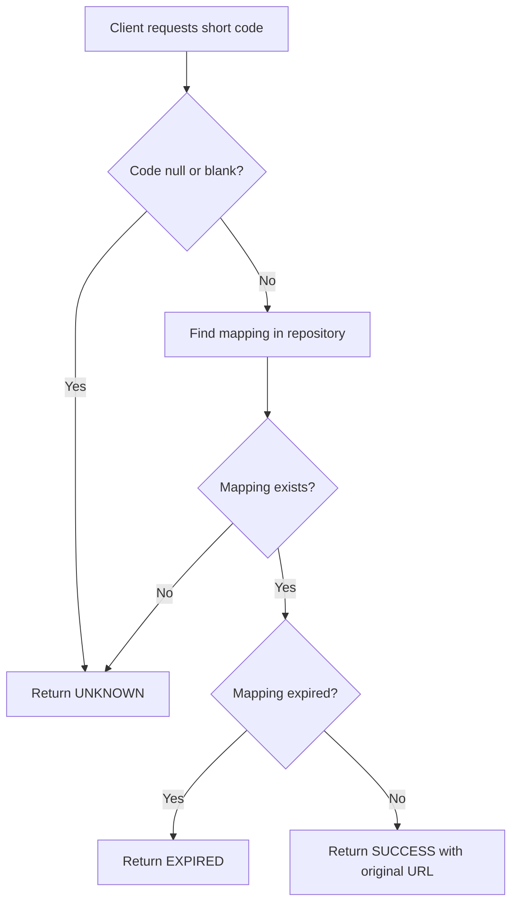
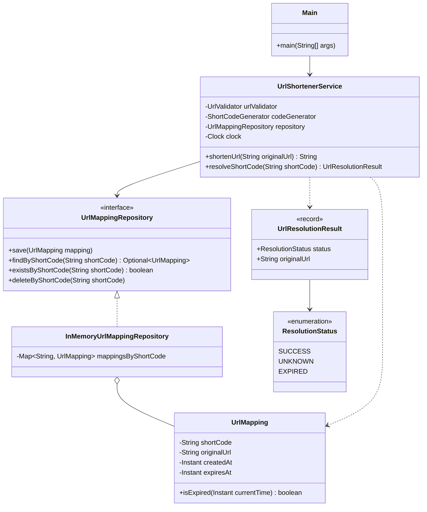

# URL Shortener — Phase 8: Resolve Short Codes to Original URLs

> Implements the reverse of shortening: resolving a short code to its original URL, while correctly handling unknown and
> expired codes.

## Table of Contents

1. [Objective](#1-objective)
2. [Understanding Resolution Outcomes](#2-understanding-resolution-outcomes)
3. [Existing Resolution Result Class](#3-existing-resolution-result-class)
4. [Resolution Flow](#4-resolution-flow)
5. [Implementing `resolveShortCode()`](#5-implementing-resolveshortcode)
6. [Complete `UrlShortenerService.java`](#6-complete-urlshortenerservicejava)
7. [Updating `Main.java`](#7-updating-mainjava)
8. [Updated UML Class Diagram](#8-updated-uml-class-diagram)
9. [Design Decisions](#9-design-decisions)
10. [Complexity Analysis](#10-complexity-analysis)
11. [Limitations](#11-limitations)
12. [Phase 8 Checklist](#12-phase-8-checklist)
13. [What Comes Next?](#13-what-comes-next)

---

## 1. Objective

In the previous phase, we implemented URL shortening, which converts a long URL into a unique short code and stores the
mapping in the repository.

In this phase, we implement the **reverse operation**: resolving a short code to its original URL.

| Step         | Value                                      |
|--------------|--------------------------------------------|
| Original URL | `https://example.com/products/electronics` |
| Short URL    | `https://short.ly/aB12xYz`                 |
| Resolved URL | `https://example.com/products/electronics` |

The service must also handle unknown and expired short codes.

### Requirements

- Resolve a short code to its original URL.
- Return an appropriate result when the code doesn't exist.
- Detect expired mappings.
- Return the original URL only when the mapping is valid.
- Use the injected `Clock` for expiration checks.
- Keep resolution logic inside `UrlShortenerService`.
- Demonstrate the functionality using `Main.java`.

### Scope

This is a Java service-layer implementation. No HTTP server or actual HTTP redirect is created in this phase.

---

## 2. Understanding Resolution Outcomes

The existing enum:

**`ResolutionStatus.java`**

```java
package urlshortener;

public enum ResolutionStatus {
    SUCCESS,
    UNKNOWN,
    EXPIRED
}
```

| Status    | Meaning                             | Original URL |
|-----------|-------------------------------------|--------------|
| `SUCCESS` | The mapping exists and is active.   | Available    |
| `UNKNOWN` | The short code doesn't exist.       | `null`       |
| `EXPIRED` | The mapping exists but has expired. | `null`       |

### Example

Suppose the repository contains these mappings:

| Short Code | Original URL                   | Expiration      |
|------------|--------------------------------|-----------------|
| `aB12xYz`  | `https://example.com/products` | Never           |
| `pQ45mNr`  | `https://example.com/profile`  | Already expired |

Expected behavior:

| Input        | Result    |
|--------------|-----------|
| `aB12xYz`    | `SUCCESS` |
| `pQ45mNr`    | `EXPIRED` |
| `unknown123` | `UNKNOWN` |
| Blank input  | `UNKNOWN` |

---

## 3. Existing Resolution Result Class

`UrlResolutionResult` was created in Phase 4 to represent the outcome of a resolution request.

**`UrlResolutionResult.java`**

```java
package urlshortener;

import java.util.Objects;

public record UrlResolutionResult(
        ResolutionStatus status,
        String originalUrl
) {
    public UrlResolutionResult {
        Objects.requireNonNull(
                status,
                "status cannot be null"
        );

        if (status == ResolutionStatus.SUCCESS) {
            Objects.requireNonNull(
                    originalUrl,
                    "originalUrl cannot be null for a successful resolution"
            );
        } else if (originalUrl != null) {
            throw new IllegalArgumentException(
                    "originalUrl must be null for unsuccessful resolution"
            );
        }
    }

    public static UrlResolutionResult success(String originalUrl) {
        return new UrlResolutionResult(
                ResolutionStatus.SUCCESS,
                originalUrl
        );
    }

    public static UrlResolutionResult unknown() {
        return new UrlResolutionResult(
                ResolutionStatus.UNKNOWN,
                null
        );
    }

    public static UrlResolutionResult expired() {
        return new UrlResolutionResult(
                ResolutionStatus.EXPIRED,
                null
        );
    }
}
```

### Why use a result object?

Instead of returning a `String` or `null`, the service returns a structured result. This lets the caller distinguish
between a successful resolution, an unknown code, and an expired mapping.

It also enforces a consistent contract:

- Successful results **must** contain an original URL.
- Unsuccessful results **must not** contain an original URL.

The caller inspects `status()` and `originalUrl()` to determine what happened.

---

## 4. Resolution Flow

Steps:

1. Validate the input short code.
2. Look up the mapping in the repository.
3. Return `UNKNOWN` if the mapping doesn't exist.
4. Check whether the mapping has expired.
5. Return `EXPIRED` if it has expired.
6. Otherwise, return `SUCCESS` with the original URL.

### Flow diagram



> **Important design decision:** Expired mappings remain in the repository. This lets the service distinguish an
*expired* code from one that *never existed*. If a mapping were deleted the moment it expired, a later lookup would
> return `UNKNOWN` instead of `EXPIRED`. A cleanup policy can be introduced later when implementing expiration management.

---

## 5. Implementing `resolveShortCode()`

We extend the existing `UrlShortenerService` rather than creating another service. Add this method to
`UrlShortenerService.java`:

```java
public UrlResolutionResult resolveShortCode(String shortCode) {
    if (shortCode == null || shortCode.isBlank()) {
        return UrlResolutionResult.unknown();
    }

    UrlMapping mapping = repository.findByShortCode(shortCode)
            .orElse(null);

    if (mapping == null) {
        return UrlResolutionResult.unknown();
    }

    if (mapping.isExpired(clock.instant())) {
        return UrlResolutionResult.expired();
    }

    return UrlResolutionResult.success(mapping.getOriginalUrl());
}
```

### Step 1: Handle invalid lookup input

```java
if(shortCode ==null||shortCode.

isBlank()){
        return UrlResolutionResult.

unknown();
}
```

A null or blank short code cannot identify a mapping. Here it is treated as an unknown lookup rather than throwing an
exception.

### Step 2: Retrieve the mapping

```java
UrlMapping mapping = repository.findByShortCode(shortCode)
        .orElse(null);
```

The repository returns an `Optional<UrlMapping>`. If no mapping exists, `orElse(null)` returns `null`, and we return
`UNKNOWN`.

### Step 3: Check expiration

```java
if(mapping.isExpired(clock.instant())){
        return UrlResolutionResult.

expired();
}
```

The service uses the injected `Clock` to get the current time. The expiration logic already lives in `UrlMapping`:

```java
public boolean isExpired(Instant currentTime) {
    Objects.requireNonNull(currentTime);

    return expiresAt != null
            && !currentTime.isBefore(expiresAt);
}
```

| Condition                  | Result        |
|----------------------------|---------------|
| `expiresAt == null`        | Never expires |
| `currentTime < expiresAt`  | Active        |
| `currentTime == expiresAt` | Expired       |
| `currentTime > expiresAt`  | Expired       |

The expiration boundary is **inclusive**: a mapping is expired once the current time reaches or passes its expiration
time.

### Step 4: Return the original URL

```java
return UrlResolutionResult.success(mapping.getOriginalUrl());
```

If the mapping exists and is active, the service returns a successful resolution containing the original URL.

---

## 6. Complete `UrlShortenerService.java`

The full service after adding resolution to the existing shortening implementation:

```java
package urlshortener;

import java.time.Clock;
import java.time.Instant;
import java.util.Objects;

public class UrlShortenerService {

    private static final int MAX_GENERATION_ATTEMPTS = 10;

    private final UrlValidator urlValidator;
    private final ShortCodeGenerator codeGenerator;
    private final UrlMappingRepository repository;
    private final Clock clock;

    public UrlShortenerService(
            UrlValidator urlValidator,
            ShortCodeGenerator codeGenerator,
            UrlMappingRepository repository,
            Clock clock
    ) {
        this.urlValidator = Objects.requireNonNull(
                urlValidator,
                "urlValidator cannot be null"
        );
        this.codeGenerator = Objects.requireNonNull(
                codeGenerator,
                "codeGenerator cannot be null"
        );
        this.repository = Objects.requireNonNull(
                repository,
                "repository cannot be null"
        );
        this.clock = Objects.requireNonNull(
                clock,
                "clock cannot be null"
        );
    }

    public String shortenUrl(String originalUrl) {
        if (!urlValidator.isValid(originalUrl)) {
            throw new IllegalArgumentException(
                    "Invalid URL: " + originalUrl
            );
        }

        for (int attempt = 0;
             attempt < MAX_GENERATION_ATTEMPTS;
             attempt++) {

            String shortCode = codeGenerator.generate();

            if (shortCode == null || shortCode.isBlank()) {
                throw new IllegalStateException(
                        "Code generator returned an invalid code"
                );
            }

            if (repository.existsByShortCode(shortCode)) {
                continue;
            }

            Instant createdAt = clock.instant();

            UrlMapping mapping = new UrlMapping(
                    shortCode,
                    originalUrl,
                    createdAt,
                    null
            );

            repository.save(mapping);

            return shortCode;
        }

        throw new IllegalStateException(
                "Unable to generate a unique short code"
        );
    }

    public UrlResolutionResult resolveShortCode(String shortCode) {
        if (shortCode == null || shortCode.isBlank()) {
            return UrlResolutionResult.unknown();
        }

        UrlMapping mapping = repository.findByShortCode(shortCode)
                .orElse(null);

        if (mapping == null) {
            return UrlResolutionResult.unknown();
        }

        if (mapping.isExpired(clock.instant())) {
            return UrlResolutionResult.expired();
        }

        return UrlResolutionResult.success(mapping.getOriginalUrl());
    }
}
```

---

## 7. Updating `Main.java`

`Main.java` serves as the client to demonstrate the functionality. No Maven configuration or test framework is involved.

```java
package urlshortener;

import java.time.Clock;

public class Main {

    public static void main(String[] args) {
        UrlValidator urlValidator = new UrlValidator();
        ShortCodeGenerator codeGenerator =
                new RandomBase62CodeGenerator();
        UrlMappingRepository repository =
                new InMemoryUrlMappingRepository();

        UrlShortenerService service = new UrlShortenerService(
                urlValidator,
                codeGenerator,
                repository,
                Clock.systemUTC()
        );

        String originalUrl =
                "https://example.com/products/electronics";

        // Shorten the original URL.
        String shortCode = service.shortenUrl(originalUrl);

        System.out.println("Short code: " + shortCode);
        System.out.println("Short URL: https://short.ly/" + shortCode);

        // Resolve the generated short code.
        UrlResolutionResult result =
                service.resolveShortCode(shortCode);

        System.out.println("\nResolution status: " + result.status());
        System.out.println("Original URL: " + result.originalUrl());

        // Resolve a code that does not exist.
        UrlResolutionResult unknownResult =
                service.resolveShortCode("unknown123");

        System.out.println(
                "\nUnknown code status: " + unknownResult.status()
        );
    }
}
```

### Example output

The generated code varies between executions; the example short code below is illustrative.

```text
Short code: aB12xYz
Short URL: https://short.ly/aB12xYz

Resolution status: SUCCESS
Original URL: https://example.com/products/electronics

Unknown code status: UNKNOWN
```

### What happens during execution?

1. The client provides the original URL.
2. `shortenUrl()` generates a short code.
3. The mapping is saved in the in-memory repository.
4. `resolveShortCode()` retrieves the mapping.
5. The service checks expiration.
6. The original URL is returned in a `UrlResolutionResult`.

---

## 8. Updated UML Class Diagram

The diagram now covers both URL shortening and resolution.



### Relationships

- `Main` calls `UrlShortenerService`.
- `UrlShortenerService` uses `UrlMappingRepository` to retrieve mappings.
- `InMemoryUrlMappingRepository` implements the repository interface.
- `InMemoryUrlMappingRepository` stores `UrlMapping` objects.
- `UrlShortenerService` creates `UrlResolutionResult` objects.
- `UrlResolutionResult` contains a `ResolutionStatus`.

The service depends on the repository **interface** rather than the concrete in-memory implementation, which makes it
easier to introduce a database-backed repository later.

---

## 9. Design Decisions

### 9.1 Why return a result object instead of a string?

Returning only a string makes unsuccessful outcomes ambiguous. For example, `null` cannot tell the caller whether the
code is unknown or expired. `UrlResolutionResult` provides an explicit status and an optional URL payload, with
constructor validation enforcing the result contract.

### 9.2 Why inject `Clock`?

```java
clock.instant()
```

This avoids hard-coding the system clock into business logic. A controllable clock can be supplied in future tests to
verify expiration at precise timestamps without waiting for real time to pass.

### 9.3 Why keep expiration logic inside `UrlMapping`?

The mapping owns the data needed to decide whether it has expired (`expiresAt`). Keeping `isExpired()` on the domain
object avoids duplicating expiration rules across service methods.

### 9.4 Why not delete expired mappings immediately?

To preserve the distinction between `EXPIRED` and `UNKNOWN`. A later phase can introduce explicit cleanup or
expired-alias reclamation while preserving the desired lookup semantics.

### 9.5 Why is this not an actual redirect?

The service returns the original URL. An HTTP controller and server are outside the current scope. In a web application,
the controller would interpret the resolution result and issue a suitable redirect response.

---

## 10. Complexity Analysis

The repository uses a `HashMap<String, UrlMapping>`.

| Operation                  | Average time complexity |
|----------------------------|-------------------------|
| Find mapping by short code | O(1)                    |
| Check expiration           | O(1)                    |
| Construct result           | O(1)                    |
| **Overall resolution**     | **O(1)**                |

These are average-case complexities for the current in-memory implementation. The space required by a single resolution
is O(1), excluding the stored mappings and the returned objects.

---

## 11. Limitations

Not yet implemented:

- Click analytics.
- Custom aliases.
- TTL configuration during URL shortening.
- Background cleanup of expired mappings.
- Actual HTTP redirects.
- Persistent database storage.
- Distributed uniqueness and concurrency guarantees.

These are intentional omissions at this stage of the learning project.

---

## 12. Phase 8 Checklist

- [x] Understand the three resolution outcomes.
- [x] Reuse `ResolutionStatus`.
- [x] Reuse `UrlResolutionResult`.
- [x] Implement `resolveShortCode()`.
- [x] Handle null and blank input.
- [x] Handle unknown mappings.
- [x] Handle expired mappings.
- [x] Return the original URL for successful resolution.
- [x] Use the injected `Clock`.
- [x] Update `Main.java`.
- [x] Document the updated UML diagram.
- [x] Analyze time and space complexity.

---

## 13. What Comes Next?

### Phase 9: Click Analytics

In the next phase, we will introduce:

- `ClickEvent` to represent a successful click or resolution event.
- `ClickAnalyticsService` to record and retrieve analytics.
- Timestamps for individual resolution events.
- Click-count calculation.
- Integration with `UrlShortenerService`.

> **Important business rule:** only *successful* resolutions are recorded. Unknown and expired codes must not increment
> click analytics.

This adds analytics without mixing click-event storage into the responsibilities of `UrlMapping`.