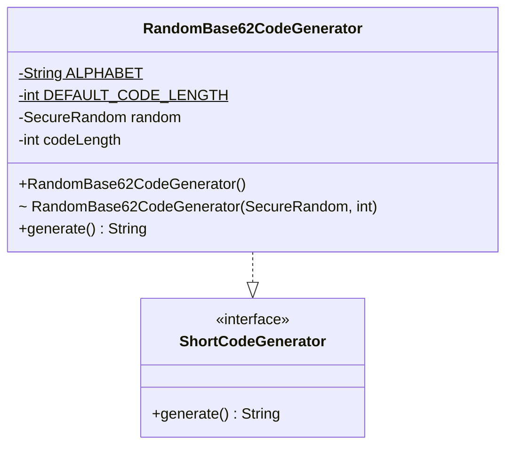
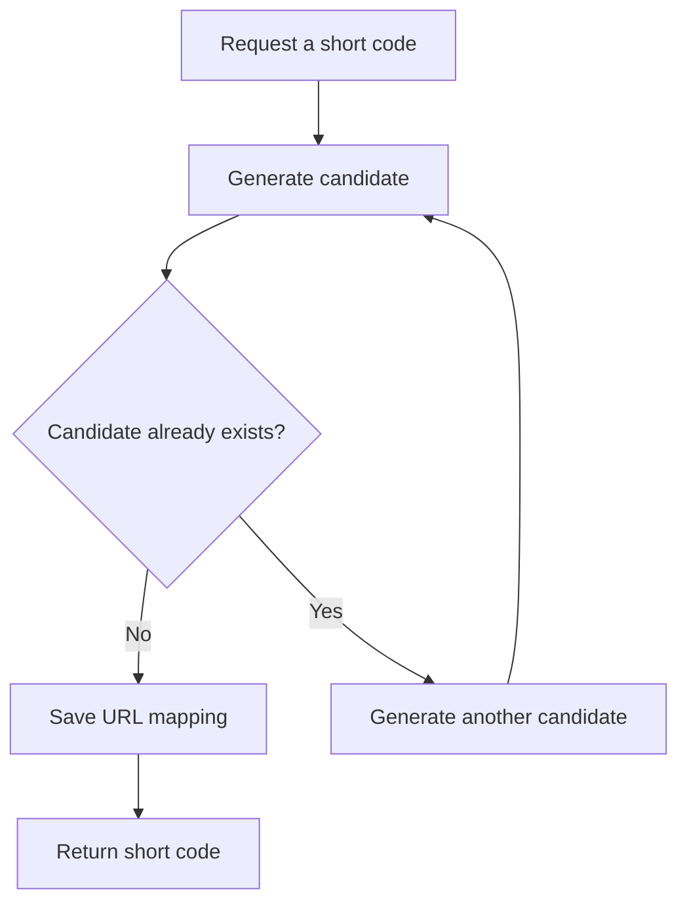

# URL Shortener — Phase 5: Short Code Generation

> Implements the component that generates short codes for long URLs.
> Storage, uniqueness checks, custom aliases, expiration, and redirection come in later phases.

## Table of Contents

1. [Objective](#1-objective)
2. [Requirements](#2-requirements)
3. [Base62 Encoding](#3-base62-encoding)
4. [Class Design](#4-class-design)
5. [Class Diagram](#5-class-diagram)
6. [Implementation](#6-implementation)
7. [Demonstrating the Generator](#7-demonstrating-the-generator)
8. [Design Decision: Generation vs. Uniqueness](#8-design-decision-code-generation-vs-uniqueness)
9. [Design Principles Applied](#9-design-principles-applied)
10. [Current Package Structure](#10-current-package-structure)
11. [Phase 5 Checklist](#11-phase-5-checklist)
12. [Key Takeaways](#12-key-takeaways)
13. [Next Phase](#13-next-phase)

---

## 1. Objective

Implement the component responsible for generating short codes for long URLs.

Given this URL:

```text
https://example.com/products/electronics/smartphones
```

The generator might produce:

```text
aZ81kLm
```

The final shortened URL will eventually look like:

```text
https://short.ly/aZ81kLm
```

At this stage, **only the short-code generation mechanism** is implemented.

---

## 2. Requirements

The generator must:

1. Generate a random short code.
2. Use Base62 characters (lowercase letters, uppercase letters, digits).
3. Generate **seven-character** codes by default.
4. Allow the code length to be configured internally for testing or alternative configurations.
5. Stay independent of URL storage.
6. Allow the generation algorithm to be replaced without changing its consumers.
7. Leave uniqueness verification to the component that manages URL mappings.

### Out of Scope

The following do **not** belong to the generator and will be handled by other components:

| Responsibility                            | Handled by                         |
|-------------------------------------------|------------------------------------|
| Storing URL mappings                      | Repository (later phase)           |
| Checking whether a code is already in use | Repository / service (later phase) |
| Generating custom aliases                 | Later phase                        |
| Validating original URLs                  | Later phase                        |
| Managing expiration                       | Later phase                        |
| Recording click analytics                 | Later phase                        |
| Redirecting users to original URLs        | Later phase                        |

---

## 3. Base62 Encoding

Alphabet used:

```text
abcdefghijklmnopqrstuvwxyzABCDEFGHIJKLMNOPQRSTUVWXYZ0123456789
```

| Character category      | Count  |
|-------------------------|--------|
| Lowercase letters (a–z) | 26     |
| Uppercase letters (A–Z) | 26     |
| Digits (0–9)            | 10     |
| **Total**               | **62** |

Each position in a code can hold any of these 62 characters. For a seven-character code:

```text
Total possible codes = 62^7
                     = 3,521,614,606,208
```

That is roughly **3.52 trillion** combinations.

> **Note:** This is the *theoretical* number of possible codes, not the number that can be safely generated without
> checking for collisions.

### Why Base62?

- Produces compact, URL-friendly identifiers.
- Uses only letters and digits.
- Avoids special characters such as `/`, `?`, and `&`.
- Offers many combinations with relatively short codes.

---

## 4. Class Design

Two types are introduced:

| Type                        | Kind      | Role                                                                                                 |
|-----------------------------|-----------|------------------------------------------------------------------------------------------------------|
| `ShortCodeGenerator`        | Interface | Defines the contract for generating a short code, without prescribing how.                           |
| `RandomBase62CodeGenerator` | Class     | Implements the interface; generates random 7-character Base62 codes by default using `SecureRandom`. |

The implementation can be replaced in the future without requiring consumers to depend on a specific generation
algorithm.

---

## 5. Class Diagram



**Relationship:** `RandomBase62CodeGenerator` implements `ShortCodeGenerator`. The interface lets the rest of the
application depend on an abstraction instead of a specific algorithm.

---

## 6. Implementation

### 6.1 `ShortCodeGenerator.java`

**Location:** `src/urlshortener/ShortCodeGenerator.java`

```java
package urlshortener;

public interface ShortCodeGenerator {
    String generate();
}
```

The interface declares a single method that returns a newly generated **candidate** short code. It does **not** promise
uniqueness; that must be verified by the component managing mappings.

### 6.2 `RandomBase62CodeGenerator.java`

**Location:** `src/urlshortener/RandomBase62CodeGenerator.java`

```java
package urlshortener;

import java.security.SecureRandom;
import java.util.Objects;

public class RandomBase62CodeGenerator implements ShortCodeGenerator {

    private static final String ALPHABET =
            "abcdefghijklmnopqrstuvwxyzABCDEFGHIJKLMNOPQRSTUVWXYZ0123456789";
    private static final int DEFAULT_CODE_LENGTH = 7;

    private final SecureRandom random;
    private final int codeLength;

    public RandomBase62CodeGenerator() {
        this(new SecureRandom(), DEFAULT_CODE_LENGTH);
    }

    RandomBase62CodeGenerator(SecureRandom random, int codeLength) {
        this.random = Objects.requireNonNull(
                random,
                "random cannot be null"
        );

        if (codeLength <= 0) {
            throw new IllegalArgumentException(
                    "codeLength must be greater than zero"
            );
        }

        this.codeLength = codeLength;
    }

    @Override
    public String generate() {
        StringBuilder code = new StringBuilder(codeLength);

        for (int i = 0; i < codeLength; i++) {
            int index = random.nextInt(ALPHABET.length());
            code.append(ALPHABET.charAt(index));
        }

        return code.toString();
    }
}
```

### 6.3 Code Walkthrough

#### A. Base62 alphabet

```java
private static final String ALPHABET =
        "abcdefghijklmnopqrstuvwxyzABCDEFGHIJKLMNOPQRSTUVWXYZ0123456789";
```

Defines every character the generator can select. Being `static final`, it is shared by all instances.

#### B. Default code length

```java
private static final int DEFAULT_CODE_LENGTH = 7;
```

Every instance created through the public default constructor generates seven-character codes.

#### C. `SecureRandom`

```java
private final SecureRandom random;
```

Supplies random values suitable for generating unpredictable identifiers. Unpredictability is useful when short URLs are
publicly accessible, but it does **not** guarantee uniqueness or replace authorization checks for private resources.

#### D. Constructor delegation

```java
public RandomBase62CodeGenerator() {
    this(new SecureRandom(), DEFAULT_CODE_LENGTH);
}
```

The public constructor creates the random-number generator and sets the default length, then delegates to the second
constructor to avoid duplicate initialization logic.

#### E. Configurable constructor

```java
RandomBase62CodeGenerator(SecureRandom random, int codeLength)
```

This package-private constructor lets code in the same package supply a random source and a custom length, which helps
with controlled demonstrations and testing. It rejects a `null` random source and non-positive lengths.

#### F. Generating the code

```java

@Override
public String generate() {
    StringBuilder code = new StringBuilder(codeLength);

    for (int i = 0; i < codeLength; i++) {
        int index = random.nextInt(ALPHABET.length());
        code.append(ALPHABET.charAt(index));
    }

    return code.toString();
}
```

Steps:

1. Create a `StringBuilder` with the configured capacity.
2. Generate a random index between `0` and `ALPHABET.length() - 1`.
3. Retrieve the character at that index.
4. Append it to the result.
5. Repeat until the required number of characters has been generated.
6. Convert the result to a `String` and return it.

With the default configuration, the loop runs seven times.

---

## 7. Demonstrating the Generator

Update `Main.java`:

```java
package urlshortener;

public class Main {

    public static void main(String[] args) {
        ShortCodeGenerator generator = new RandomBase62CodeGenerator();

        for (int i = 0; i < 5; i++) {
            System.out.println(generator.generate());
        }
    }
}
```

Example output:

```text
aZ81kLm
P0x7bQa
mN4cY2z
8Rk1vWp
Q6dLs9A
```

Actual output varies between runs. Each code contains seven characters from the Base62 alphabet.

### Why use the interface type in `Main`?

Instead of:

```java
RandomBase62CodeGenerator generator =
        new RandomBase62CodeGenerator();
```

we write:

```java
ShortCodeGenerator generator =
        new RandomBase62CodeGenerator();
```

This reduces the client's dependency on a specific implementation. If another implementation is introduced later, the
concrete generator can be swapped without changing code that depends only on the interface.

---

## 8. Design Decision: Code Generation vs. Uniqueness

Generating a random code and guaranteeing its uniqueness are **two different responsibilities**.

Consider this sequence:

```text
First generation:  aZ81kLm
Second generation: P0x7bQa
Third generation:  aZ81kLm   <- duplicates the first
```

Collisions may be uncommon at low volumes, but they remain possible. Therefore:

| Component              | Responsibility                                                          |
|------------------------|-------------------------------------------------------------------------|
| `ShortCodeGenerator`   | Generates candidate codes.                                              |
| URL-shortening service | Coordinates code creation.                                              |
| Repository             | Determines whether a code is already assigned.                          |
| Service (again)        | Retries generation when a candidate conflicts with an existing mapping. |

### Intended workflow



> **Important:** This workflow describes intended behavior, **not a concurrency guarantee**. In a concurrent production
> system, checking availability and saving a mapping must be coordinated atomically, for example with a database unique
> constraint or an equivalent concurrency-safe mechanism.
>
> For this project's in-memory, single-process demonstration, the repository-level check will be implemented in a later
> phase.

---

## 9. Design Principles Applied

| Principle                  | How it applies here                                                                      |
|----------------------------|------------------------------------------------------------------------------------------|
| **Interface-based design** | Consumers depend on `ShortCodeGenerator`, not `RandomBase62CodeGenerator`.               |
| **Single Responsibility**  | The generator only produces candidate codes; it doesn't manage mappings or analytics.    |
| **Dependency Inversion**   | Higher-level components depend on the interface rather than a concrete implementation.   |
| **Separation of concerns** | Generation and uniqueness management remain separate.                                    |
| **Constructor validation** | The configurable constructor rejects invalid configuration before the generator is used. |

---

## 10. Current Package Structure

```text
src/urlshortener/
├── UrlMapping.java
├── ResolutionStatus.java
├── UrlResolutionResult.java
├── ShortCodeGenerator.java
├── RandomBase62CodeGenerator.java
└── Main.java
```

- The first three classes represent mapping and resolution-domain concepts.
- The two generator classes provide the short-code generation abstraction and its random Base62 implementation.
- `Main.java` demonstrates the generator.

---

## 11. Phase 5 Checklist

- [x] Define the `ShortCodeGenerator` interface.
- [x] Implement `RandomBase62CodeGenerator`.
- [x] Use Base62 characters.
- [x] Generate seven-character codes by default.
- [x] Validate the random-number source and configured length.
- [x] Demonstrate generation through `Main.java`.
- [x] Confirm that codes contain only Base62 characters.
- [x] Understand why random generation does not guarantee uniqueness.
- [x] Keep uniqueness verification outside the generator.

---

## 12. Key Takeaways

1. Base62 provides a compact alphabet of 62 URL-friendly characters.
2. Seven-character codes provide approximately 3.52 trillion possible combinations.
3. `ShortCodeGenerator` defines the generation contract.
4. `RandomBase62CodeGenerator` implements that contract using `SecureRandom`.
5. Random codes can collide, so the generator cannot guarantee uniqueness by itself.
6. The repository and service will coordinate uniqueness when code generation is integrated with URL mapping.
7. Interface-based design lets the generation strategy change without changes to its consumers.

---

## 13. Next Phase

### Phase 6: Repository Implementation

We will implement:

- **`UrlMappingRepository`**: the abstraction for managing URL mappings.
- **`InMemoryUrlMappingRepository`**: the in-memory implementation backed by a `Map<String, UrlMapping>`.

We will define how mappings are saved, retrieved, checked for existing codes, and removed. This prepares the foundation
for the main `UrlShortenerService`.