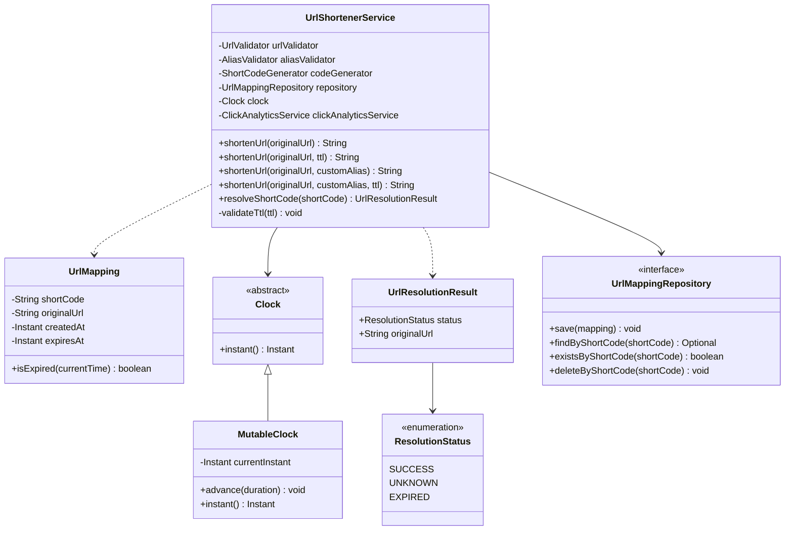

# URL Shortener — Phase 11: TTL and Expiration Management

> Adds optional Time To Live (TTL) to short URLs so mappings can expire, and demonstrates expiration deterministically
> with a controllable clock.

## Table of Contents

1. [Objective](#1-objective)
2. [Requirements and Business Rules](#2-requirements-and-business-rules)
3. [Design Approach](#3-design-approach)
4. [Understanding `Duration` and `Instant`](#4-understanding-duration-and-instant)
5. [Existing `UrlMapping` Expiration Logic](#5-existing-urlmapping-expiration-logic)
6. [Updating `UrlShortenerService`](#6-updating-urlshortenerservice)
7. [Implementing TTL Validation](#7-implementing-ttl-validation)
8. [Generated Short Codes with TTL](#8-generated-short-codes-with-ttl)
9. [Custom Aliases with TTL](#9-custom-aliases-with-ttl)
10. [Short-Code Resolution](#10-short-code-resolution)
11. [Demonstrating Expiration with `MutableClock`](#11-demonstrating-expiration-with-mutableclock)
12. [`Main` Client Demonstration](#12-main-client-demonstration)
13. [Updated Class Diagram](#13-updated-class-diagram)
14. [Complexity Analysis](#14-complexity-analysis)
15. [Limitations and Future Improvements](#15-limitations-and-future-improvements)
16. [Phase 11 Practice Checklist](#16-phase-11-practice-checklist)
17. [What We Have Achieved](#17-what-we-have-achieved)

---

## 1. Objective

In previous phases, we implemented:

- Random Base62 short-code generation.
- In-memory URL mapping storage.
- URL validation.
- Short-code resolution.
- Click analytics.
- Custom aliases and alias validation.

However, every mapping currently remains valid indefinitely because its `expiresAt` value is `null`.

In this phase, we introduce **TTL (Time To Live)**, letting users specify how long a short URL stays valid.

| Item         | Value                           |
|--------------|---------------------------------|
| Original URL | `https://example.com/offer`     |
| Short URL    | `https://short.example/aB7xK2p` |
| TTL          | 10 minutes                      |

After 10 minutes, resolving the short code should return `EXPIRED` instead of the original URL.

The implementation remains an in-memory Java application. Expiration is demonstrated with an **injected clock** rather
than waiting for real time to pass.

### Goals

By the end of this phase, the service supports:

- Generated short codes with optional expiration.
- Custom aliases with optional expiration.
- Validation of TTL values.
- Expiration checks during resolution.
- Distinguishing unknown codes from expired codes.
- Reclaiming expired custom aliases.
- Clearing old analytics when an expired alias is reclaimed.
- Deterministic expiration demonstrations using a controllable clock.

---

## 2. Requirements and Business Rules

### 2.1 Optional TTL

A short URL can be created with or without a TTL.

| Case          | Result                                                            |
|---------------|-------------------------------------------------------------------|
| Without a TTL | `expiresAt = null` (the mapping does not expire)                  |
| With a TTL    | `expiresAt = createdAt + TTL` (expires at the calculated instant) |

### 2.2 Valid TTL values

A TTL must be **strictly positive** when supplied.

| TTL                       | Valid? | Reason                   |
|---------------------------|--------|--------------------------|
| `Duration.ofSeconds(30)`  | Yes    | Positive duration        |
| `Duration.ofMinutes(10)`  | Yes    | Positive duration        |
| `Duration.ofHours(2)`     | Yes    | Positive duration        |
| `Duration.ZERO`           | No     | Zero duration            |
| `Duration.ofSeconds(-10)` | No     | Negative duration        |
| `null`                    | Yes    | Represents no expiration |

### 2.3 Expiration rule

A mapping expires when:

```text
currentTime >= expiresAt
```

| Current time | Expiration time | Status      |
|--------------|-----------------|-------------|
| 10:04 AM     | 10:05 AM        | Active      |
| 10:04:59 AM  | 10:05 AM        | Active      |
| 10:05 AM     | 10:05 AM        | **Expired** |
| 10:06 AM     | 10:05 AM        | **Expired** |

The comparison must include equality.

### 2.4 Unknown versus expired

These are different outcomes:

- **Unknown:** no mapping exists for the requested short code.
- **Expired:** a mapping exists, but its expiration time has been reached.

The existing `ResolutionStatus` enum supports both:

```java
public enum ResolutionStatus {
    SUCCESS,
    UNKNOWN,
    EXPIRED
}
```

### 2.5 Expired mappings remain in storage

Expired mappings are **not** automatically deleted during resolution. This lets the service return `EXPIRED` instead of
`UNKNOWN`. In this learning implementation, expired mappings are retained until an expired custom alias is reclaimed.

### 2.6 Expired custom aliases can be reclaimed

Suppose:

```text
special-offer -> https://example.com/old-offer
```

After the mapping expires, a user can reuse `special-offer` for another URL. The service must:

1. Detect that the old mapping has expired.
2. Delete the old mapping.
3. Remove the old mapping's analytics.
4. Create the new mapping.
5. Return the custom alias.

> Generated codes are **not** automatically reclaimed in this phase.

---

## 3. Design Approach

Most of the required design is already in place. `UrlMapping` contains `shortCode`, `originalUrl`, `createdAt`, and
`expiresAt`, and `UrlShortenerService` creates mappings and checks expiration during resolution.

The main changes:

1. Accept `Duration` as an optional input.
2. Validate supplied durations.
3. Calculate the expiration instant.
4. Save the calculated instant in `UrlMapping`.
5. Reuse the existing expiration check during resolution.
6. Demonstrate the behavior using a controllable `Clock`.

We do not introduce a separate expiration service, because expiration is currently a simple rule involving the mapping
and the current time.

---

## 4. Understanding `Duration` and `Instant`

Java provides two useful classes in `java.time`.

### 4.1 `Duration`

Represents a **length of time**:

```java
Duration.ofSeconds(30);
Duration.

ofMinutes(10);
Duration.

ofHours(2);
Duration.

ofDays(7);
```

We use `Duration` as the TTL input provided by the caller.

### 4.2 `Instant`

Represents a **specific moment** on the UTC timeline:

```java
Instant createdAt = clock.instant();
```

To calculate expiration:

```java
Instant expiresAt = createdAt.plus(Duration.ofMinutes(10));
```

A mapping created at 10:00 AM with a 10-minute TTL expires at 10:10 AM.

### 4.3 Why store `Instant` instead of `Duration`?

- `Duration` says how long the mapping should remain valid.
- `Instant` says the exact moment it expires.

After creation, checking expiration is a simple comparison:

```java
mapping.isExpired(clock.instant());
```

The mapping never needs to store or recalculate its original TTL.

---

## 5. Existing `UrlMapping` Expiration Logic

`UrlMapping` already contains the required method:

```java
public boolean isExpired(Instant currentTime) {
    Objects.requireNonNull(currentTime);

    return expiresAt != null
            && !currentTime.isBefore(expiresAt);
}
```

### How it works

| Condition                          | Meaning                                                            |
|------------------------------------|--------------------------------------------------------------------|
| `expiresAt != null`                | If there is no expiration instant, the mapping never expires.      |
| `!currentTime.isBefore(expiresAt)` | The current time is equal to or later than the expiration instant. |

Combined behavior:

- No expiration instant: not expired.
- Current time before expiration: not expired.
- Current time equal to expiration: expired.
- Current time after expiration: expired.

No change to this method is required for TTL support.

---

## 6. Updating `UrlShortenerService`

We support four creation scenarios:

| Method                                                             | Behavior                                |
|--------------------------------------------------------------------|-----------------------------------------|
| `shortenUrl(String originalUrl)`                                   | Generated code without expiration       |
| `shortenUrl(String originalUrl, Duration ttl)`                     | Generated code with optional expiration |
| `shortenUrl(String originalUrl, String customAlias)`               | Custom alias without expiration         |
| `shortenUrl(String originalUrl, String customAlias, Duration ttl)` | Custom alias with optional expiration   |

### 6.1 Why use method overloading?

These methods represent different ways to create the same type of resource. Generated codes and custom aliases share the
same `UrlMapping` model, so we can offer multiple entry points while keeping the common behavior in the service.

### 6.2 Avoid ambiguous `null` arguments

The service contains these overloads:

```java
public String shortenUrl(String originalUrl, String customAlias)

public String shortenUrl(String originalUrl, Duration ttl)
```

Both `String` and `Duration` are reference types, so this call is **ambiguous**:

```java
shortenUrl(originalUrl, null);
```

Java cannot tell whether `null` is a custom alias or a TTL. To select the `Duration` overload explicitly, cast:

```java
public String shortenUrl(String originalUrl) {
    return shortenUrl(originalUrl, (Duration) null);
}
```

For the custom-alias overload, delegation is unambiguous because the target method takes three arguments:

```java
public String shortenUrl(
        String originalUrl,
        String customAlias
) {
    return shortenUrl(originalUrl, customAlias, null);
}
```

This lets the original methods keep their behavior while reusing the TTL-aware implementation.

---

## 7. Implementing TTL Validation

Add this helper to `UrlShortenerService`:

```java
private void validateTtl(Duration ttl) {
    if (ttl != null && (ttl.isZero() || ttl.isNegative())) {
        throw new IllegalArgumentException(
                "TTL must be greater than zero"
        );
    }
}
```

### Why validate TTL?

A zero or negative TTL would produce a mapping that is already expired or has an invalid lifetime. Instead of creating
it, the service rejects the request. A `null` TTL is allowed because it represents no expiration.

### Optional hardening

Extremely large durations can exceed the range supported by `Instant`. To handle this explicitly:

```java
private Instant calculateExpiresAt(Instant createdAt, Duration ttl) {
    if (ttl == null) {
        return null;
    }

    try {
        return createdAt.plus(ttl);
    } catch (ArithmeticException | java.time.DateTimeException exception) {
        throw new IllegalArgumentException(
                "TTL is too large",
                exception
        );
    }
}
```

Then replace the expiration calculation in both creation methods with:

```java
Instant expiresAt = calculateExpiresAt(createdAt, ttl);
```

This is a defensive improvement, not a requirement for the basic implementation.

---

## 8. Generated Short Codes with TTL

The generated-code method validates the URL and TTL, generates a unique code, calculates expiration, and saves the
mapping.

```java
public String shortenUrl(String originalUrl) {
    return shortenUrl(originalUrl, (Duration) null);
}

public String shortenUrl(String originalUrl, Duration ttl) {
    if (!urlValidator.isValid(originalUrl)) {
        throw new IllegalArgumentException(
                "Invalid URL: " + originalUrl
        );
    }

    validateTtl(ttl);

    for (int attempt = 0;
         attempt < MAX_GENERATION_ATTEMPTS;
         attempt++) {

        String shortCode = codeGenerator.generate();

        if (shortCode == null || shortCode.isBlank()) {
            throw new IllegalStateException(
                    "Code generator returned an invalid code"
            );
        }

        if (repository.existsByShortCode(shortCode)) {
            continue;
        }

        Instant createdAt = clock.instant();
        Instant expiresAt = ttl == null
                ? null
                : createdAt.plus(ttl);

        UrlMapping mapping = new UrlMapping(
                shortCode,
                originalUrl,
                createdAt,
                expiresAt
        );

        repository.save(mapping);

        return shortCode;
    }

    throw new IllegalStateException(
            "Unable to generate a unique short code"
    );
}
```

> Use the method name declared in your own `UrlMappingRepository`. If your interface declares `existByShortCode()`
> rather than `existsByShortCode()`, use that name consistently.

### Important steps

1. Validate the original URL.
2. Validate the TTL.
3. Generate a candidate code.
4. Reject invalid generator output.
5. Retry when the code already exists.
6. Capture `createdAt`.
7. Calculate `expiresAt`.
8. Save the mapping.
9. Return the generated code.

### Why capture `createdAt` once?

Creation and expiration times should be based on the same instant:

```java
Instant createdAt = clock.instant();
Instant expiresAt = createdAt.plus(ttl);
```

This avoids a small timing difference from reading the clock separately for each timestamp.

---

## 9. Custom Aliases with TTL

The custom-alias method supports expiration while preserving the existing alias rules.

```java
public String shortenUrl(
        String originalUrl,
        String customAlias
) {
    return shortenUrl(originalUrl, customAlias, null);
}

public String shortenUrl(
        String originalUrl,
        String customAlias,
        Duration ttl
) {
    if (!urlValidator.isValid(originalUrl)) {
        throw new IllegalArgumentException(
                "Invalid URL: " + originalUrl
        );
    }

    aliasValidator.validate(customAlias);
    validateTtl(ttl);

    UrlMapping existingMapping = repository
            .findByShortCode(customAlias)
            .orElse(null);

    if (existingMapping != null) {
        if (!existingMapping.isExpired(clock.instant())) {
            throw new IllegalArgumentException(
                    "Alias is already in use: " + customAlias
            );
        }

        repository.deleteByShortCode(customAlias);
        clickAnalyticsService.deleteAnalytics(customAlias);
    }

    Instant createdAt = clock.instant();
    Instant expiresAt = ttl == null
            ? null
            : createdAt.plus(ttl);

    UrlMapping mapping = new UrlMapping(
            customAlias,
            originalUrl,
            createdAt,
            expiresAt
    );

    repository.save(mapping);

    return customAlias;
}
```

### Why check for an existing mapping?

Generated codes and custom aliases share the same namespace. The requested alias might already belong to a generated
code or another custom alias, so the service must reject any **active** conflict.

### Why remove analytics when reclaiming an alias?

Suppose `special-offer` pointed to URL A and received 100 successful resolutions. The mapping expires, and a user reuses
`special-offer` for URL B. If the old analytics were kept, URL B would wrongly appear to have 100 previous clicks.
Removing them gives the new mapping a fresh click history.

### Current limitation

Expired mappings remain in the repository until a custom-alias request reclaims them. Generated-code creation does not
reuse expired codes in this phase.

---

## 10. Short-Code Resolution

The existing resolution method already handles TTL correctly.

```java
public UrlResolutionResult resolveShortCode(String shortCode) {
    if (shortCode == null || shortCode.isBlank()) {
        return UrlResolutionResult.unknown();
    }

    UrlMapping mapping = repository.findByShortCode(shortCode)
            .orElse(null);

    if (mapping == null) {
        return UrlResolutionResult.unknown();
    }

    if (mapping.isExpired(clock.instant())) {
        return UrlResolutionResult.expired();
    }

    clickAnalyticsService.recordClick(shortCode);

    return UrlResolutionResult.success(mapping.getOriginalUrl());
}
```

### Resolution flow

1. Check whether the supplied code is null or blank.
2. Search the repository.
3. Return `UNKNOWN` if the mapping does not exist.
4. Check expiration.
5. Return `EXPIRED` if the expiration instant has been reached.
6. Record a click for a successful resolution.
7. Return `SUCCESS` with the original URL.

### Why check expiration before recording analytics?

An expired mapping must not count as a successful resolution, so the analytics operation occurs only after the
expiration check. The result distinguishes successful, unknown, and expired mappings without throwing exceptions for
normal outcomes.

---

## 11. Demonstrating Expiration with `MutableClock`

Using `Thread.sleep()` for this demonstration is undesirable: it makes the program slow and timing-dependent. Instead,
we provide a controllable implementation of `Clock`.

### 11.1 Why introduce `MutableClock`?

The service already accepts a `Clock` through its constructor, so it does not need to know whether time comes from the
real system clock or a controlled one. We can advance the controlled clock directly.

**File:** `MutableClock.java`

```java
package practice.workingsystem.urlshortener;

import java.time.Clock;
import java.time.Duration;
import java.time.Instant;
import java.time.ZoneId;
import java.util.Objects;

public class MutableClock extends Clock {

    private Instant currentInstant;
    private final ZoneId zone;

    public MutableClock(Instant initialInstant) {
        this(initialInstant, ZoneId.of("UTC"));
    }

    private MutableClock(Instant initialInstant, ZoneId zone) {
        this.currentInstant = Objects.requireNonNull(
                initialInstant,
                "initialInstant cannot be null"
        );
        this.zone = Objects.requireNonNull(
                zone,
                "zone cannot be null"
        );
    }

    @Override
    public ZoneId getZone() {
        return zone;
    }

    @Override
    public Clock withZone(ZoneId zone) {
        return new MutableClock(currentInstant, zone);
    }

    @Override
    public Instant instant() {
        return currentInstant;
    }

    public void advance(Duration duration) {
        Objects.requireNonNull(
                duration,
                "duration cannot be null"
        );

        currentInstant = currentInstant.plus(duration);
    }
}
```

> **Package note:** Use the package declaration and directory appropriate to your project. The example assumes
`MutableClock` is in `practice.workingsystem.urlshortener`. If you place it elsewhere, update the declaration and
> imports accordingly.
>
> This clock is intended for a sequential learning demonstration. It is not a thread-safe production clock.

---

## 12. `Main` Client Demonstration

`Main` demonstrates generated codes, custom aliases, expiration, and alias reclamation. It assumes the same service
dependencies described in earlier phases.

```java
package practice.workingsystem.urlshortener;

import practice.workingsystem.urlshortener.service.AliasValidator;
import practice.workingsystem.urlshortener.service.ClickAnalyticsService;
import practice.workingsystem.urlshortener.service.UrlShortenerService;
import practice.workingsystem.urlshortener.service.UrlValidator;
import practice.workingsystem.urlshortener.entity.UrlResolutionResult;
import practice.workingsystem.urlshortener.repositories.InMemoryUrlMappingRepository;
import practice.workingsystem.urlshortener.repositories.UrlMappingRepository;
import practice.workingsystem.urlshortener.strategy.RandomBase62CodeGenerator;
import practice.workingsystem.urlshortener.strategy.ShortCodeGenerator;

import java.time.Duration;
import java.time.Instant;

public class Main {

    public static void main(String[] args) {
        MutableClock clock = new MutableClock(
                Instant.parse("2026-10-27T10:00:00Z")
        );

        UrlValidator urlValidator = new UrlValidator();
        AliasValidator aliasValidator = new AliasValidator();
        ShortCodeGenerator codeGenerator =
                new RandomBase62CodeGenerator();
        UrlMappingRepository repository =
                new InMemoryUrlMappingRepository();
        ClickAnalyticsService clickAnalyticsService =
                new ClickAnalyticsService(clock);

        UrlShortenerService service = new UrlShortenerService(
                urlValidator,
                aliasValidator,
                codeGenerator,
                repository,
                clock,
                clickAnalyticsService
        );

        String originalUrl = "https://example.com/offer";

        // Create a generated short code that expires in 10 minutes.
        String generatedCode = service.shortenUrl(
                originalUrl,
                Duration.ofMinutes(10)
        );

        System.out.println(
                "Before expiry: "
                        + service.resolveShortCode(generatedCode).status()
        );

        // Create a custom alias that expires in 5 minutes.
        String customAlias = service.shortenUrl(
                originalUrl,
                "special-offer",
                Duration.ofMinutes(5)
        );

        // Record one successful resolution.
        service.resolveShortCode(customAlias);

        System.out.println(
                "Clicks before expiry: "
                        + clickAnalyticsService.getClickCount(customAlias)
        );

        // Advance to the custom alias's exact expiration instant.
        clock.advance(Duration.ofMinutes(5));

        System.out.println(
                "Alias at expiry: "
                        + service.resolveShortCode(customAlias).status()
        );

        System.out.println(
                "Clicks after expiry: "
                        + clickAnalyticsService.getClickCount(customAlias)
        );

        // Reclaim the expired alias for another URL.
        service.shortenUrl(
                "https://example.com/new-offer",
                customAlias,
                Duration.ofMinutes(20)
        );

        System.out.println(
                "Clicks after reclamation: "
                        + clickAnalyticsService.getClickCount(customAlias)
        );

        // Advance to the generated code's expiration instant.
        clock.advance(Duration.ofMinutes(5));

        System.out.println(
                "Generated code after expiry: "
                        + service.resolveShortCode(generatedCode).status()
        );

        // Advance to the reclaimed alias's expiration instant.
        clock.advance(Duration.ofMinutes(15));

        System.out.println(
                "Reclaimed alias at expiry: "
                        + service.resolveShortCode(customAlias).status()
        );
    }
}
```

### Expected output

The generated short code varies; the expected statuses and counts are:

```text
Before expiry: SUCCESS
Clicks before expiry: 1
Alias at expiry: EXPIRED
Clicks after expiry: 1
Clicks after reclamation: 0
Generated code after expiry: EXPIRED
Reclaimed alias at expiry: EXPIRED
```

### Understanding the timeline

| Clock time | Event                                                                                                                |
|------------|----------------------------------------------------------------------------------------------------------------------|
| 10:00 AM   | Initial clock time. Generated code (10-min TTL) will expire at 10:10; custom alias (5-min TTL) will expire at 10:05. |
| 10:05 AM   | Clock advanced 5 min. The alias is expired. It is reclaimed with a new 20-minute TTL, so it now expires at 10:25.    |
| 10:10 AM   | Clock advanced 5 min. The generated code expires.                                                                    |
| 10:25 AM   | Clock advanced 15 min. The reclaimed alias expires.                                                                  |

No real-time waiting is necessary.

---

## 13. Updated Class Diagram

The existing domain model and service dependencies remain unchanged. TTL support adds overloaded methods to
`UrlShortenerService`.



### Key design relationships

- `UrlShortenerService` creates mappings and checks their expiration.
- `UrlMapping` stores the expiration instant.
- `Clock` abstracts the source of time.
- `MutableClock` allows deterministic time advancement for the client demonstration.
- `UrlResolutionResult` communicates whether resolution succeeded, failed because the code was unknown, or failed
  because it expired.
- `UrlMappingRepository` remains responsible for mapping storage.

---

## 14. Complexity Analysis

Let:

- *n* = number of mappings in the repository
- *k* = number of click events for a short code
- *a* = length of a custom alias

The repository uses a `HashMap`, so its basic operations have average-case constant time.

| Operation              | Average-case time | Explanation                                                    |
|------------------------|-------------------|----------------------------------------------------------------|
| Validate TTL           | O(1)              | Checks duration properties                                     |
| Calculate expiration   | O(1)              | Adds a duration to an instant                                  |
| Find a mapping         | O(1)              | Hash-map lookup                                                |
| Save a mapping         | O(1)              | Hash-map insertion                                             |
| Delete a mapping       | O(1)              | Hash-map deletion                                              |
| Check expiration       | O(1)              | Compares two instants                                          |
| Resolve a short code   | O(1)              | Lookup, expiration check, and analytics insertion, on average  |
| Generate a unique code | Expected O(1)     | Bounded retries under low collision rates; at most 10 attempts |
| Validate an alias      | O(*a*)            | Checks length and allowed characters                           |
| Get click count        | O(1)              | Reads the event list size                                      |
| Get click events       | O(*k*)            | Copies the events into an immutable list                       |

Generated-code creation is bounded by `MAX_GENERATION_ATTEMPTS` (10). If every attempt collides, the method throws an
exception.

These complexities describe the current in-memory implementation. Database queries, network calls, and concurrent
operations would behave differently.

---

## 15. Limitations and Future Improvements

### 15.1 No background expiration cleanup

Expired mappings remain in memory until an expired custom alias is reclaimed. A production service may need scheduled
cleanup or a storage-level expiration mechanism.

### 15.2 In-memory storage

All mappings and analytics are lost when the process stops. A production implementation would use persistent storage.

### 15.3 Concurrency

The repository uses `HashMap` and does not guarantee atomic uniqueness under concurrent requests. A production
implementation would need concurrency-safe storage and an atomic uniqueness constraint.

### 15.4 No HTTP redirect server

`resolveShortCode()` returns the original URL through `UrlResolutionResult`; it does not send an HTTP redirect. An HTTP
layer could later translate successful resolution into a redirect and map unknown or expired codes to suitable HTTP
responses.

### 15.5 Analytics retention

Click events are stored in memory and removed when an expired alias is reclaimed. A production analytics system may need
persistent event storage, retention rules, and aggregation.

### 15.6 TTL range

Extremely large TTL values can exceed the representable range of `Instant`. The optional `calculateExpiresAt()` helper
rejects such values with a clear exception.

---

## 16. Phase 11 Practice Checklist

### TTL implementation

- [ ] Add `Duration` support.
- [ ] Implement `validateTtl()`.
- [ ] Support generated codes with TTL.
- [ ] Support custom aliases with TTL.
- [ ] Preserve the original no-expiration methods.
- [ ] Reject zero TTL.
- [ ] Reject negative TTL.
- [ ] Consider handling excessively large TTL values.

### Expiration behavior

- [ ] Verify a mapping before its expiration instant.
- [ ] Verify expiration at the exact instant.
- [ ] Verify expiration after the instant.
- [ ] Verify that an unknown code returns `UNKNOWN`.
- [ ] Verify that an expired code returns `EXPIRED`.
- [ ] Verify that expired resolutions do not increase click counts.
- [ ] Verify that expired aliases can be reclaimed.
- [ ] Verify that old analytics are removed after reclamation.
- [ ] Verify that a mapping without TTL does not expire.

### Clock demonstration

- [ ] Implement `MutableClock`.
- [ ] Inject the clock into `UrlShortenerService`.
- [ ] Inject the same clock into `ClickAnalyticsService`.
- [ ] Advance time without using `Thread.sleep()`.
- [ ] Demonstrate generated-code expiration.
- [ ] Demonstrate custom-alias expiration.
- [ ] Demonstrate alias reclamation.

### Design understanding

- [ ] Explain the difference between `Duration` and `Instant`.
- [ ] Explain why expiration is checked during resolution.
- [ ] Explain why expired mappings remain in storage.
- [ ] Explain the difference between `UNKNOWN` and `EXPIRED`.
- [ ] Explain why old analytics are removed when an alias is reclaimed.
- [ ] Explain the limitations of the current in-memory implementation.

---

## 17. What We Have Achieved

The URL shortener now supports:

- Random Base62 short-code generation.
- Custom aliases.
- URL and alias validation.
- In-memory mapping storage.
- Short-code resolution.
- Click analytics.
- Optional TTL for generated codes.
- Optional TTL for custom aliases.
- Expiration checks.
- Distinct `SUCCESS`, `UNKNOWN`, and `EXPIRED` outcomes.
- Reclamation of expired custom aliases.
- Removal of old analytics during alias reclamation.
- Deterministic expiration demonstrations through an injected clock.

### Next phase

The next phase should focus on **reviewing and hardening** the overall implementation: validating edge cases,
simplifying duplicated logic where appropriate, checking API consistency, and identifying which production concerns
should remain outside the current learning scope.