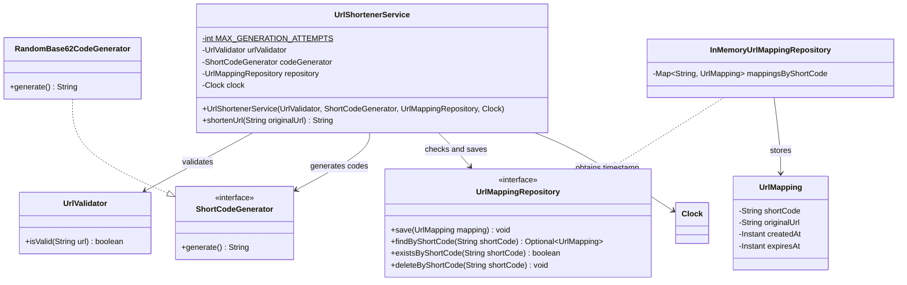
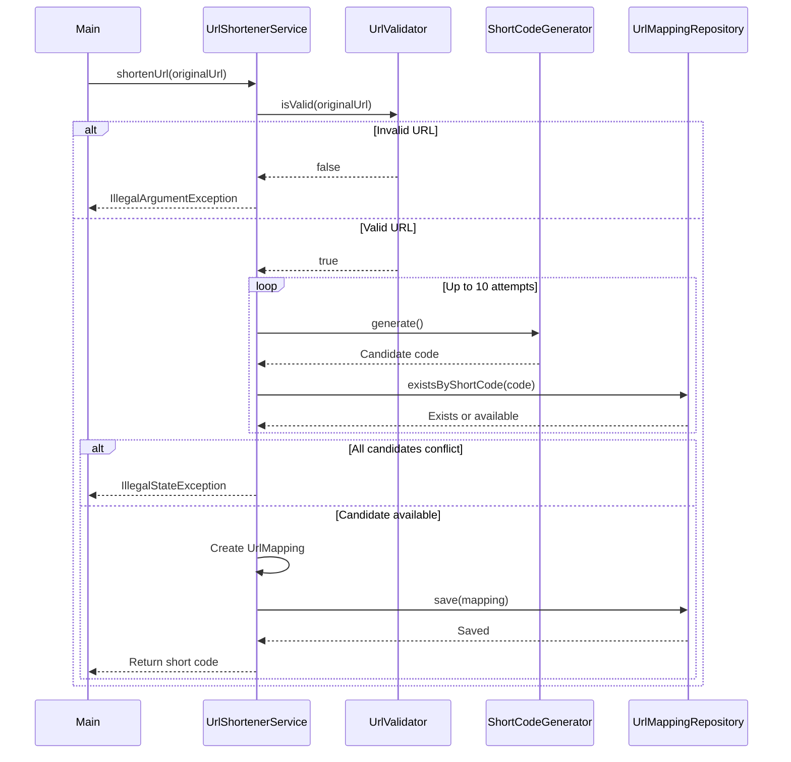

# URL Shortener — Phase 7: URL Shortening Service

> Implements `UrlShortenerService`, the component that coordinates validation, code generation, collision handling, and
> storage to create shortened URLs.

## Table of Contents

1. [Objective](#1-objective)
2. [Requirements](#2-requirements)
3. [Design Evolution](#3-design-evolution)
4. [Class Responsibilities](#4-class-responsibilities)
5. [Class Diagram](#5-class-diagram)
6. [URL Validation](#6-url-validation)
7. [Implement `UrlShortenerService`](#7-implement-urlshortenerservice)
8. [Demonstration Using `Main.java`](#8-demonstration-using-mainjava)
9. [Sequence Diagram](#9-sequence-diagram)
10. [Error Handling](#10-error-handling)
11. [Important Design Limitations](#11-important-design-limitations)
12. [Complexity Analysis](#12-complexity-analysis)
13. [Current Package Structure](#13-current-package-structure)
14. [Phase 7 Checklist](#14-phase-7-checklist)
15. [Key Takeaways](#15-key-takeaways)
16. [Next Phase](#16-next-phase-resolve-short-codes-to-original-urls)

---

## 1. Objective

Implement `UrlShortenerService`, the component responsible for coordinating the URL-shortening workflow.

### Components from previous phases

| Component                      | Purpose                                         |
|--------------------------------|-------------------------------------------------|
| `UrlMapping`                   | Represents a URL mapping                        |
| `ResolutionStatus`             | Defines URL-resolution outcomes                 |
| `UrlResolutionResult`          | Represents the result of resolving a short code |
| `ShortCodeGenerator`           | Defines the code-generation contract            |
| `RandomBase62CodeGenerator`    | Generates random Base62 codes                   |
| `UrlMappingRepository`         | Defines mapping-storage operations              |
| `InMemoryUrlMappingRepository` | Stores mappings in memory                       |

We now integrate these components to create shortened URLs.

### Example

Original URL:

```text
https://example.com/products/electronics
```

Generated short code:

```text
aZ81kLm
```

Resulting short URL:

```text
https://short.ly/aZ81kLm
```

> The service generates and stores the short code. The full short URL is constructed by the client for demonstration
> only; no HTTP server or redirect is implemented yet.

---

## 2. Requirements

The basic shortening service must:

1. Accept an original URL.
2. Validate the URL.
3. Generate a candidate short code.
4. Check whether the candidate is already assigned.
5. Retry when a collision occurs.
6. Create a `UrlMapping`.
7. Record the mapping's creation timestamp.
8. Save the mapping in the repository.
9. Return the generated short code.
10. Fail clearly when the input is invalid or code generation cannot succeed.

### Out of Scope

This phase does **not** implement:

- Custom aliases.
- Optional TTL configuration.
- Expiration-aware alias reclamation.
- Click analytics.
- Actual HTTP redirects.
- Duplicate-URL reuse.
- Persistent database storage.
- Concurrency-safe uniqueness enforcement.

These will be addressed in subsequent phases where appropriate.

---

## 3. Design Evolution

Before this phase, the generator could create a candidate but did not know whether it was in use, and the repository
could store a mapping but did not know *when* one should be created. We needed a component to coordinate them:
`UrlShortenerService`.

### Before

```text
ShortCodeGenerator          UrlMappingRepository
        |                            |
        v                            v
  Candidate code              Stored mapping
```

The components worked independently.

### After

```text
Client
  |
  v
UrlShortenerService
  |
  +--> UrlValidator
  |
  +--> ShortCodeGenerator
  |
  +--> UrlMappingRepository
  |
  +--> Clock
  |
  v
Return short code
```

The service coordinates the workflow while keeping each component's responsibilities separate.

---

## 4. Class Responsibilities

| Class                          | Responsibility                                                                                 |
|--------------------------------|------------------------------------------------------------------------------------------------|
| `UrlShortenerService`          | Coordinates URL validation, code generation, collision checking, mapping creation, and storage |
| `UrlValidator`                 | Validates the structure of an original URL                                                     |
| `ShortCodeGenerator`           | Defines the contract for generating candidate codes                                            |
| `RandomBase62CodeGenerator`    | Generates random Base62 codes                                                                  |
| `UrlMappingRepository`         | Defines mapping-storage operations                                                             |
| `InMemoryUrlMappingRepository` | Stores mappings in a `HashMap`                                                                 |
| `UrlMapping`                   | Represents a short code, original URL, creation timestamp, and optional expiration timestamp   |
| `Main`                         | Demonstrates the shortening workflow                                                           |

**Why separate the validator?**
URL validation is a distinct responsibility. Keeping it in `UrlValidator` stops the service from being responsible for
both workflow coordination and URL-parsing rules.

**Why inject `Clock`?**
The service needs a creation timestamp. Injecting `Clock` instead of calling `Instant.now()` directly lets tests supply
a fixed clock. The current client uses `Clock.systemUTC()`.

---

## 5. Class Diagram



### Important relationships

- `UrlShortenerService` depends on the `ShortCodeGenerator` and `UrlMappingRepository` **interfaces**.
- `RandomBase62CodeGenerator` implements `ShortCodeGenerator`.
- `InMemoryUrlMappingRepository` implements `UrlMappingRepository`.
- `UrlShortenerService` uses `UrlValidator` to validate input.

The service does not directly depend on `HashMap` or the concrete random-code generator.

---

## 6. URL Validation

**File:** `src/urlshortener/UrlValidator.java`

```java
package urlshortener;

import java.net.URI;
import java.net.URISyntaxException;
import java.util.Locale;

public class UrlValidator {

    public boolean isValid(String url) {
        if (url == null || url.isBlank()) {
            return false;
        }

        try {
            URI uri = new URI(url);

            String scheme = uri.getScheme();

            if (scheme == null) {
                return false;
            }

            scheme = scheme.toLowerCase(Locale.ROOT);

            if (!scheme.equals("http") && !scheme.equals("https")) {
                return false;
            }

            if (!uri.isAbsolute() || uri.getHost() == null) {
                return false;
            }

            return true;
        } catch (URISyntaxException exception) {
            return false;
        }
    }
}
```

### How it works

**Step 1: Reject null and blank input**

```java
if(url ==null||url.

isBlank()){
        return false;
        }
```

An empty string, whitespace-only string, or `null` is not a valid original URL.

**Step 2: Parse the URL**

```java
URI uri = new URI(url);
```

`URI` parses the string into its structural components. Malformed syntax throws a `URISyntaxException`.

**Step 3: Validate the scheme**

```java
String scheme = uri.getScheme();
```

Only HTTP and HTTPS are supported. The scheme is lowercased before comparison so casing does not affect validation.

**Step 4: Require an absolute URI and a host**

```java
if(!uri.isAbsolute() ||uri.

getHost() ==null){
        return false;
        }
```

This rejects relative URLs and URLs without a recognized host.

### Examples

| Input                          | Result  | Reason              |
|--------------------------------|---------|---------------------|
| `https://example.com/products` | Valid   | HTTPS URL with host |
| `http://example.com`           | Valid   | HTTP URL with host  |
| `example.com/products`         | Invalid | Missing scheme      |
| `ftp://example.com/file`       | Invalid | Unsupported scheme  |
| `javascript:alert(1)`          | Invalid | Unsupported scheme  |
| Empty string                   | Invalid | Blank input         |
| `null`                         | Invalid | Missing input       |

> **Important:** Structural validation does not establish that a domain exists, that DNS resolves, or that the
> destination is reachable.
>
> This validator also does not implement a complete security policy for fetching remote URLs. If the application later
> retrieves user-supplied destinations server-side, it will need additional protection against SSRF and unsafe network
> destinations.

---

## 7. Implement `UrlShortenerService`

**File:** `src/urlshortener/UrlShortenerService.java`

```java
package urlshortener;

import java.time.Clock;
import java.time.Instant;
import java.util.Objects;

public class UrlShortenerService {

    private static final int MAX_GENERATION_ATTEMPTS = 10;

    private final UrlValidator urlValidator;
    private final ShortCodeGenerator codeGenerator;
    private final UrlMappingRepository repository;
    private final Clock clock;

    public UrlShortenerService(
            UrlValidator urlValidator,
            ShortCodeGenerator codeGenerator,
            UrlMappingRepository repository,
            Clock clock
    ) {
        this.urlValidator = Objects.requireNonNull(
                urlValidator,
                "urlValidator cannot be null"
        );
        this.codeGenerator = Objects.requireNonNull(
                codeGenerator,
                "codeGenerator cannot be null"
        );
        this.repository = Objects.requireNonNull(
                repository,
                "repository cannot be null"
        );
        this.clock = Objects.requireNonNull(
                clock,
                "clock cannot be null"
        );
    }

    public String shortenUrl(String originalUrl) {
        if (!urlValidator.isValid(originalUrl)) {
            throw new IllegalArgumentException(
                    "Invalid URL: " + originalUrl
            );
        }

        for (int attempt = 0;
             attempt < MAX_GENERATION_ATTEMPTS;
             attempt++) {

            String shortCode = codeGenerator.generate();

            if (shortCode == null || shortCode.isBlank()) {
                throw new IllegalStateException(
                        "Code generator returned an invalid code"
                );
            }

            if (repository.existsByShortCode(shortCode)) {
                continue;
            }

            Instant createdAt = clock.instant();

            UrlMapping mapping = new UrlMapping(
                    shortCode,
                    originalUrl,
                    createdAt,
                    null
            );

            repository.save(mapping);

            return shortCode;
        }

        throw new IllegalStateException(
                "Unable to generate a unique short code"
        );
    }
}
```

### 7.1 Dependency injection

```java
public UrlShortenerService(
        UrlValidator urlValidator,
        ShortCodeGenerator codeGenerator,
        UrlMappingRepository repository,
        Clock clock
)
```

This is **constructor injection**. It makes dependencies explicit and lets different implementations be supplied. For
example, the code generator can be replaced without changing the service.

### 7.2 Validate the original URL

```java
if(!urlValidator.isValid(originalUrl)){
        throw new

IllegalArgumentException(
            "Invalid URL: "+originalUrl
            );
}
```

Invalid input is rejected before any candidate code is generated or mapping is stored.

### 7.3 Generate candidate codes

```java
String shortCode = codeGenerator.generate();
```

The service asks the generator for a candidate. The generator does not query the repository and does not guarantee
uniqueness.

### 7.4 Validate the generator's output

```java
if(shortCode ==null||shortCode.

isBlank()){
        throw new

IllegalStateException(
            "Code generator returned an invalid code"
);
}
```

The service rejects null or blank output. It does **not** independently validate the Base62 alphabet or expected length;
it relies on the configured generator to honor its contract. Those checks could be added if the service needs to guard
against arbitrary generator implementations.

### 7.5 Handle collisions

```java
if(repository.existsByShortCode(shortCode)){
        continue;
        }
```

If the candidate already exists, the service skips the rest of the current iteration and requests another. The loop
allows up to **ten** attempts.

### 7.6 Create the mapping

```java
Instant createdAt = clock.instant();

UrlMapping mapping = new UrlMapping(
        shortCode,
        originalUrl,
        createdAt,
        null
);
```

The mapping is built from:

- The generated short code.
- The original URL.
- The current timestamp from the injected clock.
- `null` for the expiration timestamp (meaning the mapping does not expire).

TTL support will be added in a later phase.

### 7.7 Save the mapping

```java
repository.save(mapping);
```

Storage is delegated to the repository; the service never touches its internal map.

### 7.8 Return the short code

```java
return shortCode;
```

The method returns the code once the mapping is saved. If all ten candidates conflict with existing mappings, it throws
`IllegalStateException`.

---

## 8. Demonstration Using `Main.java`

```java
package urlshortener;

import java.time.Clock;

public class Main {

    public static void main(String[] args) {
        UrlValidator urlValidator = new UrlValidator();
        ShortCodeGenerator codeGenerator =
                new RandomBase62CodeGenerator();
        UrlMappingRepository repository =
                new InMemoryUrlMappingRepository();

        UrlShortenerService service = new UrlShortenerService(
                urlValidator,
                codeGenerator,
                repository,
                Clock.systemUTC()
        );

        String originalUrl =
                "https://example.com/products/electronics";

        String shortCode = service.shortenUrl(originalUrl);

        System.out.println("Short code: " + shortCode);
        System.out.println("Short URL: https://short.ly/" + shortCode);

        repository.findByShortCode(shortCode)
                .ifPresent(mapping ->
                        System.out.println(
                                "Stored original URL: " +
                                        mapping.getOriginalUrl()
                        )
                );
    }
}
```

### Example output

```text
Short code: aZ81kLm
Short URL: https://short.ly/aZ81kLm
Stored original URL: https://example.com/products/electronics
```

The generated code differs between executions.

### Execution flow

1. `Main` creates the validator, generator, repository, and clock.
2. `Main` constructs `UrlShortenerService` with those dependencies.
3. The client calls `shortenUrl(originalUrl)`.
4. The service validates the original URL.
5. The service requests a candidate code.
6. The repository checks whether the candidate is already stored.
7. The service retries if the candidate conflicts.
8. The service creates a `UrlMapping`.
9. The repository stores the mapping.
10. The service returns the code.
11. `Main` builds a display URL and retrieves the stored mapping.

---

## 9. Sequence Diagram



The loop shows the intended retry behavior. An implementation must stop retrying as soon as it finds an available
candidate.

---

## 10. Error Handling

| Condition                              | Exception                  |
|----------------------------------------|----------------------------|
| Original URL is invalid                | `IllegalArgumentException` |
| Generator returns null or blank output | `IllegalStateException`    |
| All ten candidates conflict            | `IllegalStateException`    |

These exceptions distinguish invalid client input from an inability to complete the generation workflow. A future API
layer could translate them into appropriate HTTP responses.

---

## 11. Important Design Limitations

### 11.1 Duplicate original URLs

Submitting the same URL twice can create two different mappings:

```text
https://example.com/products -> aZ81kLm
https://example.com/products -> P0x7bQa
```

The service does not reuse existing mappings. Per the requirements, reuse depends on whether the URL and its
configuration are compatible. That rule will be added when implementing the complete URL-creation workflow, including
aliases and expiration.

### 11.2 Concurrency and uniqueness

The workflow checks for a code and then saves the mapping. These are separate operations:

```text
existsByShortCode(code)
save(mapping)
```

Two concurrent requests could both see the same code as available before either saves it, so uniqueness is **not
guaranteed under concurrent access**. A production implementation should use an atomic mechanism such as a database
unique constraint or a concurrency-safe repository operation.

### 11.3 In-memory persistence

Mappings live in memory and disappear when the application stops. The current repository suits the sequential learning
project, not a distributed production deployment.

### 11.4 No actual HTTP redirect

The service returns a short code. `Main` builds a display URL using the illustrative domain `short.ly`. No web server,
HTTP endpoint, DNS configuration, or redirect exists yet.

### 11.5 URL validation is not destination verification

The validator checks URL structure only. It does not contact the destination or establish that it is safe to visit.

---

## 12. Complexity Analysis

Let:

- *L* = length of the original URL
- *k* = number of candidate codes generated before finding an available one
- *n* = number of stored mappings

### Time complexity

URL parsing is roughly O(*L*). Each candidate requires:

| Step                       | Cost                                             |
|----------------------------|--------------------------------------------------|
| Code generation            | O(1) for the fixed seven-character configuration |
| Repository existence check | Average O(1)                                     |
| Mapping creation           | O(1), excluding URL-string allocation details    |
| Repository insertion       | Average O(1)                                     |

Overall expected time is approximately **O(*L* + *k*)**, assuming fixed-size codes and average-case `HashMap`
operations. In the worst case the service tries all ten candidates, so the retry loop is bounded.

### Space complexity

The repository stores *n* mappings, requiring O(*n*) space. The service itself uses constant additional working space
for the fixed-size workflow, excluding input and mapping allocations.

---

## 13. Current Package Structure

```text
src/urlshortener/
├── UrlMapping.java
├── ResolutionStatus.java
├── UrlResolutionResult.java
├── ShortCodeGenerator.java
├── RandomBase62CodeGenerator.java
├── UrlMappingRepository.java
├── InMemoryUrlMappingRepository.java
├── UrlValidator.java
├── UrlShortenerService.java
└── Main.java
```

---

## 14. Phase 7 Checklist

- [x] Implement `UrlValidator`.
- [x] Implement `UrlShortenerService`.
- [x] Inject the validator, generator, repository, and clock.
- [x] Validate the original URL before generating a code.
- [x] Handle candidate-code collisions.
- [x] Limit the number of generation attempts.
- [x] Create a `UrlMapping` after finding an available candidate.
- [x] Save the mapping through the repository interface.
- [x] Return the generated short code.
- [x] Demonstrate the workflow in `Main.java`.
- [x] Retrieve the stored mapping and verify the original URL.
- [x] Understand the limitations around duplicate URLs and concurrent uniqueness.

---

## 15. Key Takeaways

1. `UrlShortenerService` coordinates the core URL-shortening workflow.
2. `UrlValidator` isolates URL-structure validation.
3. Constructor injection makes dependencies explicit and replaceable.
4. The generator produces candidate codes, while the repository checks for existing mappings.
5. Collision retries are bounded to prevent an infinite loop.
6. `Clock` makes timestamp creation controllable during testing.
7. The current implementation does not reuse duplicate URLs or guarantee uniqueness under concurrent access.
8. The service returns a short code, but actual HTTP redirection is not implemented yet.

---

## 16. Next Phase: Resolve Short Codes to Original URLs

### Phase 8: Implement Short-Code Resolution

The next phase implements the reverse workflow:

```text
Short code
    |
    v
Look up mapping
    |
    +-- Not found -------> UNKNOWN
    |
    +-- Expired ---------> EXPIRED
    |
    +-- Valid mapping ---> SUCCESS + original URL
```

We will use `UrlMappingRepository`, `UrlMapping.isExpired()`, `ResolutionStatus`, `UrlResolutionResult`, and the
injected `Clock`.

This will complete the two fundamental operations of a URL shortener:

- Creating a shortened URL.
- Resolving a short code to its original URL.