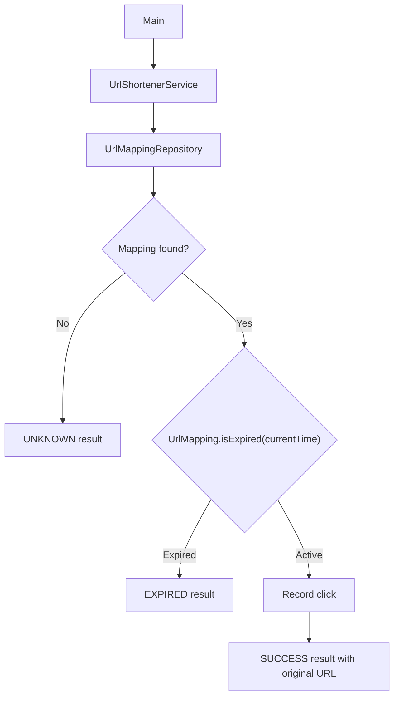

# URL Shortener — Implementing the Domain Classes

Phase 4 of the URL Shortener LLD: implementing the three foundational types — `UrlMapping`, `ResolutionStatus`, and
`UrlResolutionResult`.

> **Approach:** implement these types first, before the repository, code generator, analytics service, and main business
> service.

---

## Table of Contents

1. [Objective](#1-objective)
2. [Package Structure](#2-package-structure)
3. [Implementing UrlMapping](#3-implementing-urlmapping)
4. [Implementing ResolutionStatus](#4-implementing-resolutionstatus)
5. [Implementing UrlResolutionResult](#5-implementing-urlresolutionresult)
6. [How the Three Types Work Together](#6-how-the-three-types-work-together)
7. [Important Design Decisions](#7-important-design-decisions)
8. [Scenarios to Verify](#8-scenarios-to-verify)
9. [What We Have Not Implemented Yet](#9-what-we-have-not-implemented-yet)
10. [Implementation Checklist](#10-implementation-checklist)
11. [Key Takeaways](#12-key-takeaways)

---

## 1. Objective

In earlier phases we finalized the requirements, identified the classes, and designed the UML class diagram. In this
phase we implement three foundational types:

| # | Type                  | Role                                            |
|---|-----------------------|-------------------------------------------------|
| 1 | `UrlMapping`          | The mapping itself                              |
| 2 | `ResolutionStatus`    | The possible outcomes of a resolution request   |
| 3 | `UrlResolutionResult` | The data returned when a short code is resolved |

---

## 2. Package Structure

All three files belong to the `urlshortener` package.

```text
src/
└── urlshortener/
    ├── UrlMapping.java
    ├── ResolutionStatus.java
    └── UrlResolutionResult.java
```

---

## 3. Implementing UrlMapping

### 3.1 Why do we need it?

A URL shortener must maintain a relationship between a short code and its original URL.

| Attribute       | Example                    |
|-----------------|----------------------------|
| Short code      | `java-guide`               |
| Original URL    | `https://example.com/java` |
| Creation time   | `2026-10-24T10:00:00Z`     |
| Expiration time | `2026-10-25T10:00:00Z`     |

`UrlMapping` is the object that represents this relationship.

### 3.2 Responsibilities

| `UrlMapping` **is** responsible for                   | `UrlMapping` is **not** responsible for |
|-------------------------------------------------------|-----------------------------------------|
| Representing the short code                           | Generating short codes                  |
| Storing the original URL                              | Persisting mappings                     |
| Recording when the mapping was created                | Validating custom aliases               |
| Storing the optional expiration timestamp             | Recording clicks                        |
| Determining whether it has expired at a given instant | Removing expired mappings from storage  |

### 3.3 Implementation

**File:** `UrlMapping.java`

```java
package urlshortener;

import java.time.Instant;
import java.util.Objects;

public class UrlMapping {
    private final String shortCode;
    private final String originalUrl;
    private final Instant createdAt;
    private final Instant expiresAt;

    public UrlMapping(
            String shortCode,
            String originalUrl,
            Instant createdAt,
            Instant expiresAt
    ) {
        this.shortCode = Objects.requireNonNull(shortCode);
        this.originalUrl = Objects.requireNonNull(originalUrl);
        this.createdAt = Objects.requireNonNull(createdAt);
        this.expiresAt = expiresAt;
    }

    public String getShortCode() {
        return shortCode;
    }

    public String getOriginalUrl() {
        return originalUrl;
    }

    public Instant getCreatedAt() {
        return createdAt;
    }

    public Instant getExpiresAt() {
        return expiresAt;
    }

    public boolean isExpired(Instant currentTime) {
        Objects.requireNonNull(currentTime);
        return expiresAt != null && !currentTime.isBefore(expiresAt);
    }
}
```

### 3.4 Understanding the attributes

| Attribute     | Type      | Explanation                                          |
|---------------|-----------|------------------------------------------------------|
| `shortCode`   | `String`  | Identifies the mapping                               |
| `originalUrl` | `String`  | Stores the destination URL                           |
| `createdAt`   | `Instant` | Records the mapping's creation time                  |
| `expiresAt`   | `Instant` | When the mapping expires; `null` means no expiration |

### 3.5 Why are the fields `final`?

All four fields are `final`, so they cannot be reassigned after construction. We want the mapping's identity and
configuration to stay stable. If a user wants a different destination URL, the service should follow the business rules
to create or reuse a mapping rather than modify an existing one. We also avoid setters, since they could introduce
unexpected changes after a mapping has been stored.

### 3.6 Why is `expiresAt` nullable?

Expiration is optional in our requirements:

- `expiresAt == null` → the mapping **never expires**.
- `expiresAt != null` → the mapping expires at the specified instant.

This avoids inventing an artificial expiration timestamp for mappings that should stay valid indefinitely.

### 3.7 Understanding the expiration rule

> A mapping expires when the current time is equal to or later than its expiration timestamp.

```text
currentTime >= expiresAt
```

```java
public boolean isExpired(Instant currentTime) {
    Objects.requireNonNull(currentTime);

    return expiresAt != null && !currentTime.isBefore(expiresAt);
}
```

Breaking down the condition:

- `expiresAt != null` ensures a mapping without expiration never expires.
- `currentTime.isBefore(expiresAt)` is true when the current time precedes expiration.
- Negating it means the current time is equal to or after expiration.

### 3.8 Example

```java
Instant createdAt = Instant.parse("2026-10-24T10:00:00Z");
Instant expiresAt = Instant.parse("2026-10-25T10:00:00Z");

UrlMapping mapping = new UrlMapping(
        "java-guide",
        "https://example.com/java",
        createdAt,
        expiresAt
);

System.out.

println(
        mapping.isExpired(Instant.parse("2026-10-25T09:59:59Z"))
        ); // false

        System.out.

println(
        mapping.isExpired(Instant.parse("2026-10-25T10:00:00Z"))
        ); // true

        System.out.

println(
        mapping.isExpired(Instant.parse("2026-10-25T10:00:01Z"))
        ); // true
```

The mapping is active one second before expiration, but expired at the exact expiration instant.

### 3.9 Why pass `currentTime` as an argument?

Calling `Instant.now()` inside `isExpired()` would couple the method to the real system clock. Passing the time
explicitly makes the method **deterministic**: the same mapping and the same supplied time always give the same result.
It also lets us test expiration without waiting for real time to pass. The service will later supply the time from an
injected `Clock`.

---

## 4. Implementing ResolutionStatus

### 4.1 Why do we need it?

When a user requests a short URL, the application must determine what happened. There are three outcomes:

1. The mapping exists and is active.
2. No mapping exists for the supplied code.
3. The mapping exists but has expired.

These have different meanings and should not be treated as the same failure.

### 4.2 Implementation

**File:** `ResolutionStatus.java`

```java
package urlshortener;

public enum ResolutionStatus {
    SUCCESS,
    UNKNOWN,
    EXPIRED
}
```

### 4.3 Why use an enum?

Without an enum we might use strings:

```java
String status = "success";
```

Strings allow arbitrary values, including misspellings like `"sucess"` or inconsistent capitalization. An enum restricts
the status to explicitly declared values.

| Enum value | Meaning                                |
|------------|----------------------------------------|
| `SUCCESS`  | The mapping exists and is active       |
| `UNKNOWN`  | The supplied short code has no mapping |
| `EXPIRED`  | The mapping exists but has expired     |

### 4.4 Why distinguish `UNKNOWN` from `EXPIRED`?

Suppose a user requests the code `java-guide`:

- If the code is **unknown**, the application has no corresponding mapping.
- If the code is **expired**, the application has a mapping but must no longer resolve it successfully.

This distinction matters for both business behavior and debugging. The repository must therefore **preserve expired
mappings until they are explicitly reclaimed**.

---

## 5. Implementing UrlResolutionResult

### 5.1 Why do we need a result type?

Consider a simple service method:

```java
public String resolve(String shortCode)
```

What should it return for an unknown code? For an expired mapping? Returning `null` for both loses information, and
throwing the same generic exception for both makes the outcomes hard to distinguish. `UrlResolutionResult` represents
the outcome of a resolution request explicitly.

### 5.2 Responsibilities

`UrlResolutionResult` contains:

- A `ResolutionStatus`.
- The original URL when resolution succeeds (absent for unsuccessful outcomes).

### 5.3 Implementation

**File:** `UrlResolutionResult.java`

```java
package urlshortener;

import java.util.Objects;

public record UrlResolutionResult(
        ResolutionStatus status,
        String originalUrl
) {
    public UrlResolutionResult {
        Objects.requireNonNull(status, "status cannot be null");

        if (status == ResolutionStatus.SUCCESS) {
            Objects.requireNonNull(
                    originalUrl,
                    "originalUrl cannot be null for a successful resolution"
            );
        } else if (originalUrl != null) {
            throw new IllegalArgumentException(
                    "originalUrl must be null for unsuccessful resolution"
            );
        }
    }

    public static UrlResolutionResult success(String originalUrl) {
        return new UrlResolutionResult(
                ResolutionStatus.SUCCESS,
                originalUrl
        );
    }

    public static UrlResolutionResult unknown() {
        return new UrlResolutionResult(
                ResolutionStatus.UNKNOWN,
                null
        );
    }

    public static UrlResolutionResult expired() {
        return new UrlResolutionResult(
                ResolutionStatus.EXPIRED,
                null
        );
    }
}
```

### 5.4 Why use a record?

A Java record suits a small object whose main purpose is to carry data. Java generates:

- A canonical constructor
- Accessor methods
- `equals()`
- `hashCode()`
- `toString()`

```java
UrlResolutionResult result =
        UrlResolutionResult.success("https://example.com/java");

System.out.

println(result.status());
        System.out.

println(result.originalUrl());
```

Record accessors use the component names, so we call `status()` and `originalUrl()` rather than `getStatus()` and
`getOriginalUrl()`.

### 5.5 Why use a compact constructor?

The compact constructor validates data whenever a result is created. It enforces two rules:

| Rule                                                         | Reason                                                   |
|--------------------------------------------------------------|----------------------------------------------------------|
| `SUCCESS` requires an original URL                           | A successful resolution without a destination is invalid |
| `UNKNOWN` and `EXPIRED` must **not** contain an original URL | These statuses represent unsuccessful resolution         |

Enforcing these in the constructor prevents invalid result objects from being created through ordinary construction.

### 5.6 Why use static factory methods?

We provide three factory methods: `success(originalUrl)`, `unknown()`, and `expired()`.

Instead of:

```java
new UrlResolutionResult(ResolutionStatus.UNKNOWN, null);
```

the service can write:

```java
UrlResolutionResult.unknown();
```

This communicates intent clearly and avoids repeating the status-and-`null` combination.

---

## 6. How the Three Types Work Together

These classes support the future resolution workflow.



The actual workflow will be implemented in `UrlShortenerService` in a later phase. For now we have established the types
and their contracts.

---

## 7. Important Design Decisions

| Decision                             | Reason                                         |
|--------------------------------------|------------------------------------------------|
| Make mapping fields immutable        | Prevent accidental modification after creation |
| Use `Instant` for timestamps         | Represents a precise point on the timeline     |
| Allow `expiresAt` to be `null`       | Supports mappings without expiration           |
| Pass current time into `isExpired()` | Makes expiration deterministic                 |
| Use `ResolutionStatus`               | Defines a fixed set of outcomes                |
| Use `UrlResolutionResult`            | Carries resolution status and destination      |
| Use a record for the result          | Provides a concise immutable data carrier      |
| Use factory methods                  | Makes result creation more readable            |
| Validate result construction         | Prevents invalid status and URL combinations   |

---

## 8. Scenarios to Verify

**UrlMapping**

| Scenario                         | Expected result |
|----------------------------------|-----------------|
| Mapping has no expiration        | Not expired     |
| Current time precedes expiration | Not expired     |
| Current time equals expiration   | Expired         |
| Current time follows expiration  | Expired         |
| Current time is `null`           | Rejected        |

**UrlResolutionResult**

| Scenario                    | Expected result |
|-----------------------------|-----------------|
| `SUCCESS` with a valid URL  | Accepted        |
| `SUCCESS` with a `null` URL | Rejected        |
| `UNKNOWN` with a `null` URL | Accepted        |
| `EXPIRED` with a `null` URL | Accepted        |
| `UNKNOWN` with a URL        | Rejected        |
| `EXPIRED` with a URL        | Rejected        |
| `null` status               | Rejected        |

These describe the expected behavior. Automated tests can be added if the project later adopts a testing framework.

---

## 9. What We Have Not Implemented Yet

- Short-code generation
- URL validation
- Custom-alias validation
- Mapping storage
- Click analytics
- Expiration enforcement during actual resolution
- The main business service
- A database or REST API

These will be implemented in subsequent phases.

---

## 10. Implementation Checklist

- [x] Create `UrlMapping.java`
- [x] Define immutable mapping attributes
- [x] Implement expiration checking
- [x] Create `ResolutionStatus.java`
- [x] Define `SUCCESS`, `UNKNOWN`, and `EXPIRED`
- [x] Create `UrlResolutionResult.java`
- [x] Validate result construction
- [x] Add factory methods for each result
- [ ] Implement `ShortCodeGenerator`
- [ ] Implement `RandomBase62CodeGenerator`
- [ ] Implement the repository interface and in-memory storage
- [ ] Implement click analytics
- [ ] Implement `UrlShortenerService`
- [ ] Demonstrate the complete workflow through `Main`

---

---

## 11. Key Takeaways

1. `UrlMapping` represents the mapping and its lifecycle timestamps.
2. Immutable fields help keep mapping data consistent.
3. `isExpired()` follows the rule `currentTime >= expiresAt`.
4. `ResolutionStatus` defines the possible outcomes of resolving a short code.
5. `UrlResolutionResult` represents those outcomes without relying on ambiguous `null` returns.
6. Java records are useful for small data-carrier types.
7. Constructor validation helps enforce invariants.
8. The service will coordinate the actual resolution workflow using these types.

**Next phase:** implement `ShortCodeGenerator` and `RandomBase62CodeGenerator`, then examine why generating a random
code does not guarantee uniqueness.