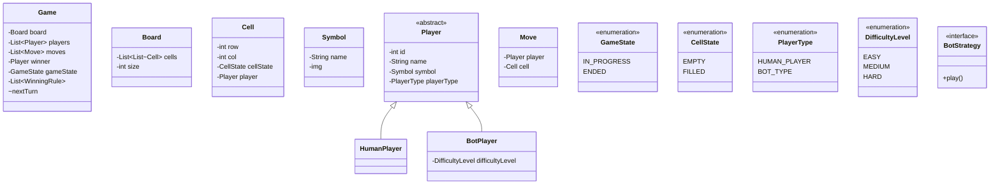

Are we going to persist the data : No
How shall I run it : through the command line / hardcoding

1. board size : N * N
2. Max number of players : N - 1
3. Allow players to choose their own symbols. Symbols should be unique
4. Will there be any BOT ? Yes
5. Bot can have multiple difficulty levels
6. Max number of bot per game : 1, cz if both bots have same difficulty level, it will be having same strategy, it will be drawn
7. Who will make the first move ? : random : order of players in which they will get the move : sequency
8. Allow users to choose the winning strategies( row, columns, diagonal, reverse diagonal etc)
9. Support global undo operation : any player can undo any time


## How to implement undo feature
Approach 1 : Store the list/stack of moves and for undo, we will remove the last move
Move : player, coordinate : for example {P1, 1, 2}

Approach 2 : Store the state of the game at every move : for every move : store the snapshot, for undo, place the previous snapshot
benefit : speed : O(1)
cons : we need a lot of space

Approach 3 : Store all the moves. for undo, play n - 1 moves from empty game.
pros : less space
cons : time-consuming
For kind of chess game, 1st and 3rd will not work, we need 2nd option only : snapshot
but for our case, any of the three approach works for tic-tac-toe

we will go 1st approach for our implementation


## Class Diagram



---

---


---


## Winning check
**Approach 1**
for every player :
for every row :
for every column
check if all the columns having symbol of player


```
for(Player p : players) {
    for(row : rows) {
        boolean isWinner = true;
        for(col : cols) {
            if(grid[row][col] != p.symbol) {
                isWinner = false;
                break;
            }
            
            if(isWinner == true) {
                return p; // p won
            }
        }
    }
}


```
- this was checking for rows only.
- time complexity : O(N ^ 3)

**Approach 2**
check only for current player :
for every row :


```
check(move) {
    currentPlayer = move.player
    for(row : rows) {
        isWinner = true;
        
        for(col : cols) {
            check for symbol
        }
    }
}
```

time complexity : O(n ^ 2)

- this was just for checking the rows
- similarly we need to check for columns
- one for normal diagonal, one for reverse diagonal
- So, total 4 times we need to check. Overall time complexity : O(n ^ 2)


**Approach 3**
check for the row, col and diagonal of only last move, no need to check all rows, all columns
- time complexity : O(n)


**Approach 4**
- we will have hashmap for every row
- we will have hashmap for every col
- we will have 1 hashmap for diagonal and 1 for reverse diagonal
- for each symbol, we will store the count in that particular row/column/diagonal after each move
- if any point of time, if the count matches, we get the winner
- **Time complexity : O(1)**
- **Space Complexity : O(n)** : n is size of board : 1 hashmap for every row, 1 for every col, 1 for diagonal, 1 for reverse diagonal

